# Безопасность Linux-контейнеров: где ломается изоляция и как это увидеть

**Филипп, scrock_**

Привет, Хабр!

Контейнеры давно перестали быть экзотикой. Сегодня они используются повсюду - от личных проектов до промышленных систем крупных компаний. При этом контейнер нередко воспринимают как «магическую коробку», хотя его изоляцию обеспечивают вполне конкретные механизмы Linux. Пока всё работает, о границах этой коробки можно не задумываться. Когда приложение оказывается скомпрометировано, контейнер получает лишние права или процесс видит ресурсы хоста, понимание устройства изоляции становится критичным.

В этой статье разберём, как устроена изоляция Linux-контейнеров и какие события помогают обнаружить опасную активность внутри них. Сначала посмотрим, что происходит при запуске контейнера, затем соберём лабораторный стенд и воспроизведём несколько сценариев, которые становятся возможны из-за ошибок конфигурации. Каждый сценарий исследуем по одной схеме:   

1. Запускаем контейнер с намеренно ослабленной конфигурацией.
2. Воспроизводим сценарий эксплуатации.
3. Собираем системные события и выделяем признаки атаки.
4. Настраиваем правило обнаружения и проверяем его на атакующем и штатном сценариях.
5. Проверяем качество детекта.
6. Повторяем эксперимент и сравниваем результат.

Целью статьи является не собрать коллекцию эффектных команд, а последовательно воспроизвести атаку, обнаружить её по телеметрии, проверить качество детекта и по возможности устранить причину.

**Важно:** все эксперименты выполняются только в отдельной одноразовой виртуальной машине.

## Границы статьи

Мы сосредоточимся на Linux-контейнерах, запущенных через Docker на одном сервере. Это позволит последовательно разобрать их изоляцию, воспроизвести несколько атак и настроить мониторинг, не переключаясь между разными средами. Кластеры Kubernetes и защиту их управляющих компонентов оставим для отдельной статьи. Там появляются собственные механизмы управления доступом, сетью и запуском контейнеров, которые требуют самостоятельной практической части. Также мы не будем подробно разбирать весь путь контейнерного образа - от сборки и хранения до запуска на сервере. В этой статье достаточно учитывать, что скомпрометированный образ может стать исходной точкой атаки.

## От chroot к контейнерам

Идея дать процессу отдельное представление файловой системы появилась задолго до Docker. Системный вызов [`chroot`](https://man7.org/linux/man-pages/man2/chroot.2.html) назначает выбранный каталог корнем для процесса и его потомков. Однако документация Linux подчёркивает, что этот механизм лишь меняет начальную точку разрешения абсолютных путей и сам по себе не создаёт полноценную песочницу.

Следующим шагом стали [`namespaces`](https://man7.org/linux/man-pages/man7/namespaces.7.html) или пространства имён. Они позволяют группе процессов видеть собственное представление глобальных ресурсов ядра:

- Пространство точек монтирования ([`mnt`](https://man7.org/linux/man-pages/man7/mount_namespaces.7.html)) изолирует набор подключённых файловых систем. Благодаря этому процессы могут видеть собственные точки монтирования, отличающиеся от точек монтирования на хосте.
- Пространство идентификаторов процессов ([`pid`](https://man7.org/linux/man-pages/man7/pid_namespaces.7.html)) изолирует нумерацию и видимость процессов. Внутри него процессы получают собственные идентификаторы и не видят процессы из родительского пространства имён.
- Сетевое пространство ([`net`](https://man7.org/linux/man-pages/man7/network_namespaces.7.html)) изолирует сетевой стек. К нему относятся сетевые интерфейсы, сетевые адреса, таблицы маршрутизации, правила межсетевого экрана и пространство сетевых портов.
- Пространство системных имён ([`uts`](https://man7.org/linux/man-pages/man7/uts_namespaces.7.html)) изолирует имя узла. Благодаря этому контейнер может иметь собственное имя, не изменяя имя хоста.
- Пространство межпроцессного взаимодействия ([`ipc`](https://man7.org/linux/man-pages/man7/ipc_namespaces.7.html)) изолирует общую память, семафоры и очереди сообщений System V, а также очереди сообщений POSIX.
- Пространство пользователей ([`user`](https://man7.org/linux/man-pages/man7/user_namespaces.7.html)) изолирует идентификаторы пользователей, идентификаторы групп и связанные с ними привилегии. Пользователь с нулевым идентификатором (UID 0) внутри этого пространства может соответствовать непривилегированному пользователю на хосте.
- Пространство групп управления ресурсами ([`cgroup`](https://man7.org/linux/man-pages/man7/cgroup_namespaces.7.html)) изолирует представление иерархии таких групп (`cgroups`). Процесс видит только отведённую ему часть этой иерархии, однако само пространство имён не устанавливает ресурсные ограничения.
- Пространство времени ([`time`](https://man7.org/linux/man-pages/man7/time_namespaces.7.html)) изолирует показания отдельных системных часов. Процессы могут иметь собственные значения монотонного времени и времени, отсчитываемого с момента загрузки системы.

Пространства имён определяют, какие ресурсы системы видит процесс. Ограничение памяти и процессорного времени в их задачи не входит.

Для учёта и ограничения ресурсов используются [`cgroups`](https://man7.org/linux/man-pages/man7/cgroups.7.html) или группы управления ресурсами. Первая версия этого механизма вошла в Linux 2.6.24. Современная единая иерархия второй версии `cgroups v2` позволяет учитывать и ограничивать потребление памяти, процессорного времени, количество процессов и другие ресурсы. Группы управления ресурсами не скрывают файлы или процессы. Их задача заключается в учёте ресурсов и защите хоста от их исчерпания.

Linux разделяет полномочия суперпользователя на отдельные [`capabilities`](https://man7.org/linux/man-pages/man7/capabilities.7.html) или привилегии. Этот механизм существует с Linux 2.2. Вместо полного набора прав суперпользователя процессу можно выдать только необходимую привилегию. Например, `CAP_NET_BIND_SERVICE` позволяет привязать сетевую службу к порту с номером меньше 1024. Некоторые привилегии охватывают слишком много операций. Особенно осторожно следует относиться к `CAP_SYS_ADMIN`, поскольку эта привилегия открывает доступ к широкому набору функций системного администрирования.

[`seccomp`](https://docs.kernel.org/userspace-api/seccomp_filter.html) или механизм ограничения системных вызовов определяет, какие обращения к ядру разрешены процессу и с какими аргументами. Он не анализирует логику приложения, не управляет доступом к файловым путям и не заменяет такие средства контроля доступа, как AppArmor или SELinux. Его задача заключается в сокращении набора системных вызовов, через которые процесс может взаимодействовать с ядром.

Дополнительный уровень защиты создают [`Linux Security Modules`](https://docs.kernel.org/admin-guide/LSM/index.html), что и переводится как модули безопасности Linux. Они применяют политики доступа к файлам, процессам и другим объектам системы. На хосте с включённым AppArmor Docker по умолчанию использует профиль [`docker-default`](https://docs.docker.com/engine/security/apparmor/), если пользователь не отключил или не заменил его.

Все эти механизмы развивались независимо друг от друга. [`container runtimes`](https://specs.opencontainers.org/runtime-spec/runtime/) (средства запуска контейнеров) объединяют их при создании процесса и каждый раз воспроизводят заданную конфигурацию изоляции.

## Как контейнер устроен на самом деле

Начнём с главного. Контейнер - не маленькая виртуальная машина. Для Linux это один процесс или группа процессов, которым ядро показывает ограниченное представление системы. У них могут быть собственные дерево процессов, сеть и файловая система, но системные вызовы по-прежнему обрабатывает ядро хоста. Поэтому контейнер изолирует процессы, а не запускает отдельную операционную систему. В [документации Docker](https://docs.docker.com/get-started/docker-concepts/the-basics/what-is-a-container/) он также определяется прежде всего как изолированный процесс.

### Контейнер и виртуальная машина

Разница между ними заключается в уровне, на котором создаётся изоляция. Гипервизор предоставляет [виртуальной машине](https://docs.kernel.org/virt/kvm/index.html) виртуальные процессоры, память и устройства, после чего она загружает полноценную гостевую операционную систему со своим ядром. Контейнер не имитирует отдельный компьютер и не загружает ещё одну операционную систему. Вместо этого среда выполнения запускает процессы на хосте и ограничивает их с помощью пространств имён, контрольных групп, отдельных полномочий, фильтров системных вызовов и модулей безопасности. Благодаря этому контейнеры обычно требуют меньше ресурсов и запускаются быстрее, однако ядро остаётся общей границей безопасности. Ошибка в приложении, уязвимость среды выполнения и уязвимость ядра дают атакующему разные возможности, поэтому сам факт запуска в контейнере ещё не означает надёжную изоляцию. На практике обе технологии часто используют вместе, когда виртуальная машина становится хостом для нескольких контейнеров.

### От образа к процессу

После команды `docker run` [Docker Engine](https://docs.docker.com/get-started/docker-overview/) ищет указанный образ в локальном хранилище. Если его там нет, движок загружает образ из реестра. Сам образ ещё не является контейнером. Это доступный только для чтения шаблон, состоящий из манифеста, конфигурации и слоёв файловой системы. Конфигурация содержит параметры, необходимые для запуска приложения. Формат этих компонентов описывает [спецификация образа OCI](https://github.com/opencontainers/image-spec/blob/main/spec.md).

Затем Docker Engine обращается к [`containerd`](https://containerd.io/), который подготавливает файловую систему контейнера и координирует его жизненный цикл. [`containerd-shim`](https://github.com/containerd/containerd/blob/main/docs/runtime-v2.md) принимает команды от `containerd` и вызывает низкоуровневую среду выполнения [`runc`](https://github.com/opencontainers/runc). Она применяет подготовленную OCI-конфигурацию через интерфейсы ядра и запускает процесс приложения. После запуска shim продолжает обслуживать ввод и вывод процесса, отслеживает его состояние и передаёт код завершения.

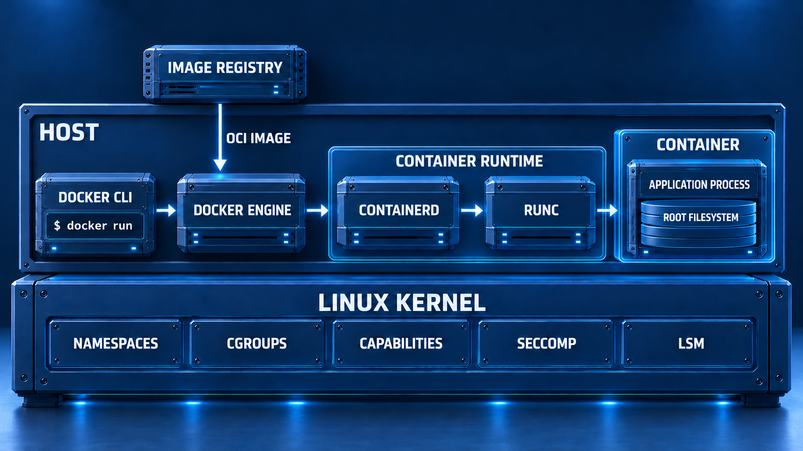

После запуска приложение продолжает работать как один или несколько обычных процессов Linux. `runc` создаёт заданную конфигурацией среду, но не становится частью контейнера или его отдельным ядром. Границу между процессами контейнера и хостом формирует совокупность механизмов Linux. Эту границу мы и будем проверять в практической части.

## Где проходит граница изоляции

На схеме контейнер выглядит как отдельный блок, однако в Linux нет единой стены между ним и хостом. Граница складывается из настроек процессов. Пространства имён меняют видимость ресурсов, группы управления ресурсами задают пределы потребления, привилегии разрешают отдельные административные операции, фильтр сокращает набор разрешённых системных вызовов, а AppArmor или SELinux ограничивают доступ к объектам системы.

Файловая система контейнера тоже не является самостоятельным диском. Она собирается из слоёв образа, изменяемого слоя и подключённых хранилищ. [Подключение каталога хоста (`bind mount`)](https://docs.docker.com/engine/storage/bind-mounts/) проводит путь через границу контейнера и делает этот каталог доступным изнутри. Если разрешена запись, изменения сразу отражаются на хосте.

Та же логика действует для других ресурсов. Контейнер можно подключить к пространству процессов или сети хоста, предоставить ему устройства или добавить привилегии. Флаг [`--privileged`](https://docs.docker.com/engine/containers/run/#runtime-privilege-and-linux-capabilities) выдаёт контейнеру все привилегии, открывает доступ к устройствам и значительно ослабляет политики AppArmor или SELinux. Контейнер не превращается в виртуальную машину. Его процессы лишь получают больше способов воздействовать на ядро и устройства хоста.

Отдельное место занимает сокет Docker. По умолчанию клиент обращается к Docker Engine через `/var/run/docker.sock`. Получив доступ к сокету, процесс может отправлять команды службе Docker. В обычном режиме служба работает от имени суперпользователя (`root`), поэтому доступ к ней фактически даёт административные полномочия на хосте. Например, через неё можно создать контейнер с подключённой корневой файловой системой хоста. Документация Docker отдельно предупреждает, что [управлять службой должны только доверенные пользователи](https://docs.docker.com/engine/security/).

Граница контейнера определяется не названием образа и не самим фактом использования Docker. Она зависит от всей конфигурации запуска. Опасность часто возникает не из-за одного параметра, а из-за сочетания нескольких условий. Например, доступная для записи файловая система хоста становится значительно опаснее вместе с лишними привилегиями, а открытый сокет Docker превращает компрометацию приложения в возможность создавать новые контейнеры с другими настройками.

## Модель угроз

В практической части будем считать, что атакующий уже выполняет команды внутри контейнера от имени приложения. Точкой входа могла стать командная инъекция, небезопасная десериализация, загрузка исполняемого файла или вредоносный образ. Мы проверим, какие возможности даёт конфигурация контейнера и какие следы оставляют действия атакующего.

В начале каждого эксперимента у атакующего нет командного доступа к хосту по протоколу SSH, учётной записи администратора и прямого управления Docker Engine. В конфигурацию намеренно добавляется одна ошибка. Так результат можно связать с конкретной настройкой, а не с неопределённым набором привилегий.

### Что защищаем

- Файловую систему и процессы хоста;
- Данные приложения и подключённых хранилищ;
- Секреты, токены и учётные данные;
- Соседние контейнеры и их сетевое окружение;
- Доступность процессора, памяти и пространства процессов;
- Саму систему мониторинга и сохранность её событий.

### Что считаем развитием атаки

Сам факт выполнения команды внутри уже скомпрометированного контейнера не равен выходу на хост. Развитием атаки будем считать доступ к ресурсам, которые не требуются приложению. К ним относятся чтение секретов, изменение файлов хоста, управление Docker Engine, вход в пространства имён хоста, воздействие на соседние контейнеры и исчерпание общих ресурсов.

Уязвимость ядра или средства запуска тоже может нарушить изоляцию, но непубличные и нестабильные способы эксплуатации в эту статью не войдут. Практика будет основана на ошибках конфигурации и штатных интерфейсах Linux и Docker. Такие сценарии проще воспроизвести, а их результат легче проверить.

### Откуда берётся первоначальный доступ

Основным сценарием станет уязвимость приложения. Для него подготовим небольшой контейнер с намеренной командной инъекцией. Она позволит контролируемо выполнять команды от имени веб-приложения и сравнивать такую активность с действиями администратора через `docker exec`.

Скомпрометированный образ рассмотрим только как другой способ оказаться внутри контейнера. Перечень его компонентов (`SBOM`), проверка подписей, подтверждение происхождения сборки и защита системы сборки и доставки приложений (`CI/CD`) остаются за пределами статьи. Доступ к программному интерфейсу Kubernetes (`API`) и атаки на управляющие компоненты кластера также не входят в выбранную модель.

## Лабораторный стенд

### Требования к физическому хосту

Для стенда понадобится компьютер с аппаратной виртуализацией и гипервизором. Подойдут KVM с libvirt, VMware Workstation, VMware Fusion, VirtualBox или Hyper-V... Для размещения всего стенда на одном физическом хосте желательно иметь не менее 16 ГБ оперативной памяти и около 100 ГБ свободного места.

Лабораторная виртуальная машина отделяет уязвимые контейнеры от основной системы и позволяет сохранить её состояние перед экспериментами. Если конфигурация будет повреждена, стенд можно вернуть к заранее созданному снимку.

### Виртуальная машина

Для воспроизводимости используем Ubuntu Server 24.04. Установочный образ доступен на [официальной странице выпуска](https://releases.ubuntu.com/24.04/). В стенде используется файл `ubuntu-24.04.4-live-server-amd64.iso`.

Для запуска всех компонентов на одной виртуальной машине выделим следующие ресурсы.

- 6 виртуальных процессоров.
- 12 ГБ оперативной памяти.
- 100 ГБ динамически расширяемого диска.
- Сетевой адаптер в режиме сетевого моста (для доступа к Kibana).
- Минимальная установка Ubuntu Server без графической оболочки.

Если Elasticsearch и Kibana работают на другой машине, объём оперативной памяти лабораторной виртуальной машины можно уменьшить до 4 ГБ. Ресурсы отдельного узла мониторинга в этом случае рассчитываются отдельно.

Для связи двух виртуальных машин лучше добавить им сетевые адаптеры, подключённые к отдельной изолированной сети гипервизора. Через эту сеть Falcosidekick сможет передавать события в Elasticsearch, а физический хост - обращаться к Kibana. Уязвимый стенд не следует подключать сетевым мостом непосредственно к рабочей локальной сети.

### Компоненты стенда

В состав лабораторного стенда войдут:

- Docker Engine и Docker Compose для запуска лабораторных контейнеров.
- Falco с современным драйвером на основе eBPF для получения событий ядра и проверки правил.
- Falcosidekick для передачи событий Falco.
- Elasticsearch для хранения и поиска событий.
- Kibana для анализа и визуализации.
- Уязвимое приложение и вспомогательные контейнеры из репозитория статьи.

Стенд можно собрать двумя способами.

1. Разместить Docker, Falco, Falcosidekick, Elasticsearch и Kibana на одной виртуальной машине с 12 ГБ оперативной памяти.
2. Оставить Docker, Falco и Falcosidekick на лабораторной машине с 4 ГБ памяти, а Elasticsearch и Kibana вынести на отдельный узел мониторинга (или вовсе отказаться от мониторинга).

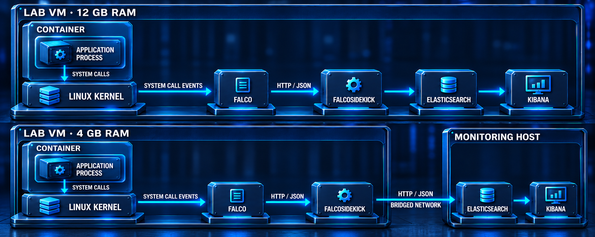

Falco устанавливается непосредственно в гостевую операционную систему и получает события её ядра. Falcosidekick, Elasticsearch и Kibana можно запустить через Docker Compose. Размещение всех компонентов на одном узле удобно для лаборатории, но не является примером промышленной архитектуры. В рабочей среде события обычно отправляют на отдельный узел, чтобы после компрометации контейнерного хоста их нельзя было удалить вместе с локальными данными.

### Подготовка системы и установка базовых инструментов

После установки Ubuntu обновим систему.

```bash
sudo apt update
sudo apt full-upgrade -y
sudo apt install -y ca-certificates curl gnupg git jq make dialog
sudo reboot
```

Проверим версию ядра и используемую иерархию групп управления ресурсами:

```bash
uname -a && stat -fc %T /sys/fs/cgroup && findmnt -t cgroup2
```

<details>
<summary>Развернуть вывод команды</summary>

  ```bash
scrock_@scrockcontainers:~$ uname -a && stat -fc %T /sys/fs/cgroup && findmnt -t cgroup2

Linux scrockcontainers 6.8.0-147-generic #147-Ubuntu SMP PREEMPT_DYNAMIC Thu
Sep 24 11:33:16 UTC 2026 x86_64 x86_64 x86_64 GNU/Linux

cgroup2fs

TARGET        SOURCE FSTYPE OPTIONS
/sys/fs/cgroup
              cgroup2
                     cgroup
                     rw,nosuid,nodev,noexec,relatime,nsdelegate,memory_r
```

</details>


Команда `stat` должна вывести `cgroup2fs`, а `findmnt` должна показать подключённую файловую систему `cgroup2`.

После перезагрузки создадим в гипервизоре снимок виртуальной машины с именем `clean-os`. Это будет контрольная точка с чистой обновлённой системой, к которой можно вернуться после неудачной установки или эксперимента. Сам снимок создаётся средствами гипервизора.

После этого можно переходить к установке Docker, Falco и остальных компонентов стенда.

### Установка Docker Engine

Docker установим из [официального репозитория](https://docs.docker.com/engine/install/ubuntu/).

```bash
sudo install -m 0755 -d /etc/apt/keyrings
sudo curl -fsSL https://download.docker.com/linux/ubuntu/gpg \
  -o /etc/apt/keyrings/docker.asc
sudo chmod a+r /etc/apt/keyrings/docker.asc

sudo tee /etc/apt/sources.list.d/docker.sources >/dev/null <<EOF
Types: deb
URIs: https://download.docker.com/linux/ubuntu
Suites: $(. /etc/os-release && echo "${UBUNTU_CODENAME:-$VERSION_CODENAME}")
Components: stable
Architectures: $(dpkg --print-architecture)
Signed-By: /etc/apt/keyrings/docker.asc
EOF

sudo apt update
sudo apt install -y docker-ce docker-ce-cli containerd.io \
  docker-buildx-plugin docker-compose-plugin
```

После установки проверим службу и запустим тестовый контейнер:

```bash
sudo systemctl --no-pager --full status docker
sudo docker run --rm hello-world
sudo docker version
sudo docker compose version
sudo docker info --format \
  'cgroup driver={{.CgroupDriver}}; cgroup version={{.CgroupVersion}}'
```

<details>
<summary>Развернуть вывод команды</summary>

  ```bash
scrock_@scrockcontainers:~$ sudo docker run --rm hello-world
Unable to find image 'hello-world:latest' locally
latest: Pulling from library/hello-world
4f55086f7dd0: Pull complete 
d5e71e642bf5: Download complete 
Digest: sha256:11a3eb1597e864c51b3f56733cb2e8a90bf0c284bfc05f9444d81c558bc848aa
Status: Downloaded newer image for hello-world:latest

Hello from Docker!
This message shows that your installation appears to be working correctly.

To generate this message, Docker took the following steps:
 1. The Docker client contacted the Docker daemon.
 2. The Docker daemon pulled the "hello-world" image from the Docker Hub.
    (amd64)
 3. The Docker daemon created a new container from that image which runs the
    executable that produces the output you are currently reading.
 4. The Docker daemon streamed that output to the Docker client, which sent it
    to your terminal.

To try something more ambitious, you can run an Ubuntu container with:
 $ docker run -it ubuntu bash

Share images, automate workflows, and more with a free Docker ID:
 https://hub.docker.com/

For more examples and ideas, visit:
 https://docs.docker.com/get-started/

scrock_@scrockcontainers:~$ sudo docker version
Client: Docker Engine - Community
 Version:           29.9.1
 API version:       1.56
 Go version:        go1.26.9
 Git commit:        dfc520d
 Built:             Wed Oct 14 18:32:55 2026
 OS/Arch:           linux/amd64
 Context:           default

Server: Docker Engine - Community
 Engine:
  Version:          29.9.1
  API version:      1.56 (minimum version 1.40)
  Go version:       go1.26.9
  Git commit:       b26fb77
  Built:            Wed Oct 14 18:32:55 2026
  OS/Arch:          linux/amd64
  Experimental:     false
 containerd:
  Version:          v2.4.2
  GitCommit:        b7a25261e029d68978bbf290df0a62fc819b3c51
 runc:
  Version:          1.5.2
  GitCommit:        v1.5.2-0-g29dd3dc2
 docker-init:
  Version:          0.19.0
  GitCommit:        de40ad0
scrock_@scrockcontainers:~$ sudo docker compose version
Docker Compose version v5.6.0
scrock_@scrockcontainers:~$ sudo docker info --format \
  'cgroup driver={{.CgroupDriver}}; cgroup version={{.CgroupVersion}}'
cgroup driver=systemd; cgroup version=2
```

</details>

Команды Docker в статье выполняются через `sudo`. Добавление пользователя в группу `docker` не выдаёт ограниченное разрешение на запуск контейнеров. Docker прямо предупреждает, что [членство в этой группе предоставляет полномочия суперпользователя (`root`)](https://docs.docker.com/engine/install/linux-postinstall/#manage-docker-as-a-non-root-user).

### Установка Falco

[Falco](https://falco.org/docs/) получает события ядра и проверяет их по набору правил. Начиная с версии 0.38, Falco по умолчанию использует современный драйвер на основе eBPF. В настройках он называется `modern_ebpf`. Для стенда выберем его явно.

```bash
curl -fsSL https://falco.org/repo/falcosecurity-packages.asc | \
  sudo gpg --dearmor -o /usr/share/keyrings/falco-archive-keyring.gpg

echo 'deb [signed-by=/usr/share/keyrings/falco-archive-keyring.gpg] https://download.falco.org/packages/deb stable main' | \
  sudo tee /etc/apt/sources.list.d/falcosecurity.list

sudo apt update
sudo env FALCO_FRONTEND=noninteractive \
  FALCO_DRIVER_CHOICE=modern_ebpf \
  apt install -y falco
```

Проверим состояние службы:

```bash
sudo systemctl --no-pager --full status falco-modern-bpf.service
sudo journalctl -u falco-modern-bpf.service -n 50 --no-pager
sudo falco --version
```

<details>
<summary>Развернуть вывод команды</summary>

  ```bash
scrock_@scrockcontainers:~$ sudo systemctl --no-pager --full status falco-modern-bpf.service
● falco-modern-bpf.service - Falco: Container Native Runtime Security with modern ebpf
     Loaded: loaded (/usr/lib/systemd/system/falco-modern-bpf.service; enabled; preset: enabled)
     Active: active (running) since Fri 2026-10-16 21:34:04 UTC; 10s ago
       Docs: https://falco.org/docs/
   Main PID: 3138 (falco)
      Tasks: 19 (limit: 13913)
     Memory: 63.1M (peak: 81.5M)
        CPU: 10.140s
     CGroup: /system.slice/falco-modern-bpf.service
             └─3138 /usr/bin/falco -o engine.kind=modern_ebpf

Oct 16 21:34:05 scrockcontainers falco[3138]: Loading rules from:
Oct 16 21:34:05 scrockcontainers falco[3138]:    /etc/falco/falco_rules.yaml | schema validation: ok
Oct 16 21:34:05 scrockcontainers falco[3138]:    /etc/falco/falco_rules.local.yaml | schema validation: none
Oct 16 21:34:05 scrockcontainers falco[3138]: The chosen syscall buffer dimension is: 8388608 bytes (8 MBs)
Oct 16 21:34:05 scrockcontainers falco[3138]: Starting health webserver with threadiness 6, listening on 0.0.0.0:8765
Oct 16 21:34:05 scrockcontainers falco[3138]: Loaded event sources: syscall
Oct 16 21:34:05 scrockcontainers falco[3138]: Enabled event sources: syscall
Oct 16 21:34:05 scrockcontainers falco[3138]: Opening 'syscall' source with modern BPF probe.
Oct 16 21:34:05 scrockcontainers falco[3138]: One ring buffer every '2' CPUs.
Oct 16 21:34:05 scrockcontainers falco[3138]: [libs]: Trying to open the right engine!
scrock_@scrockcontainers:~$ sudo journalctl -u falco-modern-bpf.service -n 50 --no-pager
Oct 16 21:34:04 scrockcontainers systemd[1]: Started falco-modern-bpf.service - Falco: Container Native Runtime Security with modern ebpf.
Oct 16 21:34:04 scrockcontainers falco[3138]: Falco version: 0.45.0 (x86_64)
Oct 16 21:34:04 scrockcontainers falco[3138]: Falco initialized with configuration files:
Oct 16 21:34:04 scrockcontainers falco[3138]:    /etc/falco/config.d/engine-kind-falcoctl.yaml | schema validation: ok
Oct 16 21:34:04 scrockcontainers falco[3138]:    /etc/falco/config.d/falco.container_plugin.yaml | schema validation: ok
Oct 16 21:34:04 scrockcontainers falco[3138]:    /etc/falco/falco.yaml | schema validation: ok
Oct 16 21:34:04 scrockcontainers falco[3138]: System info: Linux version 6.8.0-147-generic (buildd@lcy02-amd64-081) (x86_64-linux-gnu-gcc-13 (Ubuntu 13.3.0-6ubuntu2~24.04.1) 13.3.0, GNU ld (GNU Binutils for Ubuntu) 2.42) #147-Ubuntu SMP PREEMPT_DYNAMIC Thu Sep 24 11:33:16 UTC 2026
Oct 16 21:34:05 scrockcontainers falco[3138]: Loaded plugin 'container@0.7.4' from file /usr/share/falco/plugins/libcontainer.so
Oct 16 21:34:05 scrockcontainers falco[3138]: [libs]: container: Enabled 'podman' container engine.
Oct 16 21:34:05 scrockcontainers falco[3138]: [libs]: container: * enabled container runtime socket at '/run/podman/podman.sock'
Oct 16 21:34:05 scrockcontainers falco[3138]: [libs]: container: Enabled 'docker' container engine.
Oct 16 21:34:05 scrockcontainers falco[3138]: [libs]: container: * enabled container runtime socket at '/var/run/docker.sock'
Oct 16 21:34:05 scrockcontainers falco[3138]: [libs]: container: Enabled 'cri' container engine.
Oct 16 21:34:05 scrockcontainers falco[3138]: [libs]: container: * enabled container runtime socket at '/run/containerd/containerd.sock'
Oct 16 21:34:05 scrockcontainers falco[3138]: [libs]: container: * enabled container runtime socket at '/run/crio/crio.sock'
Oct 16 21:34:05 scrockcontainers falco[3138]: [libs]: container: * enabled container runtime socket at '/run/k3s/containerd/containerd.sock'
Oct 16 21:34:05 scrockcontainers falco[3138]: [libs]: container: * enabled container runtime socket at '/run/host-containerd/containerd.sock'
Oct 16 21:34:05 scrockcontainers falco[3138]: [libs]: container: Enabled 'containerd' container engine.
Oct 16 21:34:05 scrockcontainers falco[3138]: [libs]: container: * enabled container runtime socket at '/run/host-containerd/containerd.sock'
Oct 16 21:34:05 scrockcontainers falco[3138]: [libs]: container: Enabled 'lxc' container engine.
Oct 16 21:34:05 scrockcontainers falco[3138]: [libs]: container: Enabled 'libvirt_lxc' container engine.
Oct 16 21:34:05 scrockcontainers falco[3138]: [libs]: container: Enabled 'bpm' container engine.
Oct 16 21:34:05 scrockcontainers falco[3138]: Loading rules from:
Oct 16 21:34:05 scrockcontainers falco[3138]:    /etc/falco/falco_rules.yaml | schema validation: ok
Oct 16 21:34:05 scrockcontainers falco[3138]:    /etc/falco/falco_rules.local.yaml | schema validation: none                                                  
Oct 16 21:34:05 scrockcontainers falco[3138]: The chosen syscall buffer dimension is: 8388608 bytes (8 MBs)
Oct 16 21:34:05 scrockcontainers falco[3138]: Starting health webserver with threadiness 6, listening on 0.0.0.0:8765
Oct 16 21:34:05 scrockcontainers falco[3138]: Loaded event sources: syscall
Oct 16 21:34:05 scrockcontainers falco[3138]: Enabled event sources: syscall
Oct 16 21:34:05 scrockcontainers falco[3138]: Opening 'syscall' source with modern BPF probe.
Oct 16 21:34:05 scrockcontainers falco[3138]: One ring buffer every '2' CPUs.
Oct 16 21:34:05 scrockcontainers falco[3138]: [libs]: Trying to open the right engine!
scrock_@scrockcontainers:~$ sudo falco --version
Fri Oct 16 21:34:26 2026: Falco version: 0.45.0 (x86_64)
Fri Oct 16 21:34:26 2026: Falco initialized with configuration files:
Fri Oct 16 21:34:26 2026:    /etc/falco/config.d/engine-kind-falcoctl.yaml | schema validation: ok
Fri Oct 16 21:34:26 2026:    /etc/falco/config.d/falco.container_plugin.yaml | schema validation: ok
Fri Oct 16 21:34:26 2026:    /etc/falco/falco.yaml | schema validation: ok
Fri Oct 16 21:34:26 2026: System info: Linux version 6.8.0-147-generic (buildd@lcy02-amd64-081) (x86_64-linux-gnu-gcc-13 (Ubuntu 13.3.0-6ubuntu2~24.04.1) 13.3.0, GNU ld (GNU Binutils for Ubuntu) 2.42) #147-Ubuntu SMP PREEMPT_DYNAMIC Thu Sep 24 11:33:16 UTC 2026
Falco version: 0.45.0
Libs version:  0.26.0
Plugin API:    3.12.0
Engine:        0.65.0
Driver:
  API version:    11.0.0
  Schema version: 4.3.0
  Default driver: 11.0.0+driver
```

</details>

Актуальные варианты установки и имена служб приведены в [документации Falco](https://falco.org/docs/installation/).

### Elasticsearch, Kibana и Falcosidekick

Falco уже получает события ядра и проверяет их по правилам, но его журнал неудобен для поиска и сравнения экспериментов. Добавим три компонента. [`Falcosidekick`](https://github.com/falcosecurity/falcosidekick) примет уведомления Falco по протоколу HTTP и передаст их в Elasticsearch. Elasticsearch сохранит события, а Kibana позволит искать их и строить представления. Все три компонента запустим на лабораторной машине через Docker Compose.

В стенде используются Elasticsearch и Kibana версии `9.5.5`, а также Falcosidekick версии `2.35.0`. Версии Elasticsearch и Kibana совпадают полностью, как требует [документация Elastic](https://www.elastic.co/docs/deploy-manage/deploy/self-managed/installing-elasticsearch). Elasticsearch и Kibana загружаются из [официального реестра Elastic](https://www.docker.elastic.co/), а Falcosidekick — из [Docker Hub](https://hub.docker.com/r/falcosecurity/falcosidekick). Номера версий указаны явно, чтобы обновление образа не изменило стенд незаметно.

Сначала подготовим параметр ядра, необходимый Elasticsearch для работы с отображаемыми в память файлами. Для современных версий Elastic рекомендует значение `1048576` для [`vm.max_map_count`](https://www.elastic.co/docs/deploy-manage/deploy/self-managed/vm-max-map-count).

```bash
echo 'vm.max_map_count=1048576' | \
  sudo tee /etc/sysctl.d/99-elasticsearch.conf
sudo sysctl --system
sysctl vm.max_map_count
```

Ожидаемое значение:

```text
vm.max_map_count = 1048576
```

Создадим отдельный каталог для компонентов мониторинга.

```bash
mkdir -p ~/container-security-lab/monitoring
cd ~/container-security-lab/monitoring
```

В файл `compose.yaml` поместим следующую конфигурацию.

```yaml
name: container-security-monitoring

services:
  elasticsearch:
    image: docker.elastic.co/elasticsearch/elasticsearch:9.5.5
    container_name: lab-elasticsearch
    restart: unless-stopped
    environment:
      discovery.type: single-node
      xpack.security.enabled: "false"
    mem_limit: 4g
    ports:
      - "127.0.0.1:9200:9200"
    volumes:
      - elasticsearch-data:/usr/share/elasticsearch/data
    healthcheck:
      test:
        - CMD-SHELL
        - >-
          curl --silent --fail
          'http://127.0.0.1:9200/_cluster/health?wait_for_status=yellow&timeout=5s'
          >/dev/null
      interval: 10s
      timeout: 10s
      retries: 12
      start_period: 60s
    networks:
      - monitoring

  kibana:
    image: docker.elastic.co/kibana/kibana:9.5.5
    container_name: lab-kibana
    restart: unless-stopped
    environment:
      ELASTICSEARCH_HOSTS: '["http://elasticsearch:9200"]'
      SERVER_NAME: lab-kibana
    mem_limit: 2g
    ports:
      - "0.0.0.0:5601:5601"
    depends_on:
      elasticsearch:
        condition: service_healthy
    networks:
      - monitoring

  falcosidekick:
    image: falcosecurity/falcosidekick:2.35.0
    container_name: lab-falcosidekick
    restart: unless-stopped
    environment:
      ELASTICSEARCH_HOSTPORT: http://elasticsearch:9200
      ELASTICSEARCH_INDEX: falco
      ELASTICSEARCH_SUFFIX: daily
      ELASTICSEARCH_FLATTENFIELDS: "true"
      ELASTICSEARCH_CREATEINDEXTEMPLATE: "true"
      ELASTICSEARCH_NUMBEROFSHARDS: "1"
      ELASTICSEARCH_NUMBEROFREPLICAS: "0"
    mem_limit: 256m
    ports:
      - "127.0.0.1:2801:2801"
    depends_on:
      elasticsearch:
        condition: service_healthy
    networks:
      - monitoring

networks:
  monitoring:
    name: container-security-monitoring

volumes:
  elasticsearch-data:
    name: container-security-elasticsearch-data
```

Elasticsearch работает в режиме одного узла, поэтому для индексов Falco создаётся один основной сегмент без резервной копии. Постоянный том сохраняет события после перезапуска контейнера. Ограничения памяти не позволяют компонентам мониторинга занять всю оперативную память лабораторной машины.

Встроенная проверка подлинности Elasticsearch в этом стенде отключена намеренно. Elasticsearch и Falcosidekick доступны только внутри виртуальной машины через порты `9200` и `2801`. Порт Kibana `5601` опубликован на сетевых интерфейсах виртуальной машины, чтобы открыть её с основной ОС. Сетевой адаптер стенда должен быть подключён к изолированной сети гипервизора, а не к рабочей локальной сети.

Проверим синтаксис файла, загрузим образы и запустим компоненты.

```bash
sudo docker compose config --quiet
sudo docker compose pull
sudo docker compose up -d --wait
sudo docker compose ps
```

<details>
<summary>Развернуть вывод команды</summary>

  ```bash
scrock_@scrockcontainers:~/container-security-lab/monitoring$ sudo docker compose pull
[+] pull 3/3
 ✔ Image docker.elastic.co/kibana/kibana:9.5.5               Pulled                                                                                                  818.7s
 ✔ Image falcosecurity/falcosidekick:2.35.0                  Pulled                                                                                                   15.3s
 ✔ Image docker.elastic.co/elasticsearch/elasticsearch:9.5.5 Pulled                                                                                                  798.8s
scrock_@scrockcontainers:~/container-security-lab/monitoring$ sudo docker compose up -d --wait
[+] up 4/5
[+] up 5/5
 ✔ Volume container-security-elasticsearch-data Created                                                                                                                0.0s
 ✔ Container lab-elasticsearch                  Healthy                                                                                                              144.0s
 ✔ Container lab-kibana                         Healthy                                                                                                              142.9s
 ✔ Container lab-falcosidekick                  Healthy                                                                                                              142.9s
scrock_@scrockcontainers:~/container-security-lab/monitoring$ sudo docker compose ps
NAME                IMAGE                                                 COMMAND                  SERVICE         CREATED         STATUS                   PORTS
lab-elasticsearch   docker.elastic.co/elasticsearch/elasticsearch:9.5.5   "/bin/tini -- /usr/l…"   elasticsearch   2 minutes ago   Up 2 minutes (healthy)   127.0.0.1:9200->9200/tcp, 9300/tcp
lab-falcosidekick   falcosecurity/falcosidekick:2.35.0                    "./falcosidekick"        falcosidekick   2 minutes ago   Up 38 seconds            127.0.0.1:2801->2801/tcp
lab-kibana          docker.elastic.co/kibana/kibana:9.5.5                 "/bin/tini -- /usr/l…"   kibana          2 minutes ago   Up 43 seconds            0.0.0.0:5601->5601/tcp
scrock_@scrockcontainers:~/container-security-lab/monitoring$  
```

</details>

В выводе `docker compose ps` Elasticsearch должен иметь состояние `healthy`, а Kibana и Falcosidekick - состояние `running`. Первый запуск может занять несколько минут.

Убедимся, что каждый компонент отвечает.

```bash
curl -fsS 'http://127.0.0.1:9200/_cluster/health?pretty'
curl -fsS 'http://127.0.0.1:5601/api/status' | \
  jq -r '.status.overall.level'
curl -fsS 'http://127.0.0.1:2801/healthz' && \
  echo 'Falcosidekick: OK'
```

<details>
<summary>Развернуть вывод команды</summary>

  ```bash
scrock_@scrockcontainers:~/container-security-lab/monitoring$ curl -fsS 'http://127.0.0.1:9200/_cluster/health?pretty'                     
curl -fsS 'http://127.0.0.1:5601/api/status' | \                                                                                           
  jq -r '.status.overall.level'                                                                                                            
curl -fsS 'http://127.0.0.1:2801/healthz' && \                                                                                             
  echo 'Falcosidekick: OK'                                                                                                                 
{                                                                                                                                          
  "cluster_name" : "docker-cluster",                                                                                                       
  "status" : "green",                                                                                                                      
  "timed_out" : false,                                                                                                                     
  "number_of_nodes" : 1,                                                                                                                   
  "number_of_data_nodes" : 1,                                                                                                              
  "active_primary_shards" : 2,                                                                                                             
  "active_shards" : 2,                                                                                                                     
  "relocating_shards" : 0,                                                                                                                                                
  "initializing_shards" : 0,                                                                                                                                              
  "unassigned_shards" : 0,                                                                                                                                                
  "unassigned_primary_shards" : 0,
  "delayed_unassigned_shards" : 0,
  "number_of_pending_tasks" : 0,
  "number_of_in_flight_fetch" : 0,
  "task_max_waiting_in_queue_millis" : 0,
  "active_shards_percent_as_number" : 100.0
}

{"status": "ok"}

Falcosidekick: OK
```

</details>

Elasticsearch должен вернуть сведения о кластере, Kibana - состояние `available`, а проверка Falcosidekick должна завершиться строкой `Falcosidekick: OK`. 

#### Проверка передачи событий в Elasticsearch

Сначала проверим участок между Falcosidekick и Elasticsearch без участия Falco. Служебный адрес `/test` создаёт тестовое событие и отправляет его во все настроенные приёмники.

```bash
curl -fsS -X POST 'http://127.0.0.1:2801/test' && \
  echo 'Тестовое событие отправлено'
```

Falcosidekick создаёт ежедневные индексы с именами вида `falco-ГГГГ.ММ.ДД`. Проверим появление индекса и количество документов в нём (если возникает ошибка 503, то необходимо немного подождать создание индекса).

```bash
curl -fsS 'http://127.0.0.1:9200/_cat/indices/falco-*?v'
curl -fsS 'http://127.0.0.1:9200/falco-*/_count?pretty'
```

<details>
<summary>Развернуть вывод команды</summary>

  ```bash
scrock_@scrockcontainers:~/container-security-lab/monitoring$ curl -fsS 'http://127.0.0.1:9200/_cat/indices/falco-*?v'
health status index            uuid                   pri rep docs.count docs.deleted store.size pri.store.size dataset.size
yellow open   falco-2026.10.16 H5SotzzoTRCxyeBkflU8rw   1   3          1            0     11.8kb         11.8kb       11.8kb
scrock_@scrockcontainers:~/container-security-lab/monitoring$ curl -fsS 'http://127.0.0.1:9200/falco-*/_count?pretty'
{
  "count" : 1,
  "_shards" : {
    "total" : 1,
    "successful" : 1,
    "skipped" : 0,
    "failed" : 0
  }
}
```

</details>

#### Подключение Falco

Falcosidekick уже умеет записывать события в Elasticsearch. Теперь направим в него уведомления, которые создаёт Falco при срабатывании правил.

Основной файл `/etc/falco/falco.yaml` изменять не будем. Начиная с версии 0.38, Falco поддерживает [дополнительные файлы конфигурации](https://falco.org/docs/configuration/#config_files) в каталоге `/etc/falco/config.d`. Они загружаются после основного файла и могут переопределять его параметры. Такой способ упрощает обновление пакета и позволяет хранить локальные изменения отдельно.

Создадим файл настроек для подключения к Falcosidekick.

```bash
sudo install -d -m 0755 /etc/falco/config.d

sudo tee /etc/falco/config.d/99-falcosidekick.yaml \
  >/dev/null <<'EOF'
json_output: true
json_include_output_property: true

http_output:
  enabled: true
  url: "http://127.0.0.1:2801/"
EOF
```

Параметр `json_output` переводит уведомления Falco в формат JSON. Параметр `json_include_output_property` сохраняет в них готовое текстовое описание события. Блок `http_output` включает передачу уведомлений по протоколу HTTP на локальный порт Falcosidekick.

Проверим итоговую конфигурацию до перезапуска службы.

```bash
sudo falco --dry-run
```

<details>
<summary>Развернуть вывод команды</summary>

  ```bash
scrock_@scrockcontainers:~/container-security-lab/monitoring$ sudo falco --dry-run
Fri Oct 16 22:57:04 2026: Falco version: 0.45.0 (x86_64)
Fri Oct 16 22:57:04 2026: Falco initialized with configuration files:
Fri Oct 16 22:57:04 2026:    /etc/falco/config.d/99-falcosidekick.yaml | schema validation: ok
Fri Oct 16 22:57:04 2026:    /etc/falco/config.d/engine-kind-falcoctl.yaml | schema validation: ok
Fri Oct 16 22:57:04 2026:    /etc/falco/config.d/falco.container_plugin.yaml | schema validation: ok
Fri Oct 16 22:57:04 2026:    /etc/falco/falco.yaml | schema validation: ok
Fri Oct 16 22:57:04 2026: System info: Linux version 6.8.0-147-generic (buildd@lcy02-amd64-081) (x86_64-linux-gnu-gcc-13 (Ubuntu 13.3.0-6ubuntu2~24.04.1) 13.3.0, GNU ld (GNU Binutils for Ubuntu) 2.42) #147-Ubuntu SMP PREEMPT_DYNAMIC Thu Sep 24 11:33:16 UTC 2026
Fri Oct 16 22:57:04 2026: Loaded plugin 'container@0.7.4' from file /usr/share/falco/plugins/libcontainer.so
Fri Oct 16 22:57:04 2026: [libs]: container: Enabled 'podman' container engine.
Fri Oct 16 22:57:04 2026: [libs]: container: * enabled container runtime socket at '/run/podman/podman.sock'
Fri Oct 16 22:57:04 2026: [libs]: container: Enabled 'docker' container engine.
Fri Oct 16 22:57:04 2026: [libs]: container: * enabled container runtime socket at '/var/run/docker.sock'
Fri Oct 16 22:57:04 2026: [libs]: container: Enabled 'cri' container engine.
Fri Oct 16 22:57:04 2026: [libs]: container: * enabled container runtime socket at '/run/containerd/containerd.sock'
Fri Oct 16 22:57:04 2026: [libs]: container: * enabled container runtime socket at '/run/crio/crio.sock'
Fri Oct 16 22:57:04 2026: [libs]: container: * enabled container runtime socket at '/run/k3s/containerd/containerd.sock'
Fri Oct 16 22:57:04 2026: [libs]: container: * enabled container runtime socket at '/run/host-containerd/containerd.sock'
Fri Oct 16 22:57:04 2026: [libs]: container: Enabled 'containerd' container engine.
Fri Oct 16 22:57:04 2026: [libs]: container: * enabled container runtime socket at '/run/host-containerd/containerd.sock'
Fri Oct 16 22:57:04 2026: [libs]: container: Enabled 'lxc' container engine.
Fri Oct 16 22:57:04 2026: [libs]: container: Enabled 'libvirt_lxc' container engine.
Fri Oct 16 22:57:04 2026: [libs]: container: Enabled 'bpm' container engine.
Fri Oct 16 22:57:04 2026: Loading rules from:
Fri Oct 16 22:57:06 2026:    /etc/falco/falco_rules.yaml | schema validation: ok
Fri Oct 16 22:57:06 2026:    /etc/falco/falco_rules.local.yaml | schema validation: none
Fri Oct 16 22:57:06 2026: The chosen syscall buffer dimension is: 8388608 bytes (8 MBs)
```

</details>

При успешной проверке Falco завершит команду с кодом `0` и не выведет сообщение об ошибке конфигурации. После этого перезапустим службу с современным драйвером eBPF и проверим её состояние.

```bash
sudo systemctl restart falco-modern-bpf.service

sudo systemctl --no-pager --full \
  status falco-modern-bpf.service
```

<details>
<summary>Развернуть вывод команды</summary>

  ```bash
scrock_@scrockcontainers:~/container-security-lab/monitoring$ sudo systemctl restart falco-modern-bpf.service
scrock_@scrockcontainers:~/container-security-lab/monitoring$ sudo systemctl --no-pager --full \
  status falco-modern-bpf.service
● falco-modern-bpf.service - Falco: Container Native Runtime Security with modern ebpf
     Loaded: loaded (/usr/lib/systemd/system/falco-modern-bpf.service; enabled; preset: enabled)
     Active: active (running) since Fri 2026-10-16 22:57:45 UTC; 3s ago
       Docs: https://falco.org/docs/
   Main PID: 9185 (falco)
      Tasks: 20 (limit: 13913)
     Memory: 54.4M (peak: 54.4M)
        CPU: 4.434s
     CGroup: /system.slice/falco-modern-bpf.service
             └─9185 /usr/bin/falco -o engine.kind=modern_ebpf

Oct 16 22:57:45 scrockcontainers falco[9185]: Loading rules from:
Oct 16 22:57:47 scrockcontainers falco[9185]:    /etc/falco/falco_rules.yaml | schema validation: ok
Oct 16 22:57:47 scrockcontainers falco[9185]:    /etc/falco/falco_rules.local.yaml | schema validation: none
Oct 16 22:57:47 scrockcontainers falco[9185]: The chosen syscall buffer dimension is: 8388608 bytes (8 MBs)
Oct 16 22:57:47 scrockcontainers falco[9185]: Starting health webserver with threadiness 6, listening on 0.0.0.0:8765
Oct 16 22:57:47 scrockcontainers falco[9185]: Loaded event sources: syscall
Oct 16 22:57:47 scrockcontainers falco[9185]: Enabled event sources: syscall
Oct 16 22:57:47 scrockcontainers falco[9185]: Opening 'syscall' source with modern BPF probe.
Oct 16 22:57:47 scrockcontainers falco[9185]: One ring buffer every '2' CPUs.
Oct 16 22:57:47 scrockcontainers falco[9185]: [libs]: Trying to open the right engine!
```

</details>

Служба должна находиться в состоянии `active (running)`. Убедимся, что после запуска в журнале нет ошибок отправки по HTTP.

```bash
sudo journalctl \
  -u falco-modern-bpf.service \
  -n 50 \
  --no-pager
```

<details>
<summary>Развернуть вывод команды</summary>

  ```bash
scrock_@scrockcontainers:~/container-security-lab/monitoring$ sudo journalctl \
  -u falco-modern-bpf.service \
  -n 50 \
  --no-pager
Oct 16 22:56:57 scrockcontainers falco[3138]: [libs]: container: Enabled 'libvirt_lxc' container engine.
Oct 16 22:56:57 scrockcontainers falco[3138]: [libs]: container: Enabled 'bpm' container engine.
Oct 16 22:56:57 scrockcontainers falco[3138]: Loading rules from:
Oct 16 22:56:57 scrockcontainers falco[3138]:    /etc/falco/falco_rules.yaml | schema validation: ok
Oct 16 22:56:57 scrockcontainers falco[3138]:    /etc/falco/falco_rules.local.yaml | schema validation: none
Oct 16 22:56:57 scrockcontainers falco[3138]: The chosen syscall buffer dimension is: 8388608 bytes (8 MBs)
Oct 16 22:56:57 scrockcontainers falco[3138]: Starting health webserver with threadiness 6, listening on 0.0.0.0:8765
Oct 16 22:56:57 scrockcontainers falco[3138]: Loaded event sources: syscall
Oct 16 22:56:57 scrockcontainers falco[3138]: Enabled event sources: syscall
Oct 16 22:56:57 scrockcontainers falco[3138]: Opening 'syscall' source with modern BPF probe.
Oct 16 22:56:57 scrockcontainers falco[3138]: One ring buffer every '2' CPUs.
Oct 16 22:56:57 scrockcontainers falco[3138]: [libs]: Trying to open the right engine!
Oct 16 22:57:43 scrockcontainers falco[3138]: SIGINT received, exiting...
Oct 16 22:57:43 scrockcontainers systemd[1]: Stopping falco-modern-bpf.service - Falco: Container Native Runtime Security with modern ebpf...
Oct 16 22:57:45 scrockcontainers systemd[1]: falco-modern-bpf.service: Deactivated successfully.
Oct 16 22:57:45 scrockcontainers systemd[1]: Stopped falco-modern-bpf.service - Falco: Container Native Runtime Security with modern ebpf.
Oct 16 22:57:45 scrockcontainers systemd[1]: falco-modern-bpf.service: Consumed 3min 20.067s CPU time, 81.5M memory peak, 0B memory swap peak.
Oct 16 22:57:45 scrockcontainers systemd[1]: Started falco-modern-bpf.service - Falco: Container Native Runtime Security with modern ebpf.
Oct 16 22:57:45 scrockcontainers falco[9185]: Falco version: 0.45.0 (x86_64)
Oct 16 22:57:45 scrockcontainers falco[9185]: Falco initialized with configuration files:
Oct 16 22:57:45 scrockcontainers falco[9185]:    /etc/falco/config.d/99-falcosidekick.yaml | schema validation: ok
Oct 16 22:57:45 scrockcontainers falco[9185]:    /etc/falco/config.d/engine-kind-falcoctl.yaml | schema validation: ok
Oct 16 22:57:45 scrockcontainers falco[9185]:    /etc/falco/config.d/falco.container_plugin.yaml | schema validation: ok
Oct 16 22:57:45 scrockcontainers falco[9185]:    /etc/falco/falco.yaml | schema validation: ok
Oct 16 22:57:45 scrockcontainers falco[9185]: System info: Linux version 6.8.0-147-generic (buildd@lcy02-amd64-081) (x86_64-linux-gnu-gcc-13 (Ubuntu 13.3.0-6ubuntu2~24.04.1) 13.3.0, GNU ld (GNU Binutils for Ubuntu) 2.42) #147-Ubuntu SMP PREEMPT_DYNAMIC Thu Sep 24 11:33:16 UTC 2026
Oct 16 22:57:45 scrockcontainers falco[9185]: Loaded plugin 'container@0.7.4' from file /usr/share/falco/plugins/libcontainer.so
Oct 16 22:57:45 scrockcontainers falco[9185]: [libs]: container: Enabled 'podman' container engine.
Oct 16 22:57:45 scrockcontainers falco[9185]: [libs]: container: * enabled container runtime socket at '/run/podman/podman.sock'
Oct 16 22:57:45 scrockcontainers falco[9185]: [libs]: container: Enabled 'docker' container engine.
Oct 16 22:57:45 scrockcontainers falco[9185]: [libs]: container: * enabled container runtime socket at '/var/run/docker.sock'
Oct 16 22:57:45 scrockcontainers falco[9185]: [libs]: container: Enabled 'cri' container engine.
Oct 16 22:57:45 scrockcontainers falco[9185]: [libs]: container: * enabled container runtime socket at '/run/containerd/containerd.sock'
Oct 16 22:57:45 scrockcontainers falco[9185]: [libs]: container: * enabled container runtime socket at '/run/crio/crio.sock'
Oct 16 22:57:45 scrockcontainers falco[9185]: [libs]: container: * enabled container runtime socket at '/run/k3s/containerd/containerd.sock'
Oct 16 22:57:45 scrockcontainers falco[9185]: [libs]: container: * enabled container runtime socket at '/run/host-containerd/containerd.sock'
Oct 16 22:57:45 scrockcontainers falco[9185]: [libs]: container: Enabled 'containerd' container engine.
Oct 16 22:57:45 scrockcontainers falco[9185]: [libs]: container: * enabled container runtime socket at '/run/host-containerd/containerd.sock'
Oct 16 22:57:45 scrockcontainers falco[9185]: [libs]: container: Enabled 'lxc' container engine.
Oct 16 22:57:45 scrockcontainers falco[9185]: [libs]: container: Enabled 'libvirt_lxc' container engine.
Oct 16 22:57:45 scrockcontainers falco[9185]: [libs]: container: Enabled 'bpm' container engine.
Oct 16 22:57:45 scrockcontainers falco[9185]: Loading rules from:
Oct 16 22:57:47 scrockcontainers falco[9185]:    /etc/falco/falco_rules.yaml | schema validation: ok
Oct 16 22:57:47 scrockcontainers falco[9185]:    /etc/falco/falco_rules.local.yaml | schema validation: none
Oct 16 22:57:47 scrockcontainers falco[9185]: The chosen syscall buffer dimension is: 8388608 bytes (8 MBs)
Oct 16 22:57:47 scrockcontainers falco[9185]: Starting health webserver with threadiness 6, listening on 0.0.0.0:8765
Oct 16 22:57:47 scrockcontainers falco[9185]: Loaded event sources: syscall
Oct 16 22:57:47 scrockcontainers falco[9185]: Enabled event sources: syscall
Oct 16 22:57:47 scrockcontainers falco[9185]: Opening 'syscall' source with modern BPF probe.
Oct 16 22:57:47 scrockcontainers falco[9185]: One ring buffer every '2' CPUs.
Oct 16 22:57:47 scrockcontainers falco[9185]: [libs]: Trying to open the right engine!
```

</details>

Для контрольной проверки запустим интерактивную оболочку в короткоживущем контейнере.

```bash
sudo docker run \
  --rm \
  --interactive \
  --tty \
  --name falco-shell-test \
  alpine:3.22 sh
```

Внутри контейнера выполним две команды.

```sh
whoami
exit
```

Событие создаёт не команда `whoami`, а запуск оболочки `sh` с подключённым терминалом. Этому действию соответствует штатное правило Falco [`Terminal shell in container`](https://github.com/falcosecurity/rules/blob/main/rules/falco_rules.yaml).

Проверим, что правило сработало на узле.

```bash
sudo journalctl \
  -u falco-modern-bpf.service \
  --since '2 minutes ago' \
  --no-pager | \
  grep -F 'Terminal shell in container'
```

<details>
<summary>Развернуть вывод команды</summary>

  ```bash
scrock_@scrockcontainers:~/container-security-lab/monitoring$ sudo journalctl \
  -u falco-modern-bpf.service \
  --since '2 minutes ago' \
  --no-pager | \
  grep -F 'Terminal shell in container'
Oct 16 22:59:26 scrockcontainers falco[9185]: {"hostname":"scrockcontainers","output":"22:59:26.058254401: Notice A shell was spawned in a container with an attached terminal | evt_type=execve user=root user_uid=0 user_loginuid=-1 process=sh proc_exepath=/bin/busybox parent=containerd-shim command=sh terminal=34816 exe_flags=EXE_WRITABLE|EXE_LOWER_LAYER container_id=f8187887e087 container_name=falco-shell-test container_image_repository=alpine container_image_tag=3.22 k8s_pod_name=<NA> k8s_ns_name=<NA>","output_fields":{"container.id":"f8187887e087","container.image.repository":"alpine","container.image.tag":"3.22","container.name":"falco-shell-test","evt.arg.flags":"EXE_WRITABLE|EXE_LOWER_LAYER","evt.time":1792191566058254401,"evt.type":"execve","k8s.ns.name":null,"k8s.pod.name":null,"proc.cmdline":"sh","proc.exepath":"/bin/busybox","proc.name":"sh","proc.pname":"containerd-shim","proc.tty":34816,"user.loginuid":-1,"user.name":"root","user.uid":0},"priority":"Notice","rule":"Terminal shell in container","source":"syscall","tags":["T1059","container","maturity_stable","mitre_execution","shell"],"time":"2026-10-16T22:59:26.058254401Z"}
```

</details>

Доставка в Elasticsearch выполняется асинхронно, поэтому документ может появиться не сразу.

```bash
  curl -fsS -X POST \
    'http://127.0.0.1:9200/falco-*/_search' \
    -H 'Content-Type: application/json' \
    -d '{
      "size": 0,
      "query": {
        "match_phrase": {
          "rule": "Terminal shell in container"
        }
      }
    }' | jq '.hits.total.value'
```

Если событие дошло до elastic, то команда выведет `1`.

Выведем последнее найденное событие.

```bash
curl -fsS -X POST \
  'http://127.0.0.1:9200/falco-*/_search?pretty' \
  -H 'Content-Type: application/json' \
  -d '{
    "size": 1,
    "sort": [
      {
        "time": {
          "order": "desc"
        }
      }
    ],
    "query": {
      "match_phrase": {
        "rule": "Terminal shell in container"
      }
    },
    "_source": [
      "time",
      "rule",
      "priority",
      "output"
    ]
  }'
```

<details>
<summary>Развернуть вывод команды</summary>

  ```bash
scrock_@scrockcontainers:~/container-security-lab/monitoring$ curl -fsS -X POST \
  'http://127.0.0.1:9200/falco-*/_search?pretty' \
  -H 'Content-Type: application/json' \
  -d '{
    "size": 1,
    "sort": [
      {
        "time": {
          "order": "desc"
        }
      }
    ],
    "query": {
      "match_phrase": {
        "rule": "Terminal shell in container"
      }
    },
    "_source": [
      "time",
      "rule",
      "priority",
      "output"
    ]
  }'
{
  "took" : 6,
  "timed_out" : false,
  "_shards" : {
    "total" : 1,
    "successful" : 1,
    "skipped" : 0,
    "failed" : 0
  },
  "hits" : {
    "total" : {
      "value" : 1,
      "relation" : "eq"
    },
    "max_score" : null,
    "hits" : [
      {
        "_index" : "falco-2026.10.16",
        "_id" : "ms_xRqEBa3Eq3AZzEeqd",
        "_score" : null,
        "_source" : {
          "output" : "22:59:26.058254401: Notice A shell was spawned in a container with an attached terminal | evt_type=execve user=root user_uid=0 user_loginuid=-1 process=sh proc_exepath=/bin/busybox parent=containerd-shim command=sh terminal=34816 exe_flags=EXE_WRITABLE|EXE_LOWER_LAYER container_id=f8187887e087 container_name=falco-shell-test container_image_repository=alpine container_image_tag=3.22 k8s_pod_name=<NA> k8s_ns_name=<NA>",
          "priority" : "Notice",
          "rule" : "Terminal shell in container",
          "time" : "2026-10-16T22:59:26.058254401Z"
        },
        "sort" : [
          1792191566058
        ]
      }
    ]
  }
}
```

</details>

В ответе Elasticsearch должно находиться событие с правилом `Terminal shell in container`. Его наличие одновременно в журнале Falco и в индексе `falco-*` подтверждает работу всей цепочки от события ядра до сохранённого документа.


#### Просмотр событий в Kibana

С физического компьютера откроем в браузере адрес `http://<адрес_виртуальной_машины>:5601`. Например, если лабораторный интерфейс получил адрес `192.168.0.69`, Kibana будет доступна по адресу `http://192.168.0.69:5601`. В лабораторной конфигурации проверка подлинности Elastic Stack отключена, поэтому для входа в Kibana имя пользователя и пароль не требуются.

После появления первого события создадим [представление данных](https://www.elastic.co/docs/explore-analyze/find-and-organize/data-views/create-data-view). Оно укажет Kibana, из каких индексов брать события и какое поле использовать для фильтрации по времени. Само представление не копирует данные и не создаёт новый индекс.

Откроем Kibana по адресу `http://<адрес_виртуальной_машины>:5601` и выполним следующие действия.

1. Через глобальный поиск откроем раздел `Data Views`.

2. Нажмём `Create data view`.
3. В поле `Name` укажем `Falco events`.
4. В поле `Index pattern` укажем `falco-*`.
5. В качестве поля времени (`Timestamp field`) выберем `time`.
6. Нажмём `Save data view to Kibana`.
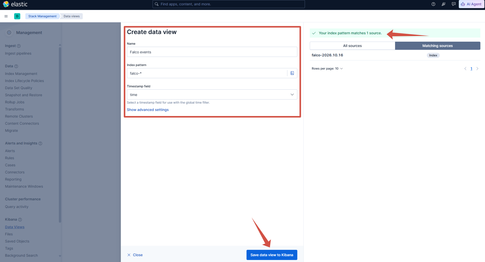

После сохранения откроем раздел `Discover` и выберем представление `Falco events`. В нём должны отображаться тестовое событие Falcosidekick и уведомление о запуске интерактивной оболочки в контейнере.


#### Контрольная точка `lab-ready`

Перед созданием снимка выполним итоговую проверку.

```bash
sudo systemctl is-active docker
sudo systemctl is-active falco-modern-bpf.service
sudo docker compose ps
curl -fsS 'http://127.0.0.1:9200/_cluster/health?pretty'
curl -fsS 'http://127.0.0.1:9200/falco-*/_count?pretty'
curl -fsS 'http://127.0.0.1:5601/api/status' | \
  jq -r '.status.overall.level'
```

<details>
<summary>Развернуть вывод команды</summary>

  ```bash
scrock_@scrockcontainers:~/container-security-lab/monitoring$ sudo systemctl is-active docker
active
scrock_@scrockcontainers:~/container-security-lab/monitoring$ sudo systemctl is-active falco-modern-bpf.service
active
scrock_@scrockcontainers:~/container-security-lab/monitoring$ sudo docker compose ps
NAME                IMAGE                                                 COMMAND                  SERVICE         CREATED          STATUS                    PORTS
lab-elasticsearch   docker.elastic.co/elasticsearch/elasticsearch:9.5.5   "/bin/tini -- /usr/l…"   elasticsearch   30 minutes ago   Up 30 minutes (healthy)   127.0.0.1:9200->9200/tcp, 9300/tcp
lab-falcosidekick   falcosecurity/falcosidekick:2.35.0                    "./falcosidekick"        falcosidekick   30 minutes ago   Up 28 minutes             127.0.0.1:2801->2801/tcp
lab-kibana          docker.elastic.co/kibana/kibana:9.5.5                 "/bin/tini -- /usr/l…"   kibana          30 minutes ago   Up 28 minutes             0.0.0.0:5601->5601/tcp
scrock_@scrockcontainers:~/container-security-lab/monitoring$ curl -fsS 'http://127.0.0.1:9200/_cluster/health?pretty'
{
  "cluster_name" : "docker-cluster",
  "status" : "yellow",
  "timed_out" : false,
  "number_of_nodes" : 1,
  "number_of_data_nodes" : 1,
  "active_primary_shards" : 35,
  "active_shards" : 35,
  "relocating_shards" : 0,
  "initializing_shards" : 0,
  "unassigned_shards" : 3,
  "unassigned_primary_shards" : 0,
  "delayed_unassigned_shards" : 0,
  "number_of_pending_tasks" : 0,
  "number_of_in_flight_fetch" : 0,
  "task_max_waiting_in_queue_millis" : 0,
  "active_shards_percent_as_number" : 92.10526315789474
}
scrock_@scrockcontainers:~/container-security-lab/monitoring$ curl -fsS 'http://127.0.0.1:9200/falco-*/_count?pretty'
{
  "count" : 2,
  "_shards" : {
    "total" : 1,
    "successful" : 1,
    "skipped" : 0,
    "failed" : 0
  }
}
scrock_@scrockcontainers:~/container-security-lab/monitoring$ curl -fsS 'http://127.0.0.1:5601/api/status' | \
  jq -r '.status.overall.level'
available
scrock_@scrockcontainers:~/container-security-lab/monitoring$ 
```

</details>

Docker и Falco должны иметь состояние `active`, контейнеры должны быть запущены, Elasticsearch должен отвечать, в индексе должен находиться хотя бы один документ, а состояние Kibana должно быть `available`.

Когда гостевая система полностью остановится, создадим в гипервизоре снимок `lab-ready`. В нём уже будут установлены Docker и Falco, загружены контейнерные образы, сохранена конфигурация мониторинга и проверена передача событий от Falco до Kibana. К этой точке можно возвращаться перед каждым практическим сценарием.

## От стенда к практическим сценариям

К этому моменту мы разобрали устройство контейнера, определили границу изоляции, зафиксировали модель угроз и настроили сбор уведомлений. Теперь можно переходить от общего описания механизмов к проверке конкретных ошибок конфигурации.

Практическая часть не пытается перечислить все способы атаки на контейнеры. Для неё выбраны сценарии, которые отвечают четырём требованиям:

- Воспроизводятся штатными средствами Linux и Docker без эксплуатации нестабильной уязвимости ядра.
- Проверяют разные участки границы между контейнером и хостом.
- Оставляют события, пригодные для анализа и построения правила обнаружения.
- Для сценариев, связанных с настройками контейнера, допускают исправление конфигурации и повторный эксперимент.    

Такой выбор позволяет проверить не только конфиденциальность и целостность данных, но и доступность хоста. Просмотр процессов или секретов нарушает конфиденциальность. Изменение файлов хоста затрагивает целостность. Неконтролируемое потребление памяти, процессорного времени или идентификаторов процессов влияет на доступность. Доступ к Docker Engine представляет отдельную опасность, поскольку позволяет управлять контейнерами от имени привилегированной службы.

### Как будем классифицировать сценарии

Для описания причины и действий атакующего используем разные справочники.

[Каталог типов слабостей программного обеспечения и конфигурации](https://cwe.mitre.org/) (Common Weakness Enumeration, CWE) отвечает на вопрос, какая ошибка сделала действие возможным.

[MITRE ATT&CK для контейнеров](https://attack.mitre.org/matrices/enterprise/containers/) - база знаний о тактиках и техниках атакующего. Идентификатор ATT&CK отвечает на вопрос, что делает атакующий и какой результат пытается получить.

### Почему выбраны именно эти сценарии

- **Командная инъекция в приложение** создаёт контролируемую точку первоначального доступа. Причина соответствует [CWE-78](https://cwe.mitre.org/data/definitions/78.html), а получение доступа через общедоступное приложение - технике [T1190 «Эксплуатация общедоступного приложения»](https://attack.mitre.org/techniques/T1190/). Этот сценарий показывает, как команда атакующего отличается от административного запуска через `docker exec`.
- **Каталог хоста, подключённый с правом записи**, проверяет файловую границу. Избыточный доступ к критическому ресурсу соответствует [CWE-732](https://cwe.mitre.org/data/definitions/732.html). Изменение файлов хоста через подключённый каталог относится к технике [T1611 «Выход на хост»](https://attack.mitre.org/techniques/T1611/). Эксплойт ядра здесь не используется, границу ослабляет сама конфигурация запуска.
- **Сокет Docker внутри контейнера** проверяет границу управления. Обращение к Docker Engine соответствует технике [T1609 «Команда управления контейнером»](https://attack.mitre.org/techniques/T1609/), создание дополнительного контейнера - [T1610 «Развёртывание контейнера»](https://attack.mitre.org/techniques/T1610/), а получение доступа к ресурсам хоста - технике [T1611](https://attack.mitre.org/techniques/T1611/).
- **Общее с хостом пространство процессов** проверяет, что происходит при отключении части изоляции. Перечисление процессов через `ps` или `/proc` соответствует технике [T1057 «Обнаружение процессов»](https://attack.mitre.org/techniques/T1057/). Раскрытие процессов хоста контейнеру можно описать как [CWE-668](https://cwe.mitre.org/data/definitions/668.html) - предоставление ресурса непредусмотренной области доступа. Если эксперимент подтвердит чтение учётных данных из файлов или окружения процессов, дополнительно применима техника [T1552.001 «Учётные данные в файлах»](https://attack.mitre.org/techniques/T1552/001/).
- **Избыточные привилегии и режим `--privileged`** проверяют принцип минимальных полномочий. Выполнение с правами выше необходимых соответствует [CWE-250](https://cwe.mitre.org/data/definitions/250.html). Конкретная техника ATT&CK будет зависеть от выполненной операции. Идентификатор [T1611](https://attack.mitre.org/techniques/T1611/) укажем только в том случае, если процесс действительно получит доступ к ресурсу хоста.
- **Отсутствие ограничений ресурсов** проверяет доступность узла. Причина соответствует [CWE-770](https://cwe.mitre.org/data/definitions/770.html) - выделению ресурсов без ограничения. Намеренное нарушение работы узла относится к технике [T1499 «Отказ в обслуживании конечной системы»](https://attack.mitre.org/techniques/T1499/). Если ресурсы используются для посторонней вычислительной задачи, точнее будет техника [T1496 «Захват ресурсов»](https://attack.mitre.org/techniques/T1496/).
- **Фильтрация системных вызовов** завершает практику контрольным экспериментом. Здесь мы не добавляем новую ошибку конфигурации, а сравниваем обнаружение с предотвращением. Эксперимент должен показать, что заблокированная операция и уведомление о выполненной операции - разные результаты, для которых могут потребоваться разные источники событий.

Набор сценариев основан на общей модели рисков из [руководства NIST SP 800-190 по безопасности контейнеров](https://csrc.nist.gov/pubs/sp/800/190/final), но ограничен одним Docker-хостом. Риски реестра образов, системы сборки и управляющих компонентов Kubernetes остаются за границами статьи.

## Что именно мы будем видеть

### События Docker

Команда [`docker events`](https://docs.docker.com/reference/cli/docker/system/events/) показывает события, которые фиксирует Docker Engine. Среди них есть создание, запуск, остановка и удаление контейнера. События `exec_create`, `exec_start` и `exec_die` относятся к командам, выполненным через Docker, а `oom` сообщает о завершении процесса из-за нехватки памяти. Эти данные показывают действия, прошедшие через программный интерфейс Docker, но не все команды, которые приложение запустило самостоятельно.

Поток событий Docker не является долговременным журналом. Служба возвращает только ограниченное число последних событий, поэтому для расследования их нужно заранее сохранять во внешней системе.

### Состояние групп управления ресурсами

Файлы групп управления ресурсами второй версии показывают текущее потребление и установленные пределы. Например, `memory.current` содержит объём занятой памяти, `memory.max` - ограничение, а `memory.events` - счётчики событий, связанных с памятью. Файлы `pids.current`, `pids.max` и `pids.events` позволяют анализировать количество процессов.

Это состояние хорошо показывает последствия нагрузки, но само по себе не отвечает на вопрос, была ли нагрузка атакой. Для такого вывода нужен контекст приложения, времени и других событий.

### Falco

Falco получает поток событий ядра и проверяет его по правилам. Условие правила представляет собой логическое выражение над полями события. Если условие выполняется, Falco формирует уведомление с выбранными полями процесса, пользователя, контейнера и файла. Формат правил и доступные конструкции описаны в [документации Falco](https://falco.org/docs/concepts/rules/).

Falco не является универсальным анализатором поведения и не доказывает факт атаки. Он обнаруживает действия, которые соответствуют заданному условию. Например, оболочка с терминалом внутри контейнера может появиться как у атакующего, так и у администратора, выполнившего `docker exec`.

### Elasticsearch и Kibana

Elasticsearch хранит события, а Kibana позволяет искать их, строить таймлайны и сравнивать поля. В нашем стенде правило срабатывает в Falco. Elasticsearch и Kibana не заменяют правило, а помогают анализировать результаты и сопоставлять их с другими источниками.

Это различие принципиально. В индекс `falco-*` попадают не все системные вызовы, которые увидел драйвер Falco, а только уведомления о срабатывании загруженных правил. Если правило Falco не охватило действие, найти это действие в Elasticsearch задним числом не получится. Для независимого обнаружения на стороне Elastic потребовалось бы дополнительно собирать исходные события, например средствами аудита Linux или отдельным агентом наблюдения. В этой статье Falco остаётся средством обнаружения, Elasticsearch — хранилищем уведомлений, а Kibana — средством поиска, проверки и визуального анализа.

Для каждого события будем сохранять как минимум:

- Время и приоритет.
- Имя правила.
- Идентификатор и имя контейнера.
- Образ контейнера.
- Имя, путь и аргументы процесса.
- Родительский процесс.
- Пользователя и идентификатор пользователя.
- Имя файла или сетевого соединения, если оно относится к событию.

### Истинные и ложные срабатывания

Истинным срабатыванием (`true positive`, TP) будем называть уведомление, которое появилось во время контролируемой атаки и правильно описывает действие. Ложное срабатывание (`false positive`, FP) - такое же уведомление на разрешённую административную или прикладную активность.

Отсутствие события при воспроизведённой атаке будем называть пропуском атаки (`false negative`, FN). Он не менее важен, чем лишний шум. Слишком узкое правило срабатывает редко, но может пропустить изменённый вариант того же действия.

Поэтому качество обнаружения будем проверять двумя сценариями. Сначала выполняется атакующее действие, затем максимально похожее штатное. Исключение добавляется только по полю, которое действительно разделяет эти случаи. Имя контейнера или образа само по себе редко является надёжным признаком.

## Как будем создавать и проверять правила

Правило нельзя начинать с предположения, что любая необычная команда является атакой. Сначала необходимо получить события атакующего и штатного сценариев, сравнить их поля и найти устойчивое различие. Только после этого условие переносится в правило Falco.

Каждое пользовательское правило будет содержать:

- однозначное имя и описание наблюдаемого поведения;
- условие, привязанное к действию, а не только к имени контейнера;
- уровень важности, соответствующий возможным последствиям;
- вывод с полями, необходимыми для проверки события;
- метки сценария, механизма Linux и соответствующей техники MITRE ATT&CK;
- комментарий с причиной каждого исключения.

В вывод уведомления включим время, тип системного события, имя и аргументы процесса, его родителя, пользователя, контейнер, образ и затронутый ресурс. Для файлового события понадобится путь, для сетевого — адреса и порты, для обращения к сокету — имя файла и тип соединения. Поля, которых нет у конкретного типа события, добавлять в правило не будем.

Правила будут храниться отдельно от поставляемого файла `falco_rules.yaml`. Для каждого сценария создадим собственный файл в каталоге `/etc/falco/rules.d`. Это не позволит обновлению пакета незаметно удалить локальные изменения.

### Проверка в Elasticsearch и Kibana

Для каждого правила подготовим два способа проверки.

Первый - запрос к Elasticsearch, который возвращает количество документов и последнее уведомление. Такой запрос удобно запускать после автоматизированного теста. Он должен фильтровать события по полю `rule`, временному интервалу и при необходимости по имени лабораторного контейнера.

Второй - фильтр языка запросов Kibana (KQL) для раздела `Discover`. Он позволит вручную изучить поля события и сравнить атакующую и штатную последовательности. Готовый фильтр и набор выбранных столбцов сохраним вместе со сценарием.

### Набор проверок

Каждое правило пройдёт не одну, а несколько проверок.

1. **Атакующий сценарий.** Правило должно сформировать уведомление с ожидаемыми полями.
2. **Штатное действие.** Похожее разрешённое действие не должно приводить к уведомлению либо должно иметь обоснованно более низкий приоритет.
3. **Изменённый вариант атаки.** Замена имени команды, оболочки или способа запуска не должна обходить правило, если опасное поведение осталось тем же.
4. **Исправленная конфигурация.** Атака должна быть остановлена на ожидаемом уровне. Отсутствие уведомления в этом случае не считается успешным обнаружением: отдельно докажем, что действие не состоялось.
5. **Повторный запуск.** После перезапуска Falco и контейнеров правило должно оставаться загруженным, а результат - воспроизводиться.

Для каждого теста заранее укажем ожидаемый результат. После выполнения запишем фактический результат как истинное срабатывание, ложное срабатывание или пропуск атаки. На небольшом лабораторном наборе нет смысла вычислять формальную точность в процентах. Важнее объяснить каждый результат и показать, на каком поле основано различие.

## Практика 1. Первоначальный доступ через командную инъекцию

### Что исследуем

В первом эксперименте воспроизведём командную инъекцию в небольшом веб-приложении. Оно принимает IP-адрес и запускает программу `ping`, чтобы проверить доступность указанного узла. Уязвимая реализация вставляет полученное значение в командную строку и передаёт её оболочке `/bin/sh`.

Если вместо IP-адреса отправить строку `127.0.0.1; id`, точка с запятой разделит две команды. Сначала оболочка запустит `ping`, а затем - добавленную нами программу `id`. Такой недостаток относится к [CWE-78](https://cwe.mitre.org/data/definitions/78.html): приложение смешивает недоверенные данные с управляющими конструкциями команды операционной системы.

В терминах MITRE ATT&CK эксплуатация доступного по сети приложения соответствует технике [T1190 - Exploit Public-Facing Application](https://attack.mitre.org/techniques/T1190/), или эксплуатации общедоступного приложения. Последующее выполнение команды через оболочку Unix соответствует технике [T1059.004 - Unix Shell](https://attack.mitre.org/techniques/T1059/004/).

На этом этапе не будем предоставлять контейнеру каталогов хоста, сокет Docker, дополнительные привилегии или пространства имён хоста. Эксперимент должен показать первоначальное выполнение команды, а не выход из контейнера. Последствия ошибок конфигурации разберём отдельно в следующих практиках.

### Что будет запущено

Для эксперимента понадобится один контейнер с небольшим приложением на Python. Сторонние библиотеки внутри образа не используются: HTTP-сервер собран из стандартной библиотеки Python. Это оставляет в дереве процессов только компоненты, относящиеся к проверяемому сценарию.

Приложение предоставляет два адреса:

- `/health` используется Docker для проверки работоспособности контейнера;
- `/ping?host=<адрес>` запускает диагностическую команду и возвращает её вывод в формате JSON.

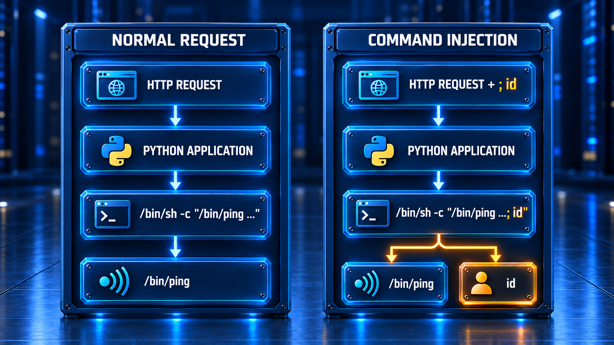

Схема показывает логическую последовательность запуска. Фактическое дерево процессов может выглядеть немного иначе: оболочка вправе заменить себя последней командой с помощью системного вызова `execve`. Мы отдельно проверим это после запуска контейнера.

### Архив лабораторного образа

Для практики подготовлен один намеренно уязвимый образ, загрузим его:

```text
mkdir -p ~/container-security-lab/scenarios/01-command-injection
cd ~/container-security-lab/scenarios/01-command-injection

curl --fail --location --remote-name \
  'https://raw.githubusercontent.com/Scrocisss/Statiya-bezop_kont/main/scenarios/practice-01-command-injection_1.0_linux-amd64/practice-01-command-injection_1.0_linux-amd64.tar.gz'
curl --fail --location --remote-name \
  'https://raw.githubusercontent.com/Scrocisss/Statiya-bezop_kont/main/scenarios/practice-01-command-injection_1.0_linux-amd64/practice-01-command-injection_1.0_linux-amd64.tar.gz.sha256'
```

Вместе с архивом опубликован файл:

```text
practice-01-command-injection_1.0_linux-amd64.tar.gz.sha256
```

Проверим целостность загрузки:

```bash
sha256sum --check \
practice-01-command-injection_1.0_linux-amd64.tar.gz.sha256
```

Ожидаемый результат:

```text
practice-01-command-injection_1.0_linux-amd64.tar.gz: OK
```

Контрольная сумма проверенного архива:

```text
0742be51e7a095ed494836fa223b79cc7b8d709637f8c75976f18759d1e13eb2
```

Если проверка завершилась ошибкой, использовать архив нельзя, его следует скачать заново. Контрольная сумма подтверждает целостность файла, но не заменяет доверенный канал публикации. Архив и значение суммы должны быть получены из официального репозитория статьи.

Загрузим образ в локальное хранилище Docker. Команда [`docker image load`](https://docs.docker.com/reference/cli/docker/image/load/) принимает в том числе архивы, сжатые программой `gzip`, поэтому предварительно распаковывать файл не нужно.

```bash
sudo docker image load \
  --input practice-01-command-injection_1.0_linux-amd64.tar.gz
```

Docker должен вывести имя загруженного образа:

```text
Loaded image: container-security-lab/command-injection:1.0-vulnerable
```

Убедимся, что образ появился в локальном хранилище:

```bash
sudo docker image inspect \
  container-security-lab/command-injection:1.0-vulnerable \
  --format 'id={{.Id}} arch={{.Architecture}} user={{.Config.User}} size={{.Size}}'
```

Для проверенного архива команда возвращает:

```text
id=sha256:542031d831bdcc311e6e4cd825960a3c50f3ad473a90c66b34a1d6817c836f52 arch=amd64 user=10001:10001 size=45157282
```

Поле `user` показывает, что процесс приложения по умолчанию запускается не от имени суперпользователя, а с идентификаторами пользователя и группы `10001`. Это не устраняет командную инъекцию, но ограничивает полномочия выполненной команды.

### Где находится уязвимость

Полный исходный код приложения будет опубликован рядом с архивом. Для понимания уязвимости достаточно рассмотреть функцию, которая запускает `ping`:

```python
def check_host(host: str) -> dict:
    command = f"/bin/ping -c 1 -W 1 {host}"
    result = subprocess.run(
        command,
        shell=True,
        executable="/bin/sh",
        capture_output=True,
        text=True,
        timeout=4,
        env={"PATH": "/usr/local/bin:/usr/bin:/bin"},
        check=False,
    )
```

Параметр `host` поступает из HTTP-запроса. Форматированная строка помещает его непосредственно в команду, а `shell=True` передаёт полученный текст оболочке. Поэтому символы `;`, `|`, `&&`, перенаправления и подстановки команд интерпретируются не как часть адреса, а как синтаксис оболочки.

Ограничение длины входной строки и четырёхсекундный предел выполнения уменьшают возможность злоупотребления ресурсами, но не исправляют командную инъекцию. Причина уязвимости заключается в смешивании данных с командой, а не в длине введённого значения.

В рамках статьи исправлять исходный код приложения не будем. Этот сценарий нужен как контролируемая точка первоначального доступа, с его помощью мы воспроизведём выполнение команды, изучим дерево процессов и построим правило обнаружения. Способы безопасной разработки веб-приложений выходят за границы статьи.

Теперь из проекта нужно создать и запустить контейнер. Такие параметры, как публикация сетевого порта, ограничения памяти, доступные привилегии и режим файловой системы, не записываются в архив как обязательные настройки хоста. Их задаёт пользователь при каждом создании контейнера.

Для воспроизводимого запуска сохраним эти параметры в файле `compose.yaml`. Сам образ при этом не изменяется и повторно загружать его в репозиторий не требуется.

Перейдём в созданный ранее каталог сценария и откроем новый файл:

```bash
cd ~/container-security-lab/scenarios/01-command-injection
vim compose.yaml
```

Добавим следующую конфигурацию:

```yaml
name: container-security-command-injection

services:
  application:
    image: container-security-lab/command-injection:1.0-vulnerable
    pull_policy: never
    container_name: lab-command-injection
    init: true
    user: "10001:10001"
    ports:
      - "0.0.0.0:8080:8080"
    read_only: true
    tmpfs:
      - /tmp:rw,noexec,nosuid,nodev,size=16m
    cap_drop:
      - ALL
    security_opt:
      - no-new-privileges:true
    pids_limit: 64
    mem_limit: 128m
    cpus: 0.50
    healthcheck:
      test:
        - CMD
        - python
        - -c
        - >-
          import urllib.request;
          urllib.request.urlopen('http://127.0.0.1:8080/health', timeout=2)
      interval: 5s
      timeout: 3s
      retries: 10
      start_period: 5s
    logging:
      driver: json-file
      options:
        max-size: 10m
        max-file: "2"
```

Приложение внутри образа уже слушает адрес `0.0.0.0:8080`. Раздел `ports` публикует этот порт на всех сетевых интерфейсах виртуальной машины, поэтому открыть сервис можно и с основной ОС. Адрес `0.0.0.0` используется только для привязки сокета. В браузере или `curl` вместо него нужно указывать настоящий адрес виртуальной машины, например `http://192.168.0.69:8080`.

Мы намеренно открываем сетевой доступ к уязвимому приложению. Виртуальная машина должна находиться в отдельной лабораторной сети и не должна принимать соединения из интернета или рабочей локальной сети.

Остальные параметры ограничивают последствия эксплуатации:

- `pull_policy: never` запрещает Docker искать образ во внешнем реестре. Будет использован именно образ, загруженный из проверенного архива.
- `init: true` добавляет небольшой начальный процесс, который корректно передаёт сигналы приложению и забирает завершившиеся дочерние процессы.
- `user: "10001:10001"` явно закрепляет непривилегированного пользователя и группу.
- `read_only: true` запрещает запись в корневую файловую систему контейнера.
- `tmpfs` предоставляет приложению временный каталог `/tmp`, но ограничивает его размер и запрещает запуск размещённых в нём файлов.
- `cap_drop: ALL` удаляет все привилегии Linux, которые Docker обычно оставляет контейнеру.
- `no-new-privileges:true` запрещает дочерним процессам получать дополнительные полномочия через исполняемые файлы.
- `pids_limit`, `mem_limit` и `cpus` ограничивают количество процессов, оперативную память и процессорное время.
- `healthcheck` проверяет HTTP-адрес `/health` изнутри контейнера.
- Ограничение журнала не позволяет отладочному выводу бесконтрольно занимать место на диске.

Контейнер не получает каталогов и устройств хоста, сокета Docker, дополнительных привилегий или пространств имён хоста. Таким образом, в этой практике мы исследуем выполнение команды внутри контейнера, а не выход из него.

### Запуск приложения

Сначала с помощью Docker Compose проверим структуру файла. При успешной проверке команда ничего не выводит:

```bash
sudo docker compose config --quiet
```

Запустим контейнер и дождёмся успешной проверки работоспособности:

```bash
sudo docker compose up --detach --wait
sudo docker compose ps
```

Ожидаемый результат:

```text
NAME                    IMAGE                                                     STATUS             PORTS
lab-command-injection   container-security-lab/command-injection:1.0-vulnerable   Up ... (healthy)   0.0.0.0:8080->8080/tcp
```

С физического компьютера проверим только служебный обработчик, подставив найденный адрес виртуальной машины:

```bash
http://<адрес_виртуальной_машины>:8080/health
```

Приложение должно ответить:

```json
{
  "status": "ok",
  "variant": "vulnerable"
}
```

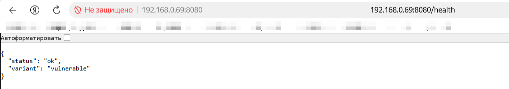

### Штатный запрос

Сначала зафиксируем нормальное поведение приложения. Все запросы можно выполнять как из виртуальной машины через `127.0.0.1`, так и с физического компьютера через её лабораторный адрес. Для единообразия следующие команды выполняются внутри основной ОС.

С основной ОС необходимо открыть следующую URI:

```bash
http://192.168.0.69:8080/ping?host=127.0.0.1
```

Приложение возвращает полученное значение, сформированную команду, код завершения и вывод `ping`:

```json
{
  "variant": "vulnerable",
  "input": "127.0.0.1",
  "command": "/bin/ping -c 1 -W 1 127.0.0.1",
  "returncode": 0,
  "stdout": "PING 127.0.0.1 (127.0.0.1): 56 data bytes\n64 bytes from 127.0.0.1: seq=0 ttl=42 time=0.077 ms\n\n--- 127.0.0.1 ping statistics ---\n1 packets transmitted, 1 packets received, 0% packet loss\nround-trip min/avg/max = 0.077/0.077/0.077 ms\n",
  "stderr": ""
}
```

Этот запрос станет отрицательным тестом для будущего правила, так как нормальная проверка доступности адреса не должна считаться успешной эксплуатацией.

### Воспроизведение командной инъекции

Теперь после адреса передадим разделитель команд `;` и безопасную диагностическую команду `id`. Можно использовать curl:

```bash
curl --fail --silent --show-error \
  --get \
  --data-urlencode 'host=127.0.0.1; id' \
  'http://127.0.0.1:8080/ping' | jq
```

Или просто дописать параметр в ссылке:

```text
http://192.168.0.69:8080/ping?host=127.0.0.1;id
```

`curl` кодирует специальные символы для передачи по HTTP. После разбора запроса приложение снова получает исходную строку `127.0.0.1; id` и без проверки помещает её в команду:

```text
/bin/ping -c 1 -W 1 127.0.0.1; id
```

В ответе появляется результат второй команды:

```json
{
  "variant": "vulnerable",
  "input": "127.0.0.1;id",
  "command": "/bin/ping -c 1 -W 1 127.0.0.1;id",
  "returncode": 0,
  "stdout": "PING 127.0.0.1 (127.0.0.1): 56 data bytes\n64 bytes from 127.0.0.1: seq=0 ttl=42 time=0.097 ms\n\n--- 127.0.0.1 ping statistics ---\n1 packets transmitted, 1 packets received, 0% packet loss\nround-trip min/avg/max = 0.097/0.097/0.097 ms\nuid=10001(lab) gid=10001(lab) groups=10001(lab)\n",
  "stderr": ""
}
```

Строка с `uid=10001` подтверждает выполнение добавленной команды. Одновременно она показывает границу результата, команда выполняется от имени пользователя приложения внутри контейнера.

Процесс `sh` можно не успеть увидеть, хотя приложение явно запускает `/bin/sh`. Оболочка BusyBox выполняет первую команду, а затем может заменить себя последней внешней командой с помощью системного вызова `execve`. Идентификатор процесса при этом сохраняется, но его имя и исполняемый файл меняются. В результате `sleep` или `id` могут выглядеть непосредственными потомками Python.

Это важно для обнаружения, условие, требующее, чтобы непосредственным родителем подозрительной команды обязательно была оболочка, пропустит часть вариантов эксплуатации.

Взглянем, что события действительно доходят в Elastic, значит мы правильно настроили лабораторный стенд

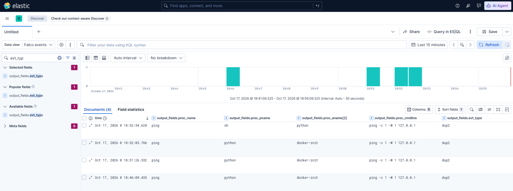

### Получение исходной телеметрии Falco

Стандартные правила Falco предназначены для широкого набора сред и не обязаны считать каждый дочерний процесс конкретного приложения атакой. Отсутствие уведомления после запроса ещё не означает, что Falco не получил системный вызов. Оно означает лишь, что событие не удовлетворило условиям загруженных правил.

Сначала проверим стандартные уведомления, относящиеся к контейнеру:

```bash
sudo journalctl \
  -u falco-modern-bpf.service \
  --since '5 minutes ago' \
  --output=cat \
  --no-pager | \
  grep -F 'lab-command-injection'
```

Команда может ничего не вывести. Для построения собственного правила сначала соберём процессы, возникающие только в исследуемой цепочке. Это будет временное правило наблюдения, а не готовый признак атаки.

В конфигурации стенда используется режим `rule_matching: first`: Falco прекращает проверку после первого совпавшего правила. Для лабораторного сравнения включим проверку всех подходящих правил, чтобы стандартное правило не могло скрыть наше пользовательское правило для того же события.

Создадим отдельный файл конфигурации:

```bash
sudo vim /etc/falco/config.d/98-lab-rule-matching.yaml
```

Его содержимое:

```yaml
rule_matching: all
```

Такой режим требует больше вычислений, поэтому в промышленной среде его включают только после оценки нагрузки. Для небольшого лабораторного стенда он позволяет видеть все совпадения и сравнивать правила независимо друг от друга.

Теперь создадим временное правило:

```bash
sudo vim /etc/falco/rules.d/01-command-injection-observe.yaml
```

```yaml
- list: lab_command_injection_application_processes
  items: [python, python3]

- list: lab_command_injection_shell_processes
  items: [sh, ash, bash, dash]

- rule: Laboratory command injection process observation
  desc: >
    Records processes started by the deliberately vulnerable laboratory
    application or by its command shell. This rule is intended for observation,
    not for use as a final attack detection.
  condition: >
    evt.type in (execve, execveat)
    and container.id != host
    and container.name = "lab-command-injection"
    and (
      proc.pname in (
        lab_command_injection_application_processes,
        lab_command_injection_shell_processes
      )
      or proc.aname[2] in (lab_command_injection_application_processes)
    )
  output: >
    Laboratory application started a process |
    evt_type=%evt.type user=%user.name user_uid=%user.uid
    process=%proc.name proc_exepath=%proc.exepath
    parent=%proc.pname grandparent=%proc.aname[2]
    command=%proc.cmdline terminal=%proc.tty
    container_id=%container.id container_name=%container.name
    container_image=%container.image.repository
    container_tag=%container.image.tag
  priority: NOTICE
  tags:
    - container
    - process
    - lab_observation
    - mitre_execution
    - T1059.004
```

Ограничение по имени контейнера здесь допустимо, потому что правило предназначено только для наблюдения в известном лабораторном сценарии. Условие учитывает как непосредственного родителя, так и процесс уровнем выше. Это позволяет увидеть команду и в случае создания отдельного дочернего процесса, и в случае замены оболочки через `execve`.

Проверим конфигурацию до перезапуска Falco:

```bash
sudo falco --dry-run
```

При успешной проверке файлы `98-lab-rule-matching.yaml` и `01-command-injection-observe.yaml` должны получить отметку `schema validation: ok`, а команда должна завершиться с кодом `0`. Проверить код завершения можно сразу после неё:

```bash
echo $?
```

Если выведено `0`, перезапустим службу и убедимся, что она работает:

```bash
sudo systemctl restart falco-modern-bpf.service
sudo systemctl --no-pager --full \
  status falco-modern-bpf.service
```

### Сравнение штатного и атакующего запросов

Зафиксируем время начала проверки и повторим штатный запрос:

```bash
http://192.168.0.69:8080/ping?host=127.0.0.1
```

Затем повторим командную инъекцию:

```bash
http://192.168.0.69:8080/ping?host=127.0.0.1;id
```

Выведем только уведомления временного правила и только поля, необходимые для сравнения процессов:

```bash
sudo journalctl \
  -u falco-modern-bpf.service \
  --since "$LAB_OBSERVE_START" \
  --output=cat \
  --no-pager | \
  jq --raw-input --raw-output '
    fromjson?
    | select(.rule == "Laboratory command injection process observation")
    | [
        .time,
        .output_fields["proc.name"],
        .output_fields["proc.pname"],
        .output_fields["proc.aname[2]"],
        .output_fields["proc.cmdline"],
        .output_fields["user.uid"],
        .output_fields["container.name"]
      ]
    | @tsv
  '
```

<details>
<summary>Развернуть вывод команды</summary>

  ```bash
2026-10-17T17:14:28.539974230Z  sh      python  docker-init     sh -c /bin/ping -c 1 -W 1 127.0.0.1    10001   lab-command-injection
2026-10-17T17:14:28.541942203Z  ping    python  docker-init     ping -c 1 -W 1 127.0.0.1       10001   lab-command-injection
2026-10-17T17:14:32.124928183Z  sh      python  docker-init     sh -c /bin/ping -c 1 -W 1 127.0.0.1;id 10001   lab-command-injection
2026-10-17T17:14:32.126252938Z  ping    sh      python  ping -c 1 -W 1 127.0.0.1       10001   lab-command-injection
2026-10-17T17:14:32.127886318Z  id      python  docker-init     id      10001 lab-command-injection
```

</details>

В последовательности штатного запроса должны присутствовать оболочка и `ping`. При атакующем запросе к ним добавляется `id`. Точные значения родителя и процесса уровнем выше зависят от того, создала ли оболочка новый процесс или заменила себя через `execve`, именно поэтому мы сначала собираем фактическую телеметрию.

### Проверка доставки в Elasticsearch и Kibana

Falco отправляет каждое срабатывание временного правила в Falcosidekick, а тот сохраняет его в индексе `falco-*`. Доставка выполняется асинхронно, поэтому после запросов документ может появиться с небольшой задержкой.

Получим последние документы за 15 минут:

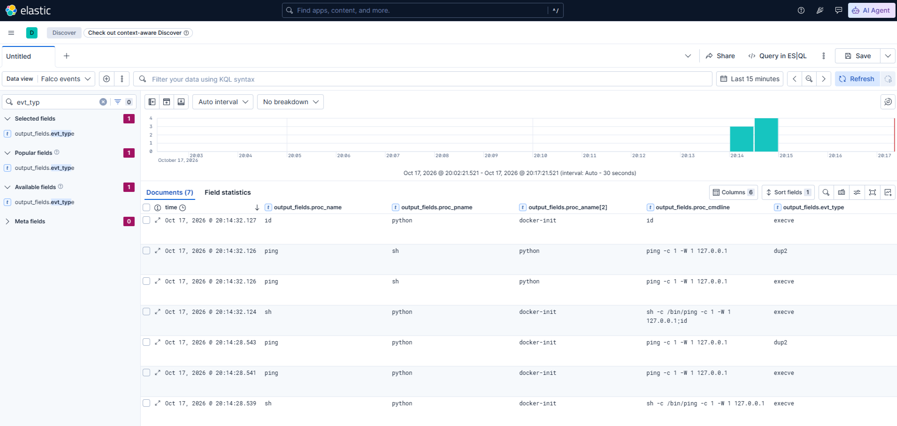

Falco зафиксировал системный вызов execve, с помощью которого уязвимое приложение запустило команду id. Процесс выполнялся без терминала от имени пользователя приложения внутри контейнера. Непосредственным родителем стал Python, поскольку оболочка заменила себя запускаемой программой.  

<details>
<summary>Развернуть событие</summary>

  ```bash
{
  "_index": "falco-2026.10.17",
  "_id": "QELbSqEBABcwyyR9q0ON",
  "_version": 1,
  "_source": {
    "uuid": "27cd68b6-2a10-43d6-826a-f20c68b04407",
    "output": "17:14:32.127886318: Notice Laboratory application started a process | evt_type=execve user=lab user_uid=10001 process=id proc_exepath=/bin/busybox parent=python grandparent=docker-init command=id terminal=0 container_id=4f5218a5673a container_name=lab-command-injection container_image=container-security-lab/command-injection container_tag=1.0-vulnerable container_id=4f5218a5673a container_name=lab-command-injection container_image_repository=container-security-lab/command-injection container_image_tag=1.0-vulnerable k8s_pod_name=<NA> k8s_ns_name=<NA>",
    "priority": "Notice",
    "rule": "Laboratory command injection process observation",
    "time": "2026-10-17T17:14:32.127886318Z",
    "output_fields": {
      "container_id": "4f5218a5673a",
      "container_image_repository": "container-security-lab/command-injection",
      "container_image_tag": "1.0-vulnerable",
      "container_name": "lab-command-injection",
      "evt_time": 1792257272127886300,
      "evt_type": "execve",
      "k8s_ns_name": null,
      "k8s_pod_name": null,
      "proc_aname[2]": "docker-init",
      "proc_cmdline": "id",
      "proc_exepath": "/bin/busybox",
      "proc_name": "id",
      "proc_pname": "python",
      "proc_tty": 0,
      "user_name": "lab",
      "user_uid": 10001
    },
    "source": "syscall",
    "tags": [
      "T1059.004",
      "container",
      "lab_observation",
      "mitre_execution",
      "process"
    ],
    "hostname": "scrockcontainers",
    "@timestamp": "2026-10-17T17:14:32.127886318Z"
  },
  "fields": {
    "output_fields.container_name.keyword": [
      "lab-command-injection"
    ],
    "output_fields.proc_name": [
      "id"
    ],
    "output_fields.container_image_tag.keyword": [
      "1.0-vulnerable"
    ],
    "output_fields.proc_tty.keyword": [
      "0"
    ],
    "tags.keyword": [
      "T1059.004",
      "container",
      "lab_observation",
      "mitre_execution",
      "process"
    ],
    "output_fields.proc_aname[2]": [
      "docker-init"
    ],
    "rule": [
      "Laboratory command injection process observation"
    ],
    "output_fields.evt_time": [
      1792257272127886300
    ],
    "uuid.keyword": [
      "27cd68b6-2a10-43d6-826a-f20c68b04407"
    ],
    "output_fields.proc_pname": [
      "python"
    ],
    "source": [
      "syscall"
    ],
    "output_fields.evt_type.keyword": [
      "execve"
    ],
    "output_fields.proc_exepath": [
      "/bin/busybox"
    ],
    "uuid": [
      "27cd68b6-2a10-43d6-826a-f20c68b04407"
    ],
    "output_fields.proc_aname[2].keyword": [
      "docker-init"
    ],
    "output": [
      "17:14:32.127886318: Notice Laboratory application started a process | evt_type=execve user=lab user_uid=10001 process=id proc_exepath=/bin/busybox parent=python grandparent=docker-init command=id terminal=0 container_id=4f5218a5673a container_name=lab-command-injection container_image=container-security-lab/command-injection container_tag=1.0-vulnerable container_id=4f5218a5673a container_name=lab-command-injection container_image_repository=container-security-lab/command-injection container_image_tag=1.0-vulnerable k8s_pod_name=<NA> k8s_ns_name=<NA>"
    ],
    "output_fields.proc_exepath.keyword": [
      "/bin/busybox"
    ],
    "output_fields.user_uid.keyword": [
      "10001"
    ],
    "hostname": [
      "scrockcontainers"
    ],
    "output_fields.container_image_repository": [
      "container-security-lab/command-injection"
    ],
    "output_fields.container_id.keyword": [
      "4f5218a5673a"
    ],
    "output_fields.container_image_repository.keyword": [
      "container-security-lab/command-injection"
    ],
    "output_fields.proc_cmdline": [
      "id"
    ],
    "output_fields.container_name": [
      "lab-command-injection"
    ],
    "output_fields.proc_pname.keyword": [
      "python"
    ],
    "source.keyword": [
      "syscall"
    ],
    "output_fields.proc_cmdline.keyword": [
      "id"
    ],
    "priority.keyword": [
      "Notice"
    ],
    "output_fields.proc_tty": [
      "0"
    ],
    "output_fields.container_image_tag": [
      "1.0-vulnerable"
    ],
    "output_fields.evt_type": [
      "execve"
    ],
    "output_fields.user_uid": [
      "10001"
    ],
    "output.keyword": [
      "17:14:32.127886318: Notice Laboratory application started a process | evt_type=execve user=lab user_uid=10001 process=id proc_exepath=/bin/busybox parent=python grandparent=docker-init command=id terminal=0 container_id=4f5218a5673a container_name=lab-command-injection container_image=container-security-lab/command-injection container_tag=1.0-vulnerable container_id=4f5218a5673a container_name=lab-command-injection container_image_repository=container-security-lab/command-injection container_image_tag=1.0-vulnerable k8s_pod_name=<NA> k8s_ns_name=<NA>"
    ],
    "priority": [
      "Notice"
    ],
    "tags": [
      "T1059.004",
      "container",
      "lab_observation",
      "mitre_execution",
      "process"
    ],
    "output_fields.container_id": [
      "4f5218a5673a"
    ],
    "@timestamp": [
      "2026-10-17T17:14:32.127Z"
    ],
    "output_fields.user_name.keyword": [
      "lab"
    ],
    "output_fields.user_name": [
      "lab"
    ],
    "time": [
      "2026-10-17T17:14:32.127Z"
    ],
    "hostname.keyword": [
      "scrockcontainers"
    ],
    "output_fields.proc_name.keyword": [
      "id"
    ],
    "rule.keyword": [
      "Laboratory command injection process observation"
    ]
  }
}
```

</details>

### Что показало наблюдение

В Kibana появилось уведомление временного правила `Laboratory command injection process observation`. В нём важны не только имя выполненной команды, но и контекст процесса:

```text
rule:          Laboratory command injection process observation
evt_type:      execve
process:       id
parent:        python
grandparent:   docker-init
command:       id
user:          lab
user_uid:      10001
terminal:      0
container:     lab-command-injection
image:         container-security-lab/command-injection:1.0-vulnerable
```

Что это доказывает:

- команда из HTTP-параметра действительно была выполнена;
- выполнение произошло внутри нужного контейнера;
- команда получила права пользователя `lab`, UID `10001`;
- это не административный запуск через `docker exec`;
- полагаться только на наличие оболочки в цепочке нельзя.

Последний вывод особенно важен. В данном событии непосредственным родителем `id` стал процесс `python`, хотя приложение запускает строку через `/bin/sh`. Это не означает, что оболочка не участвовала в выполнении. Она обработала строку `/bin/ping ...; id`, а перед запуском последней команды заменила собственный образ процессом `id` с помощью `execve`. Идентификатор процесса при такой замене сохраняется, поэтому новым непосредственным родителем оказывается Python-приложение.

В других случаях оболочка может создать отдельный дочерний процесс, и тогда цепочка будет выглядеть как `python - sh - команда`. Следовательно, условие вида `proc.pname = sh` пропустит часть атак. Для правила важнее установить происхождение процесса от Python-приложения, а не рассчитывать на неизменную глубину дерева процессов.

Теперь данных достаточно для окончательного правила. Оно должно обнаруживать любой неожиданный исполняемый процесс среди потомков Python-приложения, разрешая штатный `ping`. При этом правило не должно быть привязано только к имени `id`, иначе другая команда обойдёт детект.

### Модель окончательного правила

У приложения очень простое штатное поведение: обработчик запускает оболочку, а та - `ping`. Поэтому для этого конкретного сервиса можно сформулировать ожидаемое множество процессов:

Фактическая глубина дерева может меняться из-за оптимизации оболочки, но набор разрешённых программ остаётся тем же. Появление `id`, `uname`, `cat`, `wget` или другого исполняемого файла среди потомков приложения не требуется функции проверки узла и должно создавать уведомление.

Такой подход представляет собой список разрешённого поведения приложения. Он надёжнее правила, перечисляющего отдельные атакующие команды: список инструментов, которые может выбрать атакующий, практически не ограничен, а штатный набор процессов данного сервиса известен заранее.

Правило будет использовать следующие признаки:

1. Событие относится к запуску нового исполняемого образа - `execve` или `execveat`.
2. Процесс работает в контейнере `lab-command-injection`.
3. Среди его предков присутствует `python` или `python3`.
4. Имя запущенного процесса отсутствует в списке ожидаемых процессов.

Имя контейнера здесь используется для ограничения правила рамками лабораторного приложения. В промышленной среде такое условие обычно заменяют устойчивым признаком рабочей нагрузки, а именно меткой оркестратора, пространством имён, именем сервиса или проверенным набором образов.

### Замена временного правила окончательным

Временное правило выполнило свою задачу, оно позволило увидеть штатную и атакующую последовательности процессов. Оставлять его включённым не следует, иначе каждый обычный запуск `ping` продолжит создавать уведомление.

Сохраним файл, но изменим его расширение. Falco версии 0.45 загружает из каталога правил только файлы с расширением `.yaml` и `.yml`, поэтому копия останется рядом и не будет участвовать в проверке событий.

```bash
sudo mv /etc/falco/rules.d/01-command-injection-observe.yaml /etc/falco/rules.d/01-command-injection-observe.yaml.disabled
```

Создадим файл окончательного правила:

```bash
sudo vim /etc/falco/rules.d/01-command-injection.yaml
```

```yaml
- list: lab_command_injection_application_processes
  items: [python, python3]

- list: lab_command_injection_expected_processes
  items: [ping, sh, ash, bash, dash]

- rule: Unexpected process from laboratory web application
  desc: >
    Detects a process outside the expected allowlist when it is started by
    the deliberately vulnerable Python application in the laboratory container.
  condition: >
    evt.type in (execve, execveat)
    and container.id != host
    and container.name = "lab-command-injection"
    and proc.aname in (lab_command_injection_application_processes)
    and not proc.name in (lab_command_injection_expected_processes)
  output: >
    Unexpected process started by laboratory web application |
    evt_type=%evt.type user=%user.name user_uid=%user.uid
    process=%proc.name proc_exepath=%proc.exepath
    parent=%proc.pname grandparent=%proc.aname[2]
    command=%proc.cmdline terminal=%proc.tty
  priority: WARNING
  tags:
    - container
    - process
    - command_injection
    - mitre_execution
    - T1059.004
```

Поле [`proc.aname`](https://falco.org/docs/reference/rules/supported-fields/) без числового индекса проверяет имена во всей цепочке предков. Поэтому правило не зависит от того, находится ли `python` непосредственно над запущенной командой или между ними сохранился процесс оболочки.

Оболочки `sh`, `ash`, `bash` и `dash` внесены в разрешённый список потому, что текущая уязвимая реализация использует `/bin/sh` даже при штатном запросе. `ping` является единственной внешней программой, которая нужна функции проверки узла. Это разрешение описывает фактическое поведение именно этой версии приложения, а не универсальный список безопасных программ.

В поле `output` намеренно не добавлены сведения о контейнере. В используемой конфигурации Falco параметр `append_output.suggested_output` уже дополняет уведомление полями `container.id`, `container.name`, `container.image.repository` и `container.image.tag`. Если перечислить их ещё раз, текстовое описание будет содержать дубликаты, как это было во временном правиле.

Приоритет `WARNING` выбран потому, что неожиданный дочерний процесс является убедительным признаком нарушения модели приложения, но сам по себе ещё не доказывает выход из контейнера или получение прав на хосте.

Метка [`T1059.004`](https://attack.mitre.org/techniques/T1059/004/) связывает событие с техникой MITRE ATT&CK «Unix Shell». Техника [`T1190`](https://attack.mitre.org/techniques/T1190/) описывает эксплуатацию публично доступного приложения и подходит для контекста всего сценария, но системное событие `execve` само по себе не доказывает, что первоначальный ввод пришёл именно через публичный сетевой интерфейс.

### Проверка синтаксиса и загрузка правила

Сначала проверим все файлы конфигурации и правил без перезапуска работающей службы:

```bash
sudo falco --dry-run
echo $?
```

В выводе файл `/etc/falco/rules.d/01-command-injection.yaml` должен получить отметку `schema validation: ok`, а вторая команда должна вывести `0`. Если Falco сообщает об ошибке, перезапускать службу нельзя, сначала необходимо исправить указанную строку.

После успешной проверки перезапустим Falco и убедимся, что служба работает:

```bash
sudo systemctl restart falco-modern-bpf.service
sudo systemctl --no-pager --full \
  status falco-modern-bpf.service
```

Отдельно проверим, что загружено окончательное, а не временное правило:

```bash
sudo journalctl \
  -u falco-modern-bpf.service \
  --since '2 minutes ago' \
  --no-pager | \
  grep -E '01-command-injection|error|Error|ERROR'
```

В журнале должен присутствовать файл `01-command-injection.yaml`. Файл с окончанием `.yaml.disabled` загружаться не должен. Сообщений об ошибках разбора правила быть не должно.

### Проверка правила на четырёх сценариях

Одного успешного срабатывания недостаточно. Необходимо проверить как обнаружение разных команд, так и отсутствие уведомлений при разрешённой работе и при административном запуске, не связанном с уязвимостью приложения.

Зафиксируем время начала эксперимента:

```bash
LAB_RULE_TEST_START=$(date --iso-8601=seconds)
printf '%s\n' "$LAB_RULE_TEST_START"
```

#### 1. Штатный запрос

Отправим допустимый адрес без дополнительных команд:

```bash
http://192.168.0.69:8080/ping?host=127.0.0.1
```

Приложение запустит оболочку и `ping`. Оба процесса входят в разрешённый список, поэтому окончательное правило не должно сработать.

#### 2. Инъекция с командой `id`

Повторим уже изученный атакующий запрос:

```bash
http://192.168.0.69:8080/ping?host=127.0.0.1;id
```

В HTTP-ответе должен появиться результат `id`, а Falco должен создать уведомление о неожиданном процессе `id`.

#### 3. Инъекция с другой командой

Проверим, что правило не привязано к единственному имени `id`:

```bash
http://192.168.0.69:8080/ping?host=127.0.0.1;whoami
```

Эта команда должна создать второе уведомление - теперь для процесса `whoami`. Если правило обнаруживает только `id`, оно описывает один тестовый пример, а не нежелательное поведение приложения.

#### 4. Административный запуск через `docker exec`

Выполним ту же команду `id` непосредственно через Docker:

```bash
sudo docker exec lab-command-injection id
```

Этот процесс выполняется внутри того же контейнера и от имени того же пользователя, но не является потомком Python-приложения. Окончательное правило не должно создавать для него уведомление. Такая проверка показывает, зачем в условии используется происхождение процесса, а не только сочетание имени контейнера и имени команды.

### Проверка результата в журнале Falco

Выведем срабатывания только окончательного правила, появившиеся после начала проверки:

```bash
sudo journalctl \
  -u falco-modern-bpf.service \
  --since "$LAB_RULE_TEST_START" \
  --output=cat \
  --no-pager | \
  jq --raw-input --raw-output '
    fromjson?
    | select(.rule == "Unexpected process from laboratory web application")
    | [
        .time,
        .output_fields["proc.name"],
        .output_fields["proc.pname"],
        .output_fields["proc.aname[2]"],
        .output_fields["proc.cmdline"],
        .output_fields["user.uid"],
        .output_fields["container.name"]
      ]
    | @tsv
  '
```

<details>
<summary>Развернуть вывод команды</summary>

  ```bash
2026-10-17T18:33:02.813927386Z  id      python  docker-init     id      10001 lab-command-injection
2026-10-17T18:33:13.028352117Z  whoami  python  docker-init     whoami  10001 lab-command-injection
```

</details>


Ожидаются две строки: одна для `id`, вторая для `uname`. Штатный `ping` и команда `id`, запущенная через `docker exec`, в этом выводе появиться не должны.

### Проверка результата в Kibana

Доставка уведомлений через Falcosidekick выполняется асинхронно, поэтому перед поиском дадим Elasticsearch несколько секунд на индексирование документов. Затем откроем в Kibana раздел `Discover`, выберем представление `Falco events` и установим интервал времени, включающий эксперимент.

В строке KQL зададим фильтр:

```text
rule : "Unexpected process from laboratory web application"
and output_fields.container_name : "lab-command-injection"
```

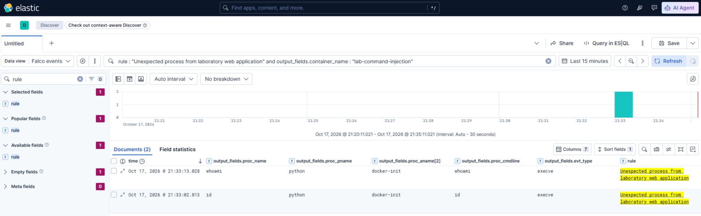

### Границы детекта

Получившееся правило качественно решает задачу лабораторного сценария, но его границы необходимо обозначить явно.

- Правило обнаруживает запуск нового исполняемого файла. Команда, реализованная встроенной функцией оболочки, например `cd`, может не создать отдельного события `execve`.
- Разрешение основано на имени процесса. Если атакующий сможет поместить вредоносную программу под разрешённым именем `ping`, одного этого правила будет недостаточно.
- Изменение приложения может добавить легитимный вспомогательный процесс. Тогда разрешённый список потребуется пересмотреть после анализа нового поведения, а не расширять автоматически.
- Срабатывание подтверждает отклонение от модели процесса, но не доказывает выход из контейнера, закрепление в системе или доступ к данным хоста.
- Условие с именем контейнера подходит для воспроизводимой лаборатории. В динамической промышленной среде идентификацию рабочей нагрузки нужно строить на доступных там устойчивых метаданных.

Эти ограничения не делают правило бесполезным. Они определяют, на какой вопрос оно отвечает: «Запустило ли это веб-приложение программу, которой нет в его штатной модели процессов?» Для наблюдаемой командной инъекции ответ однозначен.


## Практика 2. Изменение файлов хоста через подключённый каталог

### Что исследуем

В первой практике командная инъекция дала атакующему выполнение команд внутри контейнера. Сам контейнер при этом не имел доступа к каталогам хоста, сокету Docker, устройствам или пространствам имён хоста. Команда `id` подтвердила первоначальный доступ, но не показала нарушения контейнерной границы.

Теперь сохраним тот же контролируемый первоначальный доступ и изменим только один параметр запуска: подключим в контейнер каталог хоста с правом записи. Это позволит отделить последствия командной инъекции от последствий небезопасного `bind mount`.

[`Bind mount`](https://docs.docker.com/engine/storage/bind-mounts/) связывает существующий путь хоста с путём внутри контейнера. Оба пути указывают на одни и те же объекты файловой системы. Если контейнер изменяет файл в такой точке монтирования, изменение происходит не в его записываемом слое OverlayFS, а непосредственно в каталоге хоста.

Для эксперимента создадим только специальный лабораторный каталог:

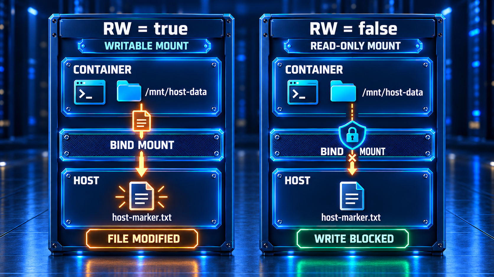

Корневую файловую систему хоста, `/etc`, домашние каталоги пользователей и другие настоящие системные пути подключать не будем. Безопасный маркер позволяет доказать влияние на хост без изменения его рабочей конфигурации.

Причину сценария можно связать с [CWE-732](https://cwe.mitre.org/data/definitions/732.html), критическому ресурсу назначены более широкие права, чем требуется. Доступ ресурса из непредусмотренной области также соответствует [CWE-668](https://cwe.mitre.org/data/definitions/668.html). В MITRE ATT&CK использование подключённой файловой системы хоста рассматривается в контексте техники [T1611 «Escape to Host»](https://attack.mitre.org/techniques/T1611/).

При этом важно не преувеличивать результат. Процесс не покидает пространства имён контейнера и не получает оболочку на хосте. Доступ к файлу хоста возникает потому, что Docker заранее провёл этот ресурс через границу изоляции. В нашей конфигурации воздействие ограничено одним подготовленным каталогом.

### Цель эксперимента

Нужно последовательно доказать четыре утверждения:

1. Контейнер видит лабораторный файл хоста по другому пути.
2. При подключении `read-write` процесс с UID `10001` способен изменить этот файл.
3. Falco фиксирует успешное открытие файла для записи, а уведомление попадает в Elasticsearch и Kibana.
4. После перевода точки монтирования в режим `read-only` тот же запрос завершается ошибкой, а контрольная сумма файла хоста не меняется.

Исходный код приложения исправлять не будем. Командная инъекция остаётся контролируемым способом выполнить действие внутри контейнера, а исправлению подлежит только конфигурация точки монтирования.

### Подготовка отдельного образа

Для сценария подготовлен отдельный архив. Приложение внутри него повторяет уязвимую реализацию из первой практики, но образ имеет собственное имя и метки практики 2. Благодаря этому эксперимент можно выполнить независимо, а события двух контейнеров не будут смешиваться.

Перед началом остановим контейнер первой практики, чтобы освободить порт `8080`. Образ и собранные события при этом сохранятся:

```bash
cd ~/container-security-lab/scenarios/01-command-injection
sudo docker compose down
```

Создадим каталог второго сценария:

```bash
mkdir -p ~/container-security-lab/scenarios/02-writable-bind-mount
cd ~/container-security-lab/scenarios/02-writable-bind-mount
```

После публикации файлов в репозитории загрузим архив и его контрольную сумму:

```bash
curl --fail --location --remote-name 'https://raw.githubusercontent.com/Scrocisss/Statiya-bezop_kont/main/scenarios/practice-02-writable-bind-mount_1.0_linux-amd64/practice-02-writable-bind-mount_1.0_linux-amd64.tar.gz'
curl --fail --location --remote-name 'https://raw.githubusercontent.com/Scrocisss/Statiya-bezop_kont/main/scenarios/practice-02-writable-bind-mount_1.0_linux-amd64/practice-02-writable-bind-mount_1.0_linux-amd64.tar.gz.sha256'
```

Проверим целостность:

```bash
sha256sum --check practice-02-writable-bind-mount_1.0_linux-amd64.tar.gz.sha256
```

Ожидаемый результат:

```text
practice-02-writable-bind-mount_1.0_linux-amd64.tar.gz: OK
```

Контрольная сумма проверенного архива:

```text
80c1dffb09c008504d60f610632c58c4e5b0d21b31b47c2b302c4f8b3dd66b1c
```

Загрузим образ в локальное хранилище Docker:

```bash
sudo docker image load --input practice-02-writable-bind-mount_1.0_linux-amd64.tar.gz
```

Ожидаемое имя образа:

```text
container-security-lab/writable-bind-mount:1.0-vulnerable
```

Проверим архитектуру, пользователя и метки:

```bash
sudo docker image inspect container-security-lab/writable-bind-mount:1.0-vulnerable --format 'id={{.Id}} arch={{.Architecture}} user={{.Config.User}} size={{.Size}} practice={{index .Config.Labels "io.container-security-lab.practice"}} variant={{index .Config.Labels "io.container-security-lab.variant"}}'
```

<details>
<summary>Развернуть вывод команды</summary>

  ```bash
scrock_@scrockcontainers:~/container-security-lab/scenarios/02-writable-bind-mount$ sudo docker image inspect container-security-lab/writable-bind-mount:1.0-vulnerable --format 'id={{.Id}} arch={{.Architecture}} user={{.Config.User}} size={{.Size}} practice={{index .Config.Labels "io.container-security-lab.practice"}} variant={{index .Config.Labels "io.container-security-lab.variant"}}'

id=sha256:cfc663e7ef6022d3f537cfaee3d8d7c372c5c464bea06d2dfad309532f8b729b arch=amd64 user=10001:10001 size=100049432 practice=02 variant=vulnerable
```

</details>

Для проверенного образа значения `arch`, `user`, `practice` и `variant` должны быть равны `amd64`, `10001:10001`, `02` и `vulnerable`. Представление идентификатора образа может отличаться между классическим и containerd-хранилищем Docker, поэтому целостность дистрибутива проверяем по SHA-256 самого архива.

### Подготовка безопасного каталога хоста

Создадим отдельный каталог, который не используется операционной системой или другими приложениями:

```bash
sudo install -d -o 10001 -g 10001 -m 0750 /srv/container-security-lab/practice-02
```

UID и GID `10001` совпадают с пользователем приложения внутри образа. Ядро проверяет права по числовым идентификаторам, а не по текстовым именам пользователей. Поэтому пользователь `lab` внутри контейнера получает права владельца на этот каталог, даже если на хосте для UID `10001` нет записи в `/etc/passwd`.

Создадим контрольный файл:

```bash
sudo vim /srv/container-security-lab/practice-02/host-marker.txt
```

```
owner=host
state=original
```

```bash
sudo chown 10001:10001 /srv/container-security-lab/practice-02/host-marker.txt
sudo chmod 0640 /srv/container-security-lab/practice-02/host-marker.txt
```

Зафиксируем содержимое, права, inode и контрольную сумму до запуска контейнера:

```bash
sudo cat /srv/container-security-lab/practice-02/host-marker.txt
sudo stat --format='inode=%i owner=%U(%u) group=%G(%g) mode=%A(%a) size=%s mtime=%y' /srv/container-security-lab/practice-02/host-marker.txt
sudo sha256sum /srv/container-security-lab/practice-02/host-marker.txt
```

<details>
<summary>Развернуть вывод команды</summary>

  ```bash
scrock_@scrockcontainers:~/container-security-lab/scenarios/02-writable-bind-mount$ sudo cat /srv/container-security-lab/practice-02/host-marker.txt
owner=host
state=original
scrock_@scrockcontainers:~/container-security-lab/scenarios/02-writable-bind-mount$ sudo stat --format='inode=%i owner=%U(%u) group=%G(%g) mode=%A(%a) size=%s mtime=%y' /srv/container-security-lab/practice-02/host-marker.txt
inode=1441797 owner=UNKNOWN(10001) group=UNKNOWN(10001) mode=-rw-r-----(640) size=26 mtime=2026-10-17 19:33:34.661448342 +0000
scrock_@scrockcontainers:~/container-security-lab/scenarios/02-writable-bind-mount$ sudo sha256sum /srv/container-security-lab/practice-02/host-marker.txt
525c7030ae45224b7ef422b9afee3bc4fe559bc463d6dcebfd59d8cad0c77838  /srv/container-security-lab/practice-02/host-marker.txt
```

</details>

Для указанного содержимого контрольная сумма равна:

```text
525c7030ae45224b7ef422b9afee3bc4fe559bc463d6dcebfd59d8cad0c77838
```

Сохранение inode поможет показать, что контейнер изменил тот же объект файловой системы, а не одноимённую копию в собственном слое.

### Уязвимая конфигурация запуска

В каталоге сценария создадим файл:

```bash
vim compose.yaml
```

Поместим в него следующую конфигурацию:

```yaml
name: container-security-writable-bind-mount

services:
  application:
    image: container-security-lab/writable-bind-mount:1.0-vulnerable
    pull_policy: never
    container_name: lab-writable-bind-mount
    init: true
    user: "10001:10001"
    ports:
      - "0.0.0.0:8080:8080"
    read_only: true
    tmpfs:
      - /tmp:rw,noexec,nosuid,nodev,size=16m
    volumes:
      - type: bind
        source: /srv/container-security-lab/practice-02
        target: /mnt/host-data
        read_only: false
        bind:
          propagation: rprivate
    cap_drop:
      - ALL
    security_opt:
      - no-new-privileges:true
    pids_limit: 64
    mem_limit: 128m
    cpus: 0.50
    healthcheck:
      test:
        - CMD
        - python
        - -c
        - >-
          import urllib.request;
          urllib.request.urlopen('http://127.0.0.1:8080/health', timeout=5)
      interval: 10s
      timeout: 8s
      retries: 10
      start_period: 15s
    logging:
      driver: json-file
      options:
        max-size: 10m
        max-file: "2"
```

Здесь присутствуют два разных параметра `read_only`, которые нельзя смешивать:

- `read_only: true` на уровне сервиса делает корневую файловую систему контейнера доступной только для чтения;
- `read_only: false` внутри описания тома оставляет конкретный `bind mount` записываемым.

Таким образом, запрет записи в корневой слой контейнера не защищает подключённый каталог. Точки монтирования имеют собственные параметры доступа и перекрывают каталог в файловой системе образа.

Режим распространения `rprivate` не позволяет событиям монтирования распространяться между этой точкой и другими пространствами монтирования. Он полезен, но не запрещает обычную запись в уже подключённый каталог.

Контейнер по-прежнему работает без дополнительных Linux-привилегий и от непривилегированного UID. Для изменения файла ему не требуются `root` или `CAP_SYS_ADMIN`: достаточно прав на сам объект и записываемой точки монтирования.

### Запуск и проверка точки монтирования

Проверим синтаксис и запустим контейнер:

```bash
sudo docker compose config --quiet
sudo docker compose up --detach --wait
sudo docker compose ps
```

Убедимся, что Docker действительно создал `bind mount` с правом записи:

```bash
sudo docker inspect lab-writable-bind-mount --format '{{json .Mounts}}' | jq
```

В описании нужной точки должны присутствовать значения:

```json
[
  {
    "Type": "bind",
    "Source": "/srv/container-security-lab/practice-02",
    "Destination": "/mnt/host-data",
    "Mode": "",
    "RW": true,
    "Propagation": "rprivate"
  }
]
```

Поле `RW: true` является главным признаком исследуемой конфигурации. Вывод `docker inspect` показывает фактически применённые параметры, тогда как `compose.yaml` показывает только намерение пользователя.

Проверим пользователя приложения и файл со стороны контейнера:

```bash
sudo docker exec lab-writable-bind-mount id
sudo docker exec lab-writable-bind-mount stat -c 'inode=%i uid=%u gid=%g mode=%A size=%s' /mnt/host-data/host-marker.txt
sudo docker exec lab-writable-bind-mount cat /mnt/host-data/host-marker.txt
```

<details>
<summary>Развернуть вывод команды</summary>

  ```bash
scrock_@scrockcontainers:~/container-security-lab/scenarios/02-writable-bind-mount$ sudo docker exec lab-writable-bind-mount id
uid=10001(lab) gid=10001(lab) groups=10001(lab)
scrock_@scrockcontainers:~/container-security-lab/scenarios/02-writable-bind-mount$ sudo docker exec lab-writable-bind-mount stat -c 'inode=%i uid=%u gid=%g mode=%A size=%s' /mnt/host-data/host-marker.txt
inode=1441797 uid=10001 gid=10001 mode=-rw-r----- size=26
scrock_@scrockcontainers:~/container-security-lab/scenarios/02-writable-bind-mount$ sudo docker exec lab-writable-bind-mount cat /mnt/host-data/host-marker.txt
owner=host
state=original
```

</details>

Номер inode внутри контейнера должен совпасть с номером, полученным командой `stat` на хосте. Это прямое подтверждение того, что обе стороны обращаются к одному объекту.

### Штатный запрос

Сначала выполним обычную проверку адреса:

```bash
http://192.168.0.69:8080/ping?host=127.0.0.1
```

После неё файл хоста не должен измениться:

```bash
sudo cat /srv/container-security-lab/practice-02/host-marker.txt
```

<details>
<summary>Развернуть вывод команды</summary>

  ```bash
scrock_@scrockcontainers:~/container-security-lab/scenarios/02-writable-bind-mount$ sudo cat /srv/container-security-lab/practice-02/host-marker.txt
owner=host
state=original
```

</details>

### Чтение файла через подключённый каталог

Сначала посмотрим, способен ли скомпрометированный процесс прочитать ресурс хоста:

```text
http://192.168.0.69:8080/ping?host=127.0.0.1%3B%20cat%20%2Fmnt%2Fhost-data%2Fhost-marker.txt
```

Адрес содержит значение параметра `host`, закодированное по [правилам URL](https://www.rfc-editor.org/rfc/rfc3986.html#section-2.1):

- `%3B` - точка с запятой `;`, разделяющая команды оболочки;
- `%20` - пробел;
- `%2F` - символ `/` в пути к файлу.

После разбора HTTP-запроса приложение декодирует параметр и получает исходную строку:

```text
192.168.0.69; cat /mnt/host-data/host-marker.txt
```

В поле `stdout` после результата `ping` должны появиться строки:

```text
owner=host
state=original
```

Так мы подтверждаем нарушение границы конфиденциальности. Право только на чтение уже может раскрыть конфигурацию, токены, резервные копии или данные другого приложения. Однако основной объект этой практики - изменение файла, поэтому окончательное правило будет контролировать успешную запись.

Команда `cat` является отдельным процессом и может вызвать правило из первой практики. Это полезная корреляция, но она не заменяет файловый детект, запись можно выполнить встроенной командой оболочки без запуска `cat`.

### Изменение файла хоста

Для проверки целостности используем встроенную команду оболочки `printf` и перенаправление `>`:

```bash
http://192.168.0.69:8080/ping?host=127.0.0.1%3B%20printf%20%22owner%3Dhost%5Cnstate%3Dmodified-by-container%5Cn%22%20%3E%20%2Fmnt%2Fhost-data%2Fhost-marker.txt
```

При успешной записи поле `returncode` будет равно `0`, а `stderr` останется пустым. `printf` в BusyBox `sh` является встроенной командой, поэтому для неё может не появиться отдельный процесс `printf`. Файл открывает для записи сама оболочка. Это показывает, почему правила запуска процессов недостаточно для контроля файловой целостности.

Проверим файл непосредственно на хосте:

```bash
sudo cat /srv/container-security-lab/practice-02/host-marker.txt
sudo stat --format='inode=%i owner=%U(%u) group=%G(%g) mode=%A(%a) size=%s mtime=%y' /srv/container-security-lab/practice-02/host-marker.txt
sudo sha256sum /srv/container-security-lab/practice-02/host-marker.txt
```

<details>
<summary>Развернуть вывод команды</summary>

  ```bash
scrock_@scrockcontainers:~/container-security-lab/scenarios/02-writable-bind-mount$ sudo cat /srv/container-security-lab/practice-02/host-marker.txt
owner=host
state=modified-by-container
scrock_@scrockcontainers:~/container-security-lab/scenarios/02-writable-bind-mount$ sudo stat --format='inode=%i owner=%U(%u) group=%G(%g) mode=%A(%a) size=%s mtime=%y' /srv/container-security-lab/practice-02/host-marker.txt
inode=1441797 owner=UNKNOWN(10001) group=UNKNOWN(10001) mode=-rw-r-----(640) size=39 mtime=2026-10-17 21:28:17.445514933 +0000
```

</details>

Ожидаемое содержимое:

```text
owner=host
state=modified-by-container
```

Если inode остался прежним, а содержимое, размер, время изменения и контрольная сумма поменялись, контейнер действительно перезаписал исходный объект хоста.

### Что уже доказано

К этому моменту можно сделать три вывода:

- непривилегированный процесс контейнера изменил файл, физически расположенный на хосте;
- `read_only: true` для корневой файловой системы контейнера не защитил отдельный записываемый `bind mount`;
- для воздействия не понадобились дополнительные capabilities, привилегированный режим или эксплуатация ядра.

Это не случайное свойство уязвимого образа. Docker по умолчанию предоставляет bind mount на чтение и запись, если пользователь явно не выбрал режим `read-only`.

### Получение файловой телеметрии Falco

Сначала посмотрим, создало ли одно из стандартных правил уведомление о нашем файле:

```bash
sudo journalctl -u falco-modern-bpf.service --since '5 minutes ago' --output=cat --no-pager | grep -F '/mnt/host-data'
```

Команда может ничего не вывести. Произвольный каталог приложения не является универсально опасным путём: многие контейнеры штатно записывают данные в подключённые тома. Контекст о том, что именно этот каталог должен быть доступен контейнеру только для чтения, известен владельцу приложения, но неизвестен стандартному набору правил Falco.

Как и в первой практике, сначала создадим широкое временное правило наблюдения. Оно покажет фактический тип события, путь, процесс и флаги открытия файла на нашем стенде.

```bash
sudo vim /etc/falco/rules.d/02-writable-bind-mount-observe.yaml
```

Содержимое файла:

```yaml
- rule: Laboratory container file write observation
  desc: >
    Records successful file opens for writing in the writable bind mount
    laboratory container. This is an observation rule, not a final detection.
  condition: >
    evt.type in (open, openat, openat2)
    and evt.dir=<
    and evt.is_open_write=true
    and fd.typechar='f'
    and evt.rawres>=0
    and container.id != host
    and container.name = "lab-writable-bind-mount"
  output: >
    Laboratory container opened a file for writing |
    evt_type=%evt.type result=%evt.res raw_result=%evt.rawres
    file=%fd.name directory=%fd.directory flags=%evt.arg.flags
    process=%proc.name proc_exepath=%proc.exepath
    parent=%proc.pname command=%proc.cmdline
    user=%user.name user_uid=%user.uid
  priority: NOTICE
  tags:
    - container
    - filesystem
    - lab_observation
    - mitre_privilege_escalation
    - T1611
```

Поле [`evt.is_open_write`](https://falco.org/docs/rules/supported-fields/) истинно для событий `open`, `openat` и `openat2`, когда файл открывается с возможностью записи. Условие `evt.dir=<` выбирает событие выхода из системного вызова, когда уже известен его результат. Проверка `evt.rawres>=0` оставляет только успешные открытия, а `fd.typechar='f'` исключает каталоги, сокеты и другие типы дескрипторов.

На этом этапе путь намеренно не ограничен `/mnt/host-data`. Сначала необходимо подтвердить, в каком виде Falco показывает путь bind mount в фактическом событии. После этого сузим окончательное правило.

Проверим конфигурацию и перезапустим Falco:

```bash
sudo falco --dry-run
echo $?
sudo systemctl restart falco-modern-bpf.service
sudo systemctl --no-pager --full status falco-modern-bpf.service
```

Файл правила должен получить отметку `schema validation: ok`, код завершения должен быть равен `0`, а служба - перейти в состояние `active (running)`.

### Повторная запись под наблюдением

С хоста вернём маркер в исходное состояние:

```bash
sudo vim /srv/container-security-lab/practice-02/host-marker.txt
```

```text
owner=host
state=original
```

```bash
sudo chown 10001:10001 /srv/container-security-lab/practice-02/host-marker.txt
sudo chmod 0640 /srv/container-security-lab/practice-02/host-marker.txt
```

Повторим штатный и атакующий запросы:

```bash
http://192.168.0.69:8080/ping?host=127.0.0.1
http://192.168.0.69:8080/ping?host=127.0.0.1%3B%20printf%20%22owner%3Dhost%5Cnstate%3Dmodified-by-container%5Cn%22%20%3E%20%2Fmnt%2Fhost-data%2Fhost-marker.txt
```

Выведем события временного правила:

```bash
sudo journalctl -u falco-modern-bpf.service --output=cat --no-pager | jq --raw-input --raw-output '
    fromjson?
    | select(.rule == "Laboratory container file write observation")
    | [
        .time,
        .output_fields["evt.type"],
        .output_fields["evt.res"],
        .output_fields["fd.name"],
        .output_fields["evt.arg.flags"],
        .output_fields["proc.name"],
        .output_fields["proc.pname"],
        .output_fields["proc.cmdline"],
        .output_fields["user.uid"],
        .output_fields["container.name"]
      ]
    | @tsv
  '
```

<details>
<summary>Развернуть вывод команды</summary>

  ```bash
scrock_@scrockcontainers:~/container-security-lab/scenarios/02-writable-bind-mount$ sudo journalctl -u falco-modern-bpf.service --output=cat --no-pager | jq --raw-input --raw-output '
    fromjson?
    | select(.rule == "Laboratory container file write observation")
    | [
        .time,
        .output_fields["evt.type"],
        .output_fields["evt.res"],
        .output_fields["fd.name"],
        .output_fields["evt.arg.flags"],
        .output_fields["proc.name"],
        .output_fields["proc.pname"],
        .output_fields["proc.cmdline"],
        .output_fields["user.uid"],
        .output_fields["container.name"]
      ]
    | @tsv
  '
2026-10-17T21:31:46.330357743Z  openat  SUCCESS /proc/self/oom_score_adj      O_RDWR   6       runc    6 init  0       lab-writable-bind-mount
2026-10-17T21:31:46.779147553Z  openat  SUCCESS <UNKNOWN>thread-self/fd/8     O_WRONLY|O_CLOEXEC       runc:[1:CHILD]  runc    runc:[1:CHILD] init     10001 lab-writable-bind-mount
2026-10-17T21:32:23.918655254Z  openat  SUCCESS /proc/self/oom_score_adj      O_RDWR   6       runc    6 init  0       lab-writable-bind-mount
2026-10-17T21:32:24.650880203Z  openat  SUCCESS <UNKNOWN>thread-self/fd/8     O_WRONLY|O_CLOEXEC       runc:[1:CHILD]  runc    runc:[1:CHILD] init     10001 lab-writable-bind-mount
2026-10-17T21:32:42.787964093Z  openat  SUCCESS /proc/self/oom_score_adj      O_RDWR   6       runc    6 init  0       lab-writable-bind-mount
2026-10-17T21:32:43.247479324Z  openat  SUCCESS <UNKNOWN>thread-self/fd/8     O_WRONLY|O_CLOEXEC       runc:[1:CHILD]  runc    runc:[1:CHILD] init     10001 lab-writable-bind-mount
2026-10-17T21:33:00.064266600Z  openat  SUCCESS /proc/self/oom_score_adj      O_RDWR   6       runc    6 init  0       lab-writable-bind-mount
2026-10-17T21:33:00.486973737Z  openat  SUCCESS <UNKNOWN>thread-self/fd/8     O_WRONLY|O_CLOEXEC       runc:[1:CHILD]  runc    runc:[1:CHILD] init     10001 lab-writable-bind-mount
2026-10-17T21:33:18.212827451Z  openat  SUCCESS /proc/self/oom_score_adj      O_RDWR   6       runc    6 init  0       lab-writable-bind-mount
2026-10-17T21:33:18.370766819Z  openat  SUCCESS <UNKNOWN>thread-self/fd/8     O_WRONLY|O_CLOEXEC       runc:[1:CHILD]  runc    runc:[1:CHILD] init     10001 lab-writable-bind-mount
2026-10-17T21:33:36.156484846Z  openat  SUCCESS /proc/self/oom_score_adj      O_RDWR   6       runc    6 init  0       lab-writable-bind-mount
2026-10-17T21:33:36.362242288Z  openat  SUCCESS <UNKNOWN>thread-self/fd/8     O_WRONLY|O_CLOEXEC       runc:[1:CHILD]  runc    runc:[1:CHILD] init     10001 lab-writable-bind-mount
2026-10-17T21:33:53.472271193Z  openat  SUCCESS /proc/self/oom_score_adj      O_RDWR   6       runc    6 init  0       lab-writable-bind-mount
2026-10-17T21:33:53.858789165Z  openat  SUCCESS <UNKNOWN>thread-self/fd/8     O_WRONLY|O_CLOEXEC       runc:[1:CHILD]  runc    runc:[1:CHILD] init     10001 lab-writable-bind-mount
2026-10-17T21:34:12.814068760Z  openat  SUCCESS /proc/self/oom_score_adj      O_RDWR   6       runc    6 init  0       lab-writable-bind-mount
2026-10-17T21:34:13.262282424Z  openat  SUCCESS <UNKNOWN>thread-self/fd/8     O_WRONLY|O_CLOEXEC       runc:[1:CHILD]  runc    runc:[1:CHILD] init     10001 lab-writable-bind-mount
2026-10-17T21:34:27.746806745Z  openat  SUCCESS /proc/self/oom_score_adj      O_RDWR   6       runc    6 init  0       lab-writable-bind-mount
2026-10-17T21:34:27.959567139Z  openat  SUCCESS <UNKNOWN>thread-self/fd/8     O_WRONLY|O_CLOEXEC       runc:[1:CHILD]  runc    runc:[1:CHILD] init     10001 lab-writable-bind-mount
2026-10-17T21:34:44.586623421Z  openat  SUCCESS /proc/self/oom_score_adj      O_RDWR   6       runc    6 init  0       lab-writable-bind-mount
2026-10-17T21:34:44.872176867Z  openat  SUCCESS <UNKNOWN>thread-self/fd/8     O_WRONLY|O_CLOEXEC       runc:[1:CHILD]  runc    runc:[1:CHILD] init     10001 lab-writable-bind-mount
2026-10-17T21:34:54.201268872Z  open    SUCCESS /mnt/host-data/host-marker.txtO_LARGEFILE|O_TRUNC|O_CREAT|O_WRONLY     sh      python  sh -c /bin/ping -c 1 -W 1 127.0.0.1; printf "owner=host\\nstate=modified-by-container\\n" > /mnt/host-data/host-marker.txt    10001   lab-writable-bind-mount
2026-10-17T21:35:02.259244408Z  openat  SUCCESS /proc/self/oom_score_adj      O_RDWR   6       runc    6 init  0       lab-writable-bind-mount
2026-10-17T21:35:02.747533120Z  openat  SUCCESS <UNKNOWN>thread-self/fd/8     O_WRONLY|O_CLOEXEC       runc:[1:CHILD]  runc    runc:[1:CHILD] init     10001 lab-writable-bind-mount
2026-10-17T21:35:19.532568027Z  openat  SUCCESS /proc/self/oom_score_adj      O_RDWR   6       runc    6 init  0       lab-writable-bind-mount
2026-10-17T21:35:19.887690974Z  openat  SUCCESS <UNKNOWN>thread-self/fd/8     O_WRONLY|O_CLOEXEC       runc:[1:CHILD]  runc    runc:[1:CHILD] init     10001 lab-writable-bind-mount
2026-10-17T21:35:34.496661338Z  openat  SUCCESS /proc/self/oom_score_adj      O_RDWR   6       runc    6 init  0       lab-writable-bind-mount
2026-10-17T21:35:34.680916951Z  openat  SUCCESS <UNKNOWN>thread-self/fd/8     O_WRONLY|O_CLOEXEC       runc:[1:CHILD]  runc    runc:[1:CHILD] init     10001 lab-writable-bind-mount
2026-10-17T21:35:49.766763573Z  openat  SUCCESS /proc/self/oom_score_adj      O_RDWR   6       runc    6 init  0       lab-writable-bind-mount
2026-10-17T21:35:50.050795958Z  openat  SUCCESS <UNKNOWN>thread-self/fd/8     O_WRONLY|O_CLOEXEC       runc:[1:CHILD]  runc    runc:[1:CHILD] init     10001 lab-writable-bind-mount
```

</details>

Ожидается событие успешного открытия `/mnt/host-data/host-marker.txt` для записи. Процессом, вероятнее всего, будет `sh`, потому что именно оболочка обрабатывает перенаправление `>`. Штатный запрос не должен создавать файлового события этого правила.

Временное правило сформировало целевое событие:

```text
2026-10-17T21:34:54.201268872Z  open  SUCCESS  /mnt/host-data/host-marker.txt  O_LARGEFILE|O_TRUNC|O_CREAT|O_WRONLY  sh  python  sh -c /bin/ping -c 1 -W 1 127.0.0.1; printf "owner=host\\nstate=modified-by-container\\n" > /mnt/host-data/host-marker.txt  10001  lab-writable-bind-mount
```

Разберём поля этого события:

- `evt.type=open` - оболочка вызвала системный вызов открытия файла;
- `evt.res=SUCCESS` и неотрицательный `evt.rawres` подтверждают, что ядро
  разрешило операцию и вернуло файловый дескриптор;
- `fd.name=/mnt/host-data/host-marker.txt` содержит путь, видимый процессу
  внутри контейнера;
- `O_WRONLY` запрашивает доступ только для записи, `O_CREAT` разрешает создать
  отсутствующий файл, а `O_TRUNC` обнуляет длину существующего файла при
  успешном открытии;
- `proc.name=sh` и `proc.pname=python` показывают, что перенаправление выполнила
  оболочка, запущенная веб-приложением;
- `user.uid=10001` подтверждает, что для изменения не потребовался пользователь
  `root`;
- `container.name=lab-writable-bind-mount` связывает событие с исследуемой
  рабочей нагрузкой.

Системный вызов `open` в этом событии не содержит записываемые байты. Обычно после него следуют вызовы `write`, однако флаг `O_TRUNC` уже изменяет размер существующего файла в момент успешного открытия. Полное изменение содержимого мы доказали отдельно, прочитав файл на хосте и сравнив его контрольную сумму. Таким образом, событие Falco показывает механизм воздействия, а проверка файла показывает его результат.

Отдельного процесса `printf` в событии нет. Команда реализована внутри `sh`, а оператор `>` обрабатывается оболочкой до выполнения встроенной функции. Поэтому детект, основанный только на запуске подозрительной программы, эту запись не увидел бы.

В выводе временного правила также появились служебные события:

```text
openat  SUCCESS  /proc/self/oom_score_adj       O_RDWR                 6               runc
openat  SUCCESS  <UNKNOWN>thread-self/fd/8      O_WRONLY|O_CLOEXEC     runc:[1:CHILD]   runc
```

Они повторялись при запуске процессов контейнера, в том числе во время периодической проверки работоспособности. Falco связал служебные процессы `runc` с контейнером, поэтому одного условия `container.name` оказалось недостаточно. Это не ложная телеметрия, правило наблюдения намеренно выбирало любое успешное открытие обычного файла для записи внутри контекста контейнера. Для окончательного детекта добавим проверку пути `/mnt/host-data/`. Она уберёт операции среды выполнения и оставит только доступ к защищаемому каталогу.

### Проверка временного события в Kibana

Событие уже найдено в локальном журнале Falco. Теперь проверим вторую часть цепочки, доставку того же уведомления через Falcosidekick в Elasticsearch. В `Discover` выберем представление `Falco events`, установим интервал, включающий `2026-10-17 21:34:54`, и зададим KQL-фильтр:

```text
rule : "Laboratory container file write observation"
and output_fields.container_name : "lab-writable-bind-mount"
```

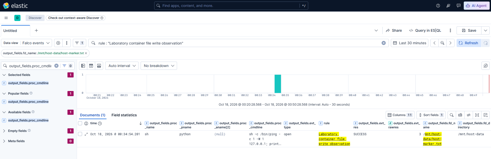

<details>
<summary>Развернуть событие</summary>

  ```bash
{
  "_index": "falco-2026.10.17",
  "_id": "8kLKS6EBABcwyyR9CVyQ",
  "_version": 1,
  "_source": {
    "uuid": "a52dd2b5-a046-4a8c-aded-e35a2df6ae7c",
    "output": "21:34:54.201268872: Notice Laboratory container opened a file for writing | evt_type=open result=SUCCESS raw_result=3 file=/mnt/host-data/host-marker.txt directory=/mnt/host-data flags=O_LARGEFILE|O_TRUNC|O_CREAT|O_WRONLY process=sh proc_exepath=/bin/busybox parent=python command=sh -c /bin/ping -c 1 -W 1 127.0.0.1; printf \"owner=host\\nstate=modified-by-container\\n\" > /mnt/host-data/host-marker.txt user=lab user_uid=10001 container_id=63ee99ad80c3 container_name=lab-writable-bind-mount container_image_repository=container-security-lab/writable-bind-mount container_image_tag=1.0-vulnerable k8s_pod_name=<NA> k8s_ns_name=<NA>",
    "priority": "Notice",
    "rule": "Laboratory container file write observation",
    "time": "2026-10-17T21:34:54.201268872Z",
    "output_fields": {
      "container_id": "63ee99ad80c3",
      "container_image_repository": "container-security-lab/writable-bind-mount",
      "container_image_tag": "1.0-vulnerable",
      "container_name": "lab-writable-bind-mount",
      "evt_arg_flags": "O_LARGEFILE|O_TRUNC|O_CREAT|O_WRONLY",
      "evt_rawres": 3,
      "evt_res": "SUCCESS",
      "evt_time": 1792272894201269000,
      "evt_type": "open",
      "fd_directory": "/mnt/host-data",
      "fd_name": "/mnt/host-data/host-marker.txt",
      "k8s_ns_name": null,
      "k8s_pod_name": null,
      "proc_cmdline": "sh -c /bin/ping -c 1 -W 1 127.0.0.1; printf \"owner=host\\nstate=modified-by-container\\n\" > /mnt/host-data/host-marker.txt",
      "proc_exepath": "/bin/busybox",
      "proc_name": "sh",
      "proc_pname": "python",
      "user_name": "lab",
      "user_uid": 10001
    },
    "source": "syscall",
    "tags": [
      "T1611",
      "container",
      "filesystem",
      "lab_observation",
      "mitre_privilege_escalation"
    ],
    "hostname": "scrockcontainers",
    "@timestamp": "2026-10-17T21:34:54.201268872Z"
  },
  "fields": {
    "output_fields.container_name.keyword": [
      "lab-writable-bind-mount"
    ],
    "output_fields.proc_name": [
      "sh"
    ],
    "output_fields.container_image_tag.keyword": [
      "1.0-vulnerable"
    ],
    "output_fields.evt_time": [
      1792272894201269000
    ],
    "source": [
      "syscall"
    ],
    "output_fields.proc_exepath": [
      "/bin/busybox"
    ],
    "uuid": [
      "a52dd2b5-a046-4a8c-aded-e35a2df6ae7c"
    ],
    "output": [
      "21:34:54.201268872: Notice Laboratory container opened a file for writing | evt_type=open result=SUCCESS raw_result=3 file=/mnt/host-data/host-marker.txt directory=/mnt/host-data flags=O_LARGEFILE|O_TRUNC|O_CREAT|O_WRONLY process=sh proc_exepath=/bin/busybox parent=python command=sh -c /bin/ping -c 1 -W 1 127.0.0.1; printf \"owner=host\\nstate=modified-by-container\\n\" > /mnt/host-data/host-marker.txt user=lab user_uid=10001 container_id=63ee99ad80c3 container_name=lab-writable-bind-mount container_image_repository=container-security-lab/writable-bind-mount container_image_tag=1.0-vulnerable k8s_pod_name=<NA> k8s_ns_name=<NA>"
    ],
    "output_fields.proc_exepath.keyword": [
      "/bin/busybox"
    ],
    "hostname": [
      "scrockcontainers"
    ],
    "output_fields.container_image_repository": [
      "container-security-lab/writable-bind-mount"
    ],
    "output_fields.container_id.keyword": [
      "63ee99ad80c3"
    ],
    "output_fields.proc_cmdline": [
      "sh -c /bin/ping -c 1 -W 1 127.0.0.1; printf \"owner=host\\nstate=modified-by-container\\n\" > /mnt/host-data/host-marker.txt"
    ],
    "output_fields.evt_rawres": [
      3
    ],
    "output_fields.container_image_tag": [
      "1.0-vulnerable"
    ],
    "priority": [
      "Notice"
    ],
    "tags": [
      "T1611",
      "container",
      "filesystem",
      "lab_observation",
      "mitre_privilege_escalation"
    ],
    "output_fields.user_name": [
      "lab"
    ],
    "hostname.keyword": [
      "scrockcontainers"
    ],
    "output_fields.evt_res": [
      "SUCCESS"
    ],
    "tags.keyword": [
      "T1611",
      "container",
      "filesystem",
      "lab_observation",
      "mitre_privilege_escalation"
    ],
    "rule": [
      "Laboratory container file write observation"
    ],
    "uuid.keyword": [
      "a52dd2b5-a046-4a8c-aded-e35a2df6ae7c"
    ],
    "output_fields.fd_directory.keyword": [
      "/mnt/host-data"
    ],
    "output_fields.proc_pname": [
      "python"
    ],
    "output_fields.evt_type.keyword": [
      "open"
    ],
    "output_fields.evt_arg_flags": [
      "O_LARGEFILE|O_TRUNC|O_CREAT|O_WRONLY"
    ],
    "output_fields.user_uid.keyword": [
      "10001"
    ],
    "output_fields.fd_directory": [
      "/mnt/host-data"
    ],
    "output_fields.container_image_repository.keyword": [
      "container-security-lab/writable-bind-mount"
    ],
    "output_fields.container_name": [
      "lab-writable-bind-mount"
    ],
    "output_fields.proc_pname.keyword": [
      "python"
    ],
    "source.keyword": [
      "syscall"
    ],
    "output_fields.proc_cmdline.keyword": [
      "sh -c /bin/ping -c 1 -W 1 127.0.0.1; printf \"owner=host\\nstate=modified-by-container\\n\" > /mnt/host-data/host-marker.txt"
    ],
    "priority.keyword": [
      "Notice"
    ],
    "output_fields.evt_type": [
      "open"
    ],
    "output_fields.user_uid": [
      "10001"
    ],
    "output.keyword": [
      "21:34:54.201268872: Notice Laboratory container opened a file for writing | evt_type=open result=SUCCESS raw_result=3 file=/mnt/host-data/host-marker.txt directory=/mnt/host-data flags=O_LARGEFILE|O_TRUNC|O_CREAT|O_WRONLY process=sh proc_exepath=/bin/busybox parent=python command=sh -c /bin/ping -c 1 -W 1 127.0.0.1; printf \"owner=host\\nstate=modified-by-container\\n\" > /mnt/host-data/host-marker.txt user=lab user_uid=10001 container_id=63ee99ad80c3 container_name=lab-writable-bind-mount container_image_repository=container-security-lab/writable-bind-mount container_image_tag=1.0-vulnerable k8s_pod_name=<NA> k8s_ns_name=<NA>"
    ],
    "output_fields.evt_arg_flags.keyword": [
      "O_LARGEFILE|O_TRUNC|O_CREAT|O_WRONLY"
    ],
    "output_fields.fd_name": [
      "/mnt/host-data/host-marker.txt"
    ],
    "output_fields.container_id": [
      "63ee99ad80c3"
    ],
    "@timestamp": [
      "2026-10-17T21:34:54.201Z"
    ],
    "output_fields.user_name.keyword": [
      "lab"
    ],
    "output_fields.evt_res.keyword": [
      "SUCCESS"
    ],
    "output_fields.fd_name.keyword": [
      "/mnt/host-data/host-marker.txt"
    ],
    "time": [
      "2026-10-17T21:34:54.201Z"
    ],
    "output_fields.proc_name.keyword": [
      "sh"
    ],
    "rule.keyword": [
      "Laboratory container file write observation"
    ]
  }
}
```

</details>

Значение `evt_rawres=3` — не количество записанных байтов и не код успеха. Для успешного `open` это номер файлового дескриптора, который ядро вернуло процессу. Отдельное поле `evt_res=SUCCESS` предоставляет текстовое представление результата.

Путь и флаги подтверждают, что оболочка успешно открыла именно файл в bind mount с возможностью записи. `proc_exepath=/bin/busybox` объясняется устройством образа: `sh` является апплетом многовызовного исполняемого файла BusyBox. Сочетание `proc_name=sh`, `proc_pname=python` и полной командной строки связывает файловую операцию с запросом к уязвимому приложению. Поля пользователя показывают, что действие выполнил `lab` с UID `10001`, а поля контейнера однозначно указывают на лабораторную рабочую нагрузку.

### Окончательное правило записи

Фактическое событие содержит полный путь `/mnt/host-data/host-marker.txt`, поэтому можно сузить условие до защищаемой точки монтирования. Сначала отключим широкое правило наблюдения:

```bash
sudo mv /etc/falco/rules.d/02-writable-bind-mount-observe.yaml /etc/falco/rules.d/02-writable-bind-mount-observe.yaml.disabled
```

Создадим окончательное правило:

```bash
sudo vim /etc/falco/rules.d/02-writable-bind-mount.yaml
```

```yaml
- macro: lab_successful_file_open_for_write
  condition: >
    evt.type in (open, openat, openat2)
    and evt.dir=<
    and evt.is_open_write=true
    and fd.typechar='f'
    and evt.rawres>=0

- rule: Write to laboratory host bind mount
  desc: >
    Detects a successful file open for writing below the host directory
    mounted into the laboratory container as read-write.
  condition: >
    lab_successful_file_open_for_write
    and container.id != host
    and container.name = "lab-writable-bind-mount"
    and fd.name startswith "/mnt/host-data/"
  output: >
    File in laboratory host bind mount opened for writing |
    evt_type=%evt.type result=%evt.res raw_result=%evt.rawres
    file=%fd.name directory=%fd.directory flags=%evt.arg.flags
    process=%proc.name
    proc_exepath=%proc.exepath parent=%proc.pname
    grandparent=%proc.aname[2] command=%proc.cmdline
    user=%user.name user_uid=%user.uid
  priority: ERROR
  tags:
    - container
    - filesystem
    - host
    - mitre_privilege_escalation
    - T1611
```

Макрос `lab_successful_file_open_for_write` отделяет общий файловый признак от контекста конкретной рабочей нагрузки. Он выбирает события выхода из `open`, `openat` и `openat2`, для которых был запрошен режим записи и ядро вернуло неотрицательный результат. Проверка `fd.typechar='f'` оставляет обычные файлы.

Оператор `startswith` охватывает не только контрольный маркер, но и остальные файлы ниже `/mnt/host-data/`, включая вложенные каталоги. Завершающий `/` важен: без него условию соответствовал бы, например, путь `/mnt/host-data-copy/file`. Служебные записи `runc` в `/proc` и `<UNKNOWN>thread-self/fd/8`, найденные временным правилом, этому условию уже не соответствуют.

Правило не привязано к имени `printf`, `sh` или другой программы. Опасным считается успешное получение доступа на запись к файлу в защищаемом каталоге. Поэтому замена команды или способа запуска не должна обходить детект, пока операция приводит к одному из контролируемых системных вызовов открытия.

Приоритет `ERROR` выше, чем в правиле первой практики: процесс уже получил дескриптор с правом записи к объекту, физически расположенному на хосте. В проверенном событии флаг `O_TRUNC` и изменившаяся контрольная сумма дополнительно доказывают фактическое нарушение целостности. При анализе других срабатываний нужно помнить, что одно лишь открытие с `O_WRONLY` или `O_RDWR` ещё не подтверждает последующую передачу данных через `write`.

Правило намеренно контролирует только успешные открытия. После перевода точки монтирования в режим `read-only` неуспешная попытка не удовлетворит условию `evt.rawres>=0`. Факт предотвращения будем доказывать отдельно по ошибке приложения, параметру `RW: false` и неизменной контрольной сумме.

Такой детект не охватывает все способы изменения файловой системы. Например, удаление и переименование используют `unlink`, `unlinkat`, `rename` или `renameat`, а запись через уже открытый ранее дескриптор не создаёт нового `open`. В этой практике правило отвечает на более узкий и проверяемый вопрос: «успешно ли процесс исследуемого контейнера открыл файл в bind mount для записи?» Расширять его на остальные операции следует отдельными условиями и тестами, а не считать их обнаруженными автоматически.

Проверим и загрузим правило:

```bash
sudo falco --dry-run
echo $?

sudo systemctl restart falco-modern-bpf.service
sudo systemctl --no-pager --full status falco-modern-bpf.service
```

### Проверка окончательного правила

Для проверки используем четыре действия: штатный запрос, изменение существующего файла из контейнера, создание нового файла из контейнера и изменение маркера непосредственно на хосте.

Сначала вернём исходное содержимое и удалим результат возможной предыдущей проверки:

```bash
sudo vim /srv/container-security-lab/practice-02/host-marker.txt
```

```text
owner=host
state=original
```

```bash
sudo chown 10001:10001 /srv/container-security-lab/practice-02/host-marker.txt
sudo chmod 0640 /srv/container-security-lab/practice-02/host-marker.txt
```

Зафиксируем время:

```bash
LAB_BIND_RULE_START=$(date --iso-8601=seconds)
printf '%s\n' "$LAB_BIND_RULE_START"
```

#### 1. Штатный запрос

```bash
http://192.168.0.69:8080/ping?host=127.0.0.1
```

Ожидаемый результат: приложение отвечает успешно, правило записи не срабатывает.

#### 2. Изменение существующего файла из контейнера

```bash
http://192.168.0.69:8080/ping?host=127.0.0.1%3B%20printf%20%22owner%3Dhost%5Cnstate%3Dfinal-rule-test%5Cn%22%20%3E%20%2Fmnt%2Fhost-data%2Fhost-marker.txt
```

Ожидаемый результат: файл меняется, Falco создаёт уведомление с путём `/mnt/host-data/host-marker.txt`.

#### 3. Создание нового файла из контейнера

```bash
http://192.168.0.69:8080/ping?host=127.0.0.1%3B%20printf%20%22created-by-container%5Cn%22%20%3E%20%2Fmnt%2Fhost-data%2Fcreated-from-container.txt
```

Ожидаемый результат: в каталоге хоста появляется новый файл, а правило создаёт второе уведомление.

#### 4. Административное изменение с хоста

```bash
printf 'owner=host\nstate=changed-from-host\n' | sudo tee /srv/container-security-lab/practice-02/host-marker.txt >/dev/null
```

Операция затрагивает тот же файл, но выполняется процессом хоста, для которого `container.id = host`. Наше правило ограничено лабораторным контейнером и не должно сработать.

Выведем результаты:

```bash
sudo journalctl \
  -u falco-modern-bpf.service \
  --since "$LAB_BIND_RULE_START" \
  --output=cat \
  --no-pager | \
  jq --raw-input --raw-output '
    fromjson?
    | select(.rule == "Write to laboratory host bind mount")
    | [
        .time,
        .output_fields["fd.name"],
        .output_fields["evt.arg.flags"],
        .output_fields["proc.name"],
        .output_fields["proc.pname"],
        .output_fields["proc.cmdline"],
        .output_fields["user.uid"],
        .output_fields["container.name"]
      ]
    | @tsv
  '
```

<details>
<summary>Развернуть вывод команды</summary>

  ```bash
scrock_@scrockcontainers:~/container-security-lab/scenarios/02-writable-bind-mount$ sudo journalctl \
  -u falco-modern-bpf.service \
  --since "$LAB_BIND_RULE_START" \
  --output=cat \
  --no-pager | \
  jq --raw-input --raw-output '
    fromjson?
    | select(.rule == "Write to laboratory host bind mount")
    | [
        .time,
        .output_fields["fd.name"],
        .output_fields["evt.arg.flags"],
        .output_fields["proc.name"],
        .output_fields["proc.pname"],
        .output_fields["proc.cmdline"],
        .output_fields["user.uid"],
        .output_fields["container.name"]
      ]
    | @tsv
  '
2026-10-17T22:03:51.652535459Z  /mnt/host-data/host-marker.txt  O_LARGEFILE|O_TRUNC|O_CREAT|O_WRONLY   sh      python  sh -c /bin/ping -c 1 -W 1 127.0.0.1; printf "owner=host\\nstate=final-rule-test\\n" > /mnt/host-data/host-marker.txt 10001    lab-writable-bind-mount
2026-10-17T22:03:57.069109291Z  /mnt/host-data/created-from-container.txt     O_LARGEFILE|O_TRUNC|O_CREAT|O_WRONLY|O_F_CREATED sh      python  sh -c /bin/ping -c 1 -W 1 127.0.0.1; printf "created-by-container\\n" > /mnt/host-data/created-from-container.txt     10001   lab-writable-bind-mount
```

</details>

Ожидаются две строки, для перезаписи `host-marker.txt` и для создания `created-from-container.txt`. Штатный запрос и запись, выполненная с хоста, появиться не должны.

### Проверка окончательного правила в Kibana

В `Discover` используем фильтр:

```text
rule : "Write to laboratory host bind mount"
and output_fields.container_name : "lab-writable-bind-mount"
```

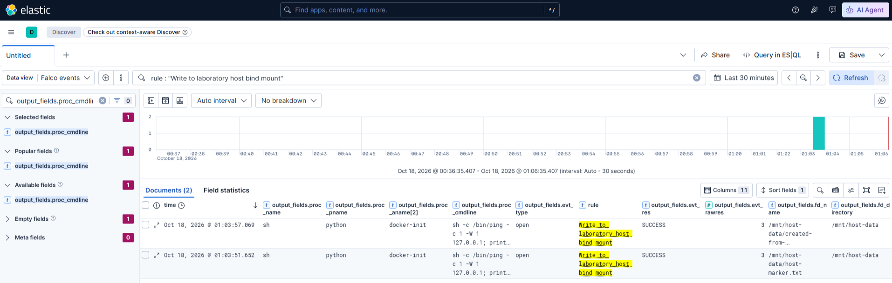

Две строки с разными путями показывают, что правило обнаруживает не конкретную строку команды, а класс операций — успешное открытие файлов в подключённом каталоге хоста с возможностью записи.

### Разбор результата окончательного правила

Фактический вывод соответствует ожидаемой модели. Falco сформировал два уведомления: первое при перезаписи существующего `host-marker.txt`, второе при создании `created-from-container.txt`. Штатная проверка адреса и изменение маркера непосредственно с хоста в результат не попали.

У обоих обнаруженных событий совпадает контекст выполнения:

- файл открывает процесс `sh`;
- родительским процессом является `python`;
- команда выполняется от имени пользователя `lab` с UID `10001`;
- событие относится к контейнеру `lab-writable-bind-mount`;
- путь находится ниже контролируемого каталога `/mnt/host-data/`;
- системный вызов завершился успешно и вернул файловый дескриптор.

Имена файлов и аргументы команд различаются, но правило срабатывает в обоих случаях. Значит, оно обнаруживает не конкретную строку `printf` и не один заранее известный файл, а проверяемый класс поведения: успешное открытие файла в подключённом каталоге хоста с возможностью записи.

Флаги позволяют различить две операции. Для `host-marker.txt` Falco показал:

```text
O_LARGEFILE|O_TRUNC|O_CREAT|O_WRONLY
```

`O_WRONLY` означает открытие только для записи, `O_TRUNC` - обнуление длины существующего файла, а `O_CREAT` разрешает создать объект, если его ещё нет. Наличие `O_CREAT` само по себе не доказывает создание, этот флаг передаётся и при открытии уже существующего пути.

Для `created-from-container.txt` появился дополнительный признак:

```text
O_LARGEFILE|O_TRUNC|O_CREAT|O_WRONLY|O_F_CREATED
```

[`O_F_CREATED`](https://github.com/falcosecurity/libs/blob/master/driver/ppm_events_public.h#L106-L108) не является пользовательским флагом Linux `open(2)`. Его добавляет средство сбора событий Falco, когда файл действительно был создан во время системного вызова. Поэтому первое уведомление описывает открытие и усечение существующего объекта, а второе - создание нового.

Отсутствие уведомления при штатном `ping` является корректным результатом, приложение не обращается к `/mnt/host-data/` для записи. Административное изменение с хоста тоже не попало в выборку, поскольку условие правила требует контейнерный контекст и имя `lab-writable-bind-mount`. Процесс `tee`, запущенный на хосте, имеет `container.id = host` и отбрасывается до проверки пути.

Результаты четырёх тестов можно свести в таблицу:

| Проверка | Фактическое действие | Результат правила |
|---|---|---|
| Штатный запрос с `ping` | Записи в bind mount нет | Уведомления нет |
| Перезапись `host-marker.txt` из контейнера | Существующий файл открыт с `O_TRUNC|O_WRONLY` | Уведомление создано |
| Создание `created-from-container.txt` из контейнера | Новый файл открыт с признаком `O_F_CREATED` | Уведомление создано |
| Изменение `host-marker.txt` с хоста | Файл изменён вне контейнерного контекста | Уведомления нет |

Первые два атакующих теста являются истинными срабатываниями. Штатный запрос и административная операция показывают, что правило не реагирует на отсутствие файловой записи и не превращается в общий контроль всех изменений этого файла на хосте.

### Что именно обнаруживает правило

Окончательное правило отвечает на узкий вопрос - успешно ли процесс лабораторного контейнера открыл обычный файл ниже `/mnt/host-data/` с флагами, разрешающими запись. Для этого одновременно проверяются:

1. тип события `open`, `openat` или `openat2`;
2. событие выхода из системного вызова `evt.dir=<`;
3. наличие режима записи через `evt.is_open_write=true`;
4. успешный результат `evt.rawres>=0`;
5. обычный файл `fd.typechar='f'`;
6. контейнер `lab-writable-bind-mount`;
7. путь с префиксом `/mnt/host-data/`.

Каждая часть условия выполняет отдельную задачу. Проверка результата исключает заблокированные попытки, тип дескриптора отделяет обычные файлы от каталогов и сокетов, имя контейнера ограничивает область наблюдения, а путь устраняет служебные события `runc` в `/proc` и `thread-self/fd`, обнаруженные временным правилом.

Проверка `startswith "/mnt/host-data/"` заканчивается символом `/` намеренно. Без него условию соответствовали бы также похожие пути, например `/mnt/host-data-copy/file`. Одновременно такой префикс охватывает произвольные файлы и вложенные каталоги внутри точки монтирования.

Правило Falco выполняет обнаружение, а не предотвращение. Уведомление формируется после того, как системный вызов уже завершился успешно. В нашем эксперименте `O_TRUNC` к этому моменту уже мог обнулить существующий файл, а `O_F_CREATED` подтверждает появление нового. Поэтому наличие события в Kibana не означает, что целостность данных была сохранена: оно предоставляет данные для расследования и последующей реакции.

### Итог практики

Эксперимент показал, что `read_only: true` для корневой файловой системы контейнера не распространяется на отдельно подключённый bind mount. Процессу не потребовались `root`, дополнительные Linux capabilities, режим `--privileged` или эксплуатация уязвимости ядра. Для изменения файла оказалось достаточно трёх условий:

1. каталог хоста подключён в контейнер с правом записи;
2. числовой UID процесса имеет права на объект хоста;
3. уязвимость приложения позволяет выполнить команду внутри контейнера.

Тем самым нарушение изоляции произошло не из-за обхода механизма Docker, а из-за заданной конфигурации доступа. Docker предоставил процессу прямой путь к объектам файловой системы хоста и выполнил эту настройку так, как было указано при создании контейнера.

Связка из двух правил показала разные этапы одного сценария. Правило первой практики обнаруживает неожиданный дочерний процесс веб-приложения, но встроенная команда `printf` не обязана создавать отдельный процесс. Файловое правило закрывает этот пробел и фиксирует действие оболочки над защищаемым каталогом. События дополняют друг друга, процессная телеметрия показывает источник выполнения, а файловая - затронутый ресурс и режим доступа.

Перед следующим сценарием остановим контейнер, чтобы освободить порт `8080`:

```bash
cd ~/container-security-lab/scenarios/02-writable-bind-mount
sudo docker compose down
```

# Практика 3. Доступ к Docker Engine через Unix-сокет

В первых двух практиках мы проверяли файловую границу контейнера. Сначала приложение выполняло произвольную команду из HTTP-параметра, затем эта возможность использовалась для чтения и изменения каталога хоста, подключённого через bind mount. Теперь рассмотрим другой класс ошибки, когда контейнер получает не файл с данными, а интерфейс управления самим Docker Engine.

Для разнообразия подготовим не один, а два сервиса с небольшими веб-интерфейсами. Первый - уязвимый `Container Control Center`, через который мы получаем первоначальный доступ. Второй - безопасный `Target Service`, состояние которого можно наблюдать отдельно и на котором будет заметен импакт.

В этой практике мы не будем исправлять код сервисов. Нам важно разделить две причины: `Control Center` уже содержит намеренную командную инъекцию, а подключение Docker-сокета добавляет к нему управляющий доступ к демону. `Target Service` не содержит уязвимости и нужен для наблюдения последствий: после обращения к Docker API мы сможем остановить его, проверить исчезновение страницы и затем вернуть контейнер в исходное состояние. Сначала докажем сам факт обращения к сокету и получим телеметрию Falco. После проверки фактических полей события продолжим практику отдельным фрагментом.

## Что исследуем

Docker CLI обычно обращается к локальному демону через `/var/run/docker.sock`. Это не обычный файл с конфигурацией: запись и чтение из него являются HTTP-обменом с Docker Engine. Процесс, которому разрешено открыть сокет и отправить запрос, может обращаться к API демона так же, как локальный администратор.

Проблема возникает, когда разработчик подключает Docker-сокет в контейнер «для удобства», например чтобы приложение могло запускать вспомогательные контейнеры или читать состояние сервиса. Доступ к сокету нужно рассматривать как доступ к управляющей плоскости Docker, а не как безобидный bind mount. Docker Engine в обычной rootful-конфигурации работает с полномочиями `root`, поэтому API может создавать контейнеры с другими пользователями, подключать новые ресурсы и менять состояние всего узла.

Причина этой ошибки описывается [CWE-668 «Exposure of Resource to Wrong Sphere»](https://cwe.mitre.org/data/definitions/668.html): управляющий ресурс доступен компоненту, которому он не предназначен. Это не отдельная уязвимость версии Docker и не CVE. Результат определяется конфигурацией запуска и доверительной моделью приложения.

В терминах MITRE ATT&CK первая операция относится к [T1609 «Container Administration Command»](https://attack.mitre.org/techniques/T1609/): процесс внутри контейнера отправляет команду службе контейнеров. Создание контролируемого соседнего контейнера будет относиться к [T1610 «Deploy Container»](https://attack.mitre.org/techniques/T1610/). Технику [T1611 «Escape to Host»](https://attack.mitre.org/techniques/T1611/) укажем только после того, как действительно докажем доступ к ресурсу хоста, а не по одному факту подключения сокета.

Логическая цепочка запроса выглядит так:

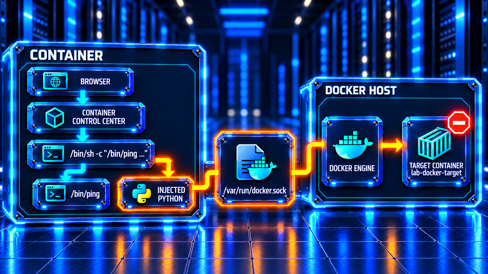

Последние блоки не являются частью обычного запроса. При штатной проверке приложение запускает только `ping`. При командной инъекции атакующий добавляет программу, которая открывает Unix-сокет и отправляет ему HTTP-запрос. Docker Engine после этого может вернуть метаданные `lab-docker-target`, остановить его или создать новый экземпляр. Именно подключение к сокету и изменение состояния второго контейнера мы будем искать в событиях ядра и в интерфейсе `Target Service`.


## Основные источники

### Linux

- [`chroot(2)`](https://man7.org/linux/man-pages/man2/chroot.2.html)
- [`namespaces(7)`](https://man7.org/linux/man-pages/man7/namespaces.7.html)
- [`user_namespaces(7)`](https://man7.org/linux/man-pages/man7/user_namespaces.7.html)
- [`cgroups(7)`](https://man7.org/linux/man-pages/man7/cgroups.7.html)
- [`capabilities(7)`](https://man7.org/linux/man-pages/man7/capabilities.7.html)
- [Фильтрация системных вызовов `seccomp`](https://docs.kernel.org/userspace-api/seccomp_filter.html)
- [Модули безопасности Linux](https://docs.kernel.org/admin-guide/LSM/index.html)

### OCI и Docker

- [Спецификация образа OCI](https://specs.opencontainers.org/image-spec/config/)
- [Спецификация запуска OCI](https://specs.opencontainers.org/runtime-spec/runtime/)
- [Безопасность Docker Engine](https://docs.docker.com/engine/security/)
- [Стандартный профиль `seccomp` Docker](https://docs.docker.com/engine/security/seccomp/)
- [Профили AppArmor Docker](https://docs.docker.com/engine/security/apparmor/)
- [Ограничение ресурсов контейнера](https://docs.docker.com/engine/containers/resource_constraints/)
- [Подключение каталогов хоста](https://docs.docker.com/engine/storage/bind-mounts/)

### Классификация сценариев

- [Матрица MITRE ATT&CK для контейнеров](https://attack.mitre.org/matrices/enterprise/containers/)
- [Перечень типов слабостей CWE](https://cwe.mitre.org/)
- [Руководство NIST SP 800-190 по безопасности контейнеров](https://csrc.nist.gov/pubs/sp/800/190/final)

### Стенд и мониторинг

- [Требования Ubuntu Server](https://ubuntu.com/server/docs/reference/installation/system-requirements/)
- [Установка Docker Engine на Ubuntu](https://docs.docker.com/engine/install/ubuntu/)
- [Документация Falco](https://falco.org/docs/)
- [Источник событий ядра Falco](https://falco.org/docs/concepts/event-sources/kernel/)
- [Правила Falco](https://falco.org/docs/concepts/rules/)
- [Документация Elasticsearch](https://www.elastic.co/docs/)
- [Документация Kibana](https://www.elastic.co/docs/explore-analyze/)

